# Managed Host State Diagrams

This document contains the complete Finite State Machine (FSM) that illustrates the lifecycle of NICo managed hosts from discovery through ingestion through instance assignment and management.

## High-Level Overview

The compact diagram shows one route through the main lifecycle. The tables retain every overview transition, including alternate paths and the unreleased [NIC Firmware Recovery](#nic-firmware-recovery) engine:

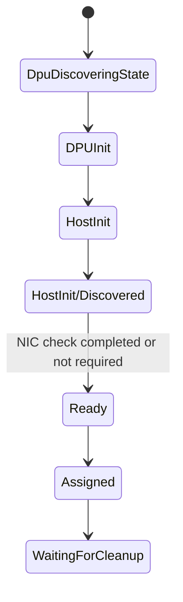

For edges without a condition label in the overview, **State details** refers to the destination-specific diagrams below. `Decommissioned` is terminal.

### Discovery and Preparation

The following table lists these overview transitions:

| From | To | Condition |
| --- | --- | --- |
| `[*]` | `DpuDiscoveringState` | Site Explorer creates managed host |
| `DpuDiscoveringState` | `DPUInit` | All DPU Security Boot Configured / DPU Reboot |
| `DpuDiscoveringState` | `HostInit` | No DPU |
| `DPUInit` | `HostInit` | DPU Ready |
| `HostInit` | `BomValidating` | Host Configured |
| `HostInit` | `HostInit/Discovered` | See HostInit diagram |
| `HostInit/Discovered` | `NicFirmwareUpdating/Pending` | Reboot gate passed; enabled baseline check or recovery obligation |
| `HostInit/Discovered` | `Ready` | NIC preparation checked or not required; existing boot/readiness gate passes |
| `BomValidating` | `Validation` | BOM checks completed or skipped; machine validation context present |
| `BomValidating` | `HostInit/Discovered` | BOM checks completed or skipped; no machine validation context |
| `Validation` | `HostInit/Discovered` | Validation completed or skipped; no Cleanup-context NIC readiness qualification obligation |
| `Validation` | `HostInit/WaitingForPlatformConfiguration` | Cleanup-context validation completed or skipped; NIC readiness qualification required |

### Assignment and Host Work

The following table lists these overview transitions:

| From | To | Condition |
| --- | --- | --- |
| `Measuring` | `Ready` | Measurements Valid |
| `Ready` | `HostInit` | BIOS Password Setup Needed |
| `Ready` | `HostInit/WaitingForPlatformConfiguration` | No attached instance; NIC readiness qualification required |
| `Ready` | `Assigned` | Instance Assigned |
| `Ready` | `HostReprovision` | Host Reprovision Request |
| `Ready` | `DPUReprovision` | DPU Reprovision Request |
| `Ready` | `Measuring` | Redo Measurements Request |
| `Ready` | `BomValidating` | BOM Validation Request |
| `Ready` | `Validation` | Machine Validation Request |
| `Ready` | `Decommissioning` | Decommission Request |
| `Assigned` | `PostAssignedMeasuring` | Measurements required |
| `Assigned` | `WaitingForCleanup` | Cleanup |
| `Assigned` | `HostReprovision` | Host reprovision needed |
| `Assigned` | `DPUReprovision` | State details |
| `HostReprovision` | `Ready` | Reprovision Complete |
| `HostReprovision` | `Assigned` | Reprovision Complete |
| `DPUReprovision` | `Assigned` | if came from Assigned |
| `DPUReprovision` | `HostInit/Discovered` | if came from Ready |
| `DPUReprovision` | `HostReprovision` | Host reprovision requested |
| `WaitingForCleanup/Init` | `NicFirmwareUpdating/Pending` | Deprovision cleanup needs a baseline check or restoration |
| `WaitingForCleanup` | `BomValidating` | Deprovision cleanup completed; retain Cleanup validation context and any NIC readiness qualification obligation |
| `PostAssignedMeasuring` | `WaitingForCleanup` | Measurements complete |
| `Decommissioning` | `Decommissioned` | Device reset and credential deletion complete |

### Firmware Recovery and Failure

The following table lists these overview transitions:

| From | To | Condition |
| --- | --- | --- |
| `NicFirmwareUpdating/Pending` | `HostInit/Discovered` | Initial check needs no mutation and has no recovery obligation |
| `NicFirmwareUpdating` | `HostInit/WaitingForPlatformConfiguration` | Initial baseline mutation restored and verified; idle continuation is model support only |
| `NicFirmwareUpdating/Pending` | `HostInit/WaitingForPlatformConfiguration` | Initial restoration verified without mutation, or qualification-only recovery while admission is disabled |
| `NicFirmwareUpdating/Pending` | `Ready` | Model-only queued idle check needs no mutation or recovery; no production producer |
| `NicFirmwareUpdating/Pending` | `WaitingForCleanup/Init` | Release check needs no mutation, or admission disabled without restoration |
| `NicFirmwareUpdating/Pending` | `Reset/DeletingInstance` | Eligible managed-host reset requested |
| `NicFirmwareUpdating/Pending` | `Failed` | Recorded host or DPU failure |
| `NicFirmwareUpdating` | `Assigned` | Allocation complete |
| `NicFirmwareUpdating` | `Assigned` | Restored allocation failure |
| `NicFirmwareUpdating` | `Reset` | Eligible reset after restored failure |
| `NicFirmwareUpdating` | `WaitingForCleanup` | Baseline restoration complete |
| `AnyNotAssignedState` | `Failed` | Failure outside NIC firmware recovery |
| `Failed` | `AnyNotAssignedState` | Recovery |
| `Failed` | `ForceDeletion` | Admin forced deletion |
| `Failed` | `Failed` | Unrecoverable condition |
| `ForceDeletion` | `[*]` | Force deletion complete |

### `Failed` recovery semantics

`FailureCause::BiosSetupFailed` is set when BIOS setup retries are exhausted during ingestion or instance deprovisioning. The Failed handler polls `is_bios_setup` and auto-recovers into `SetBootOrder` once the BMC reports success.

## NIC Firmware Recovery

The recovery engine introduced in [PR #8596](https://github.com/dsx-ai-factory/infra-controller/pull/8596) reconciles persisted operations. Its entry points during initial preparation and deprovision release require a Core build and schema containing the unreleased [lifecycle admission implementation](https://github.com/dsx-ai-factory/infra-controller/issues/6680). They are disabled by default: `firmware_global.nic_firmware_admission_enabled = false` and `nic_firmware_platforms = []`. No hardware cohort is qualified by those defaults or by software tests.

Before enablement, deploy supporting Core replicas, Scout, matching helpers, and any native DPA agents. Core must accept the admission settings. Scout must advertise `nic_firmware_dispatch_supported`; SiteCache delivery also requires `nic_firmware_site_cache_supported`. Without the required Scout capability, Core rejects the tracked dispatch rather than sending an untracked command. There is no native-agent capability flag that establishes physical completion semantics. Keep admission disabled until the deployed native agent and exact platform/card combination satisfy [hardware qualification](https://github.com/dsx-ai-factory/infra-controller/issues/6689), including physical identity and reset scope, running-version evidence, recovery, network readiness, and applicable preparation checks.

Apply the same admission policy to all Core replicas; changes require restart. Before first enablement, drain or fence every older untracked sender and reconcile its effects. Inventory alone cannot establish that an earlier sender has settled. Older Core must not own machines with pending or admitted NIC work, restoration or readiness qualification obligations, or unresolved dispatch state. Rollback across that boundary is unsupported. Refer to the [Core configuration contract](https://github.com/dsx-ai-factory/infra-controller/blob/main/crates/api-core/src/cfg/README.md#firmwareglobal) for field syntax, defaults, and validation.

### Admission and Preparation

Initial preparation requests a baseline check from `HostInit/Discovered` after its reboot gate. Deprovision release requests the check from `WaitingForCleanup/Init` and preserves the cleanup context. Initial-discovery and reset cleanup do not produce release checks. Reset preserves recorded baseline obligations through re-ingestion, where the initial-preparation hook handles them.

The controller saves `NicFirmwareUpdating/Pending` before the update manager acts. This queues a check without reserving hardware or an update slot. The manager resolves baseline selections in precedence order: card, machine, then site. It requires whole-host inventory collected and received after the request and any prior dispatch settlement. Changed cards also require correlated lockdown status. A changed target or a newer recorded dispatch invalidates earlier candidate status.

NIC demand notifications trigger additional admission checks through the same host update budget. These checks leave the normal firmware-check interval unchanged.

The first diagram shows the possible outcomes of a queued check:

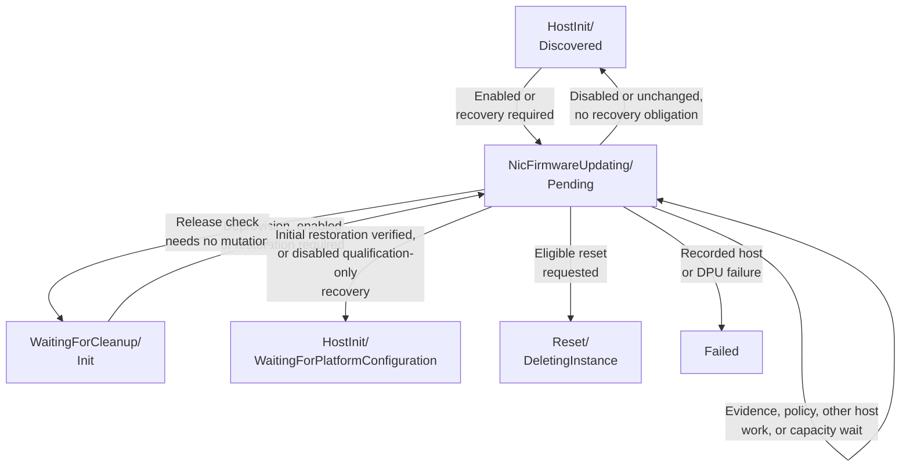

Changed targets take the admitted path instead:

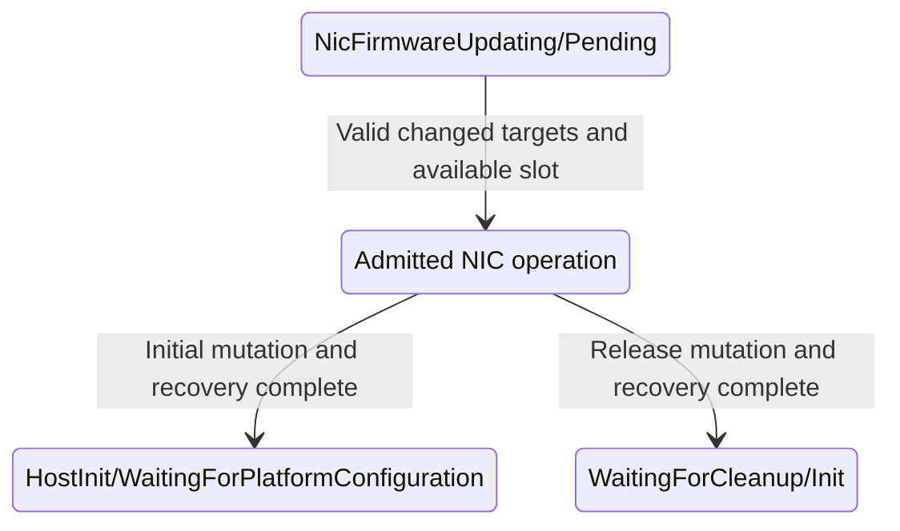

The following table distinguishes the admission results:

**NIC Preparation Results**

| Condition | Result |
| --- | --- |
| No applicable target and no restoration obligation | Unmanaged skip; resume the saved lifecycle without a slot |
| Selected installed/running versions already match, with sufficient configuration evidence | Record baseline approval and resume without mutation or a slot |
| Selected target in the current check scope is missing, ambiguous, unsupported, or overlapping legacy DPA policy | Keep `Pending` with a diagnostic; do not reinterpret the error as an unmanaged skip |
| Inventory, prior sender settlement, or lockdown/key evidence is missing | Keep `Pending` and retry the checks |
| Active DPA interface work, maintenance health override, or started host/DPU reprovision | Keep `Pending` with "waiting for other host hardware work to settle" |
| Shared update capacity is zero or full | Keep changed work pending; unmanaged and matching-version checks can still complete |
| Admission disabled, with no restoration or readiness qualification obligation | Resume ordinary preparation without starting NIC mutation |
| Admission disabled, with readiness qualification required but no restoration required | Resume full host preparation without selecting new targets or starting a burn |
| Admission disabled after an operation was admitted | Continue the saved operation and its recovery |
| Admission disabled with a restoration obligation | Resolve the current baseline only for the saved restoration scope; a required new mutation still needs matching platform entries, identical options, settled evidence, and a shared slot |

An unresolved dispatch also prevents admission, allocation, and ordinary controller progress until the recorded sender and its effects settle. Refer to [Other Senders and Operator Reconciliation](#other-senders-and-operator-reconciliation) for the supported evidence and limits.

A mutation requires an exact, case-sensitive `sys_vendor`/`product_name` and PN/PSID allow-list match. Every changed card must be qualified and use the same execution options. The allow-list does not select artifacts or certify a reset level. Retain entries needed by recorded restoration obligations until those obligations clear; disabling admission does not remove those prerequisites.

A machine-scoped profile must cover each non-DPU NIC reached by that selection. Missing PN/PSID or an unsupported pair leaves the check pending. An unselected card with incomplete PN/PSID is skipped when it is a managed DPU or no machine profile is set. A target resolved through card, machine, or site policy is rejected if it identifies a managed DPU. A generic target overlapping a configured legacy DPA firmware policy also remains pending. On a tracked overlapping cohort, the legacy DPA `ApplyFirmware` path returns `FAILED_PRECONDITION` until [shared execution is implemented](https://github.com/dsx-ai-factory/infra-controller/issues/6686).

A locked changed card needs its MAC and settled current IKM version; a rotation in progress does not supply that evidence. Refer to [Generic NIC Firmware Recovery](../supernic_lockdown_key_management.md#generic-nic-firmware-recovery) for original key identity and lockdown restoration.

Admission freezes ordered targets, profile revisions, artifacts and digests, activation options, delivery mode, and original lockdown policies. Only the committed admitted state reserves the host. NIC requests are considered oldest request first, then host ID, after the DPU and host update modules. Admitted NIC work joins the union of active host IDs, including `NicFirmwareUpdating/Failed` until state departure. Refer to [Managed-Machine Scheduling](../../operations/firmware-updates/configuration.md#managed-machine-scheduling) for the shared budget. If both `machine_updater.max_concurrent_machine_updates_absolute` and `machine_updater.max_concurrent_machine_updates_percent` are unset, effective capacity is zero. Changed NIC work requires positive effective capacity and an available slot. Pending checks do not add a budget entry.

The model also supports a queued idle check that continues to `Ready`. It remains allocatable; allocation invalidates it while retaining the allocation's frozen selection. An idle check yields to a queued decommission request. Required initial preparation, release restoration, and readiness qualification finish before `Ready` consumes that request. There is no production idle-check producer or allocation admission entry point.

Baseline restoration uses the current baseline policy rather than the previous tenant's frozen selection. Exact cards requiring restoration remain recorded across teardown. An unrelated approved card cannot clear a missing card's obligation; restoration waits for a current target or operator reconciliation. Matching versions alone do not prove an optional configuration artifact was applied to a dirty card. Recorded artifacts identify the approved selection; ordinary inventory reports identity and installed/running versions, not image-byte identity.

With admission disabled, restoration checks only the saved required cards. Unrelated selections, drift, and missing unrelated selected cards neither add work nor block that recovery, and unrelated approvals remain unchanged. For a legacy record with restoration required and an empty saved selector list, the required scope is every previously approved card. If that record has no prior approved cards, Core cannot infer a restoration scope from current selections; it remains pending for operator reconciliation. Missing or ambiguous required cards still block recovery. With no restoration or readiness qualification obligation, disablement creates no recovery work.

Admitted non-failed operations retain their artifact digests. Cache eviction and physical file opening are fenced against newly committed admission. Each request rechecks current operation authorization and retention membership before opening a cached file. Pending checks do not pin artifacts. Restored `Failed` still reserves a host update slot, but its artifacts can return to normal cache eviction. Refer to [supervised firmware operations](https://github.com/dsx-ai-factory/infra-controller/blob/main/crates/libmlx/README.md#supervised-firmware-operations) for transport behavior. The [managed artifact cache](https://github.com/dsx-ai-factory/infra-controller/blob/main/crates/firmware/README.md#managed-artifact-cache) describes storage and retention; the [Core configuration contract](https://github.com/dsx-ai-factory/infra-controller/blob/main/crates/api-core/src/cfg/README.md#firmwareglobal) defines cache capacity.

NICo Core saves each admitted card's progress and the supervisor's receipt, which records accepted work and its results. After a Core restart, Core reloads that frozen operation and reconciles the retained receipt. It does not select new targets or repeat completed firmware writes. Supervisor daemon loss leaves unfinished work blocked for explicit reconciliation. A host reboot can remove the default supervisor journal; lost state does not establish safe hardware settlement.

### Execution and Activation

Cards execute in target order. This diagram shows observation, unlock, and execution for each card. Self-loops represent the polling, retry, and readback waits defined in the [phase descriptions](#phase-behavior):

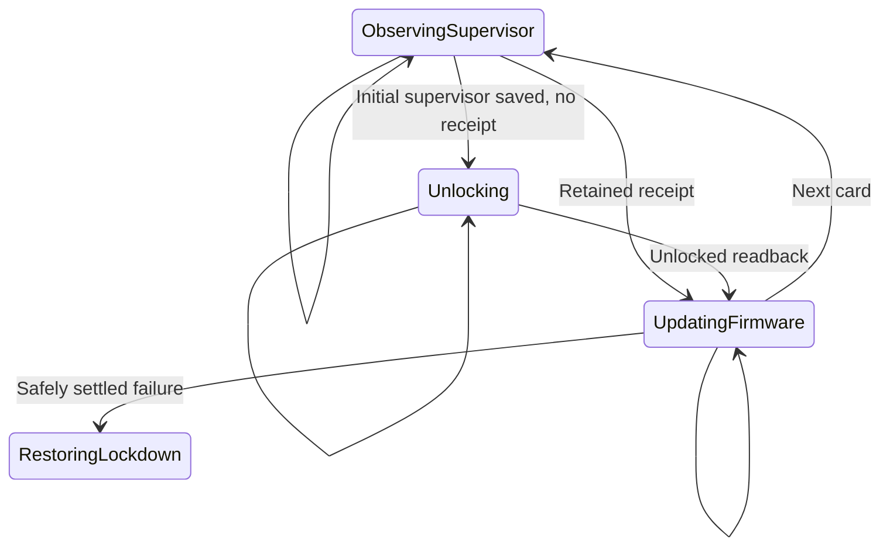

After the last successful card, activation and fresh inventory lead to policy restoration. The second diagram continues from the same `UpdatingFirmware` phase:

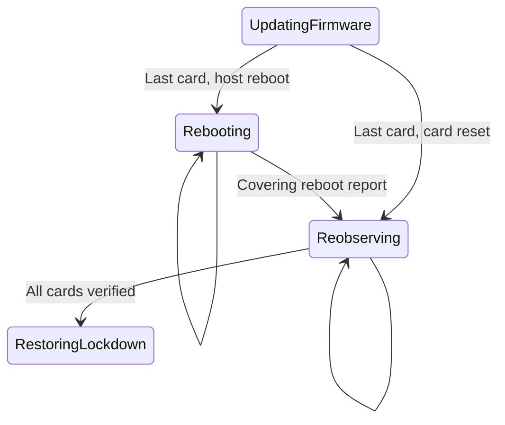

### Restoration and Continuation

Core checks every original lockdown policy before parking a failure or resuming the operation's purpose. The self-loop waits for independent policy readback:

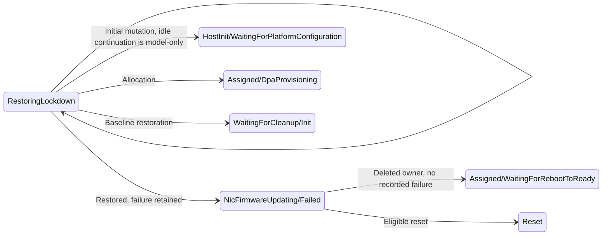

The following table maps the saved purpose and outcome to its continuation:

**NIC Firmware Continuations**

| Purpose and Outcome | Continuation |
| --- | --- |
| Initial baseline check without mutation or a recovery obligation | `HostInit/Discovered` with the reboot wait already satisfied (`skip_reboot_wait = true`) |
| Initial baseline mutation, verified restoration, or readiness qualification recovery | `HostInit/WaitingForPlatformConfiguration`, repeating host preparation |
| Idle baseline mutation or recovery (model support only; no production producer) | `HostInit/WaitingForPlatformConfiguration`, repeating host preparation |
| Queued idle check without mutation or recovery (model support only; no production producer) | `Ready`, subject to allocation guards |
| Already persisted allocation operation | `Assigned/DpaProvisioning` |
| Release baseline check or restoration | `WaitingForCleanup/Init`, preserving the cleanup context |

Firmware convergence and original-lockdown restoration do not themselves establish readiness. Initial mutation repeats platform configuration, discovery, BOM validation, and applicable readiness checks. Deprovision release first completes host cleanup, then follows BOM and machine validation with the saved `Cleanup` context. After successful Cleanup validation or a configured validation skip, a retained NIC readiness qualification obligation returns the host to `HostInit/WaitingForPlatformConfiguration`. That preparation cycle runs the applicable `Discovery` checks before Ready; it does not replace Cleanup checks. The obligation remains recorded through both stages.

`HostInit/Discovered` clears readiness qualification only after the preparation cycle reaches its boot/readiness gate. A recorded obligation prevents allocation even if the visible state is `Ready`. An attached instance takes precedence over redirecting an otherwise idle `Ready` host into preparation.

Before handoff, Core transactionally rechecks the controller state version, ownership, attachments, and recorded host or DPU failures. Busy interface or DPU locks defer completion without changing the operation. Destination-specific diagrams below retain the ordinary preparation and cleanup transitions.

### Failure and Ownership Changes

During an admitted operation, a recorded host or DPU failure, or ineligible allocation ownership, stops new firmware submissions and pending unlocks. Core continues observing work that might already have started. After those effects settle safely, it restores the original policies and records failure:

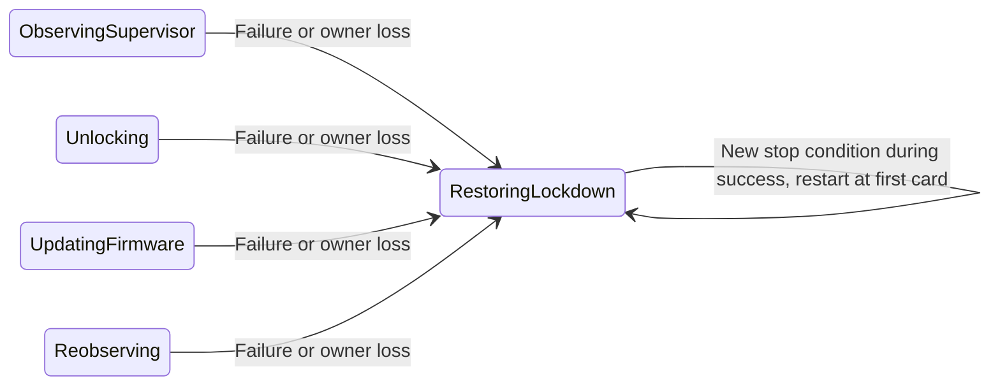

Baseline work requires no instance owner. Allocation requires its original live instance. Baseline restoration permits the original deleted instance or no instance; disappearance of that cleanup owner does not stop restoration. A replacement owner is never eligible.

A completed receipt establishes settled execution. An unsuccessful receipt permits restoration only when execution failed or was canceled before configuration or firmware writing, with no reported successful mutation, reset, or verification. Uncertain terminal effects require operator intervention.

In `Rebooting`, Core completes the persisted activation handshake, including reboot retries, before reacting to a stop condition. A new stop condition during successful restoration restarts policy checks at the first card. Restoration already recording a failure preserves its position and original reason.

### Phase Behavior

`Pending` is a queued check; the remaining phases belong to an admitted operation. A managed-host reset can preempt `Pending`, and a recorded host or DPU failure can move it to the global `Failed` state.

- **`Pending`:** The controller exposes the last admission diagnostic while the update manager retries policy and evidence checks. Restart preserves the original request age. Capacity waits do not freeze targets or reserve a slot; disablement and no-change continuations follow the admission results above.
- **`ObservingSupervisor`:** Core polls for the current card's receipt. During receipt-free initial observation, Core can establish or refresh `supervisor_instance_id` before permitting `Unlocking`. After leaving that phase, a missing receipt from a replacement supervisor cannot renew submission permission. A retained receipt resumes `UpdatingFirmware`. Without a stop condition or retained receipt, `InvalidTask`, `Conflict`, and `Unsupported` delivery errors require operator intervention. Unresolved terminal evidence also requires intervention.
- **`Unlocking`:** Core observes lockdown and changes it only when needed and the saved key identity permits it. An independent unlocked readback advances to `UpdatingFirmware`. Missing replies wait; change acknowledgements and reported errors return to observation.
- **`UpdatingFirmware`:** Core delivers the frozen request under the saved operation and supervisor identities. Without a receipt, an eligible retry resends that identical request only to the saved supervisor instance, which deduplicates it. Scout checks that instance before submitting; a replacement without the receipt blocks resubmission and requires reconciliation. Once a receipt exists or submission is prohibited, delivery only observes accepted work. Successful evidence for every requested step advances to the next card, or after the last card to `Rebooting` or `Reobserving`. A safely settled unsuccessful execution enters `RestoringLockdown` with a failure; unavailable or missing receipts alone never establish safe settlement.
- **`Rebooting`:** Core commits activation intent and each attempt timestamp before requesting power. Health overrides can block the reboot. A failed or timed-out power call leaves this phase pending. An authenticated reboot report covering activation and the latest attempt advances to `Reobserving`.
- **`Reobserving`:** Core waits for one inventory containing every saved card at the requested installed and running firmware version. Both collection and Core receipt times must follow the activation boundary. Missing, stale, partial, ambiguous, or mismatched evidence waits; matching evidence enters `RestoringLockdown`. A stop condition instead begins restoration without claiming successful inventory convergence.
- **`RestoringLockdown`:** Core reconciles every original policy with independent readback. Originally unlocked cards remain unlocked. Missing replies wait; acknowledgements and reported errors return to observation. After all cards, a retained failure enters `NicFirmwareUpdating/Failed`; success resumes the continuation after the transactional checks above.
- **`Failed`:** Core retains the operation and receipts after policy restoration. A deleted original allocation can resume `Assigned/WaitingForRebootToReady` when no host or DPU failure remains and the transactional checks pass. An eligible managed-host reset can enter `Reset`. Otherwise Core requires intervention and includes any current recorded failure without replacing the saved firmware reason.

For host activation, the freshness boundary is the database time when Core received the covering reboot report. For card reset, it is the database time when Core processed the last card's completion. Keep the Scout host and Core database clocks synchronized. Core does not compensate for skew: an ahead clock can make old collection appear fresh, while a behind clock can delay acceptance of new inventory.

Lockdown readback verifies `Locked` or `Unlocked`; it does not identify the installed key or repair external rekeying.

### Recovery Diagnostics

Reboot calls have a 120-second attempt deadline. The retry interval is the greater of 180 seconds and `machine_state_controller.failure_retry_time`, whose default is 90 minutes. Neither a timeout nor a lost reply abandons the operation. There is no maximum reboot-attempt count or overall workflow deadline. Active phases have no state service-level agreement (SLA); restored `Failed` has a zero SLA for observability.

Missing IKM versions, credential backend errors, and credential lookup timeouts return lockdown changes to observation and retry. They do not automatically become terminal failures. For retained phase errors and controller outcomes, use [state-history diagnostics](../../playbooks/stuck_objects/diagnostic_tools.md#query-state-history). Inspect [manual intervention alerts](../../observability/alerts.md#manual-intervention-alerts), including `carbide_object_manual_intervention_required`, when the controller cannot safely proceed. During uncertain active work, preserve the operation and its evidence rather than bypassing its guards.

### Reset, Power, and Deletion

Clearing a recorded cause does not restart a parked firmware recipe. After original-policy restoration, recovery is an [eligible managed-host reset](../../manuals/nico-admin-cli/commands/managed-host/managed-host-reset-set.md) or the deleted-allocation release described above. Admitted operations reject reset until `NicFirmwareUpdating/Failed`; the DPF, instance, and health preconditions still apply. Queued checks retain ordinary reset preconditions.

Force deletion has a separate guard. It refuses admitted NIC ownership, an unsettled dispatch, or a recorded restoration or readiness qualification obligation, including after admission is disabled. A force flag does not bypass those conditions. Reset can preserve an obligation through re-ingestion; it does not establish that a recorded sender has settled.

Admitted firmware handling precedes ordinary maintenance, DPU reprovisioning, restart verification, and reset dispatch. Admitted ownership rejects instance power requests. Direct component compute-power control, direct compute-tray firmware updates, and raw Redfish actions are refused for participating hosts because those paths have no supported NIC completion proof. When admission is enabled, these paths also refuse targets without an unambiguous managed-host owner. With a nonempty platform list, missing DMI identity also prevents excluding a host from that policy. Tenant allocation status is `Updating`, or `Failed` in the firmware failure phase; baseline restoration reports `Terminating`.

### Other Senders and Operator Reconciliation

A queued check does not own hardware or exclude ordinary legacy work. Admitted NIC ownership rejects overlapping DPA, MLX administration, instance/admin power, and destructive ownership changes. Legacy dispatch tracking applies when admission is enabled for the host's listed DMI platform or the host has a restoration or readiness qualification obligation. The latter keeps tracking active after admission is disabled. Each participating sender records its UUID and origin before sending. An unresolved dispatch prevents further dispatch, NIC admission, allocation, and ordinary controller progress until its effects settle.

Tracked MLX profile/configuration synchronization and configuration writes mark saved baseline cards for restoration and readiness qualification. That obligation prevents allocation. After the sender settles, an idle `Ready` host returns to platform preparation; an attached instance takes precedence over that idle redirect. Fresh preparation checks or restoration run through the initial-preparation hook. Legacy operations outside participation do not create new admission work.

Tracked DPA requests require a Scout that echoes dispatch tokens and supports receipt-only polling. They are omitted from legacy JSON. Known successful replies settle only the matching token. An explicit rejection from the matching helper before it accepts Submit can establish that no work was accepted. A missing receipt or transport failure cannot. Receipt-only polling does not resubmit a mutation.

While `firmware_global.nic_firmware_admission_enabled` is enabled, untracked admin power is refused with `FAILED_PRECONDITION` before sending. This includes known hosts excluded from the platform list and targets without usable ownership or DMI evidence. Qualified tracked admin power and recovery tracking remain available under the evidence rules below.

BFB manual recovery requests are also refused while admission is enabled, including requests with `pre_copy_powercycle = false`. Already queued BFB host `PowerOff` and `PowerOn` steps are refused before sending. A blocked `PowerOn` can leave the host off. The queued recovery phase and pause state remain recorded; refusal does not claim completion or automatically clear the recovery.

With admission disabled, ordinary untracked admin power retains its legacy behavior. BFB host power checks current ownership after client setup and refuses known admitted NIC ownership, restoration or readiness qualification obligations, and unresolved dispatches. These guards do not create new NIC recovery obligations.

Tracked instance restart and admin power require action-specific stable evidence before sending. Unsupported admin actions or insufficient observed pre-dispatch evidence return `FAILED_PRECONDITION` with no command sent. A failed pre-dispatch observation also returns an error without sending. On/off needs a stable initial power state; restart/cycle needs a stable running-boot generation. After accepted delivery, on/off settles through the observed stable transition. Restart/cycle requires two different, nonempty boot generations that each reached `OSRunning`, or `OEM` with `OsIsRunning`. A BMC acceptance reply, `OSBootStarted`, unchanged power, or unrelated Scout report is insufficient. An on/off request already at its stable target returns without sending a command. Uncertain effects after a send require reconciliation.

Tracked native DPA requests include configuration requests and heartbeats. Publication alone does not establish settlement; completion must correlate to the exact recorded request. Hardware qualification must establish that the deployed native agent acknowledges mutations only after actual completion. A failed publication or lost acknowledgement leaves the dispatch unresolved; it does not authorize a replacement mutation.

`FindMachinesByIds` exposes the last dispatch in `MachineStatus.nic_firmware_dispatch`: token, origin, start and settlement times, settled status, the `not_admitted` result, any power target, and any DPA interface/version correlation. This status does not expose all internal completion evidence, including the original power observation or native request.

Lost replies, vendor errors, and uncertain execution do not expire or clear themselves. An operator must fence or quiesce every original Core sender, Scout stream, native-agent delivery path, and BMC task, preserve the evidence, and establish both tool and hardware settlement. Only then can a privileged procedure condition a settlement write on the exact current token and record a new database settlement time. Knowing the UUID, resetting the host, or changing a flag does not fence delayed delivery. There is no supported public token-clear API. [Operator reconciliation tooling](https://github.com/dsx-ai-factory/infra-controller/issues/6687) remains separately tracked.

The supervisor claim coordinates participating local tools. Do not run direct `FirmwareFlasher` mutations, legacy integrations, or independently launched vendor tools concurrently with admitted NIC execution. Those paths require site coordination. Neither sender settlement nor process exit qualifies physical recovery of an interrupted flash.

## DPU Discovery State Details (DpuDiscoveringState)

Shows the complete DPU discovery and configuration process:

```mermaid
stateDiagram-v2
    state "Initializing" as DD_Initializing
    state if_state_dpu_nodpu <<choice>>
    state "Configuring" as DD_Configuring
    state "EnableRshim" as DD_EnableRshim
    state if_bfb_supported <<choice>>
    state "HostInit/WaitingForPlatformConfiguration" as HostInit_HI_WaitingForPlatformConfiguration
    state "DPUInit/InstallingBFB" as DPUInit_DI_IDO_InstallingBFB

    state "EnableSecureBoot" as DD_EnableSecureBoot {
        state "CheckSecureBootStatus" as DD_SSB_E_CheckSecureBootStatus
        state "CheckSecureBootStatusWait" as DD_SSB_E_CheckSecureBootStatusWait
        state "SetSecureBoot" as DD_SSB_E_SetSecureBoot
        state "RebootDPU" as DD_SSB_E_RebootDPU
        state "RebootDPUWait" as DD_SSB_E_RebootDPUWait
    }

    state "DisableSecureBoot" as DD_DisableSecureBoot {
        state "CheckSecureBootStatus" as DD_SSB_D_CheckSecureBootStatus
        state "CheckSecureBootStatusWait" as DD_SSB_D_CheckSecureBootStatusWait
        state "DisableSecureBoot" as DD_SSB_D_DisableSecureBoot
        state "RebootDPU" as DD_SSB_D_RebootDPU
        state "RebootDPUWait" as DD_SSB_D_RebootDPUWait
    }

    state "SetUefiHttpBoot" as DD_SetUefiHttpBoot
    state "RebootAllDPUS" as DD_RebootAllDPUS
    state Failed
    state "DPUInit/Init" as DPUInit_DI_Init

    [*] --> DD_Initializing : Site Explorer creates managed host

    DD_Initializing --> if_state_dpu_nodpu
    if_state_dpu_nodpu --> DD_Configuring : Assoc DPU
    if_state_dpu_nodpu --> HostInit_HI_WaitingForPlatformConfiguration : No DPU

    DD_Configuring --> DD_EnableRshim
    DD_EnableRshim --> DD_RebootAllDPUS : DPF selected during site exploration
    DD_EnableRshim --> if_bfb_supported : DPF not selected during site exploration

    if_bfb_supported --> DD_SSB_E_CheckSecureBootStatus : BFB install supported
    if_bfb_supported --> DD_SSB_D_CheckSecureBootStatus : BFB install not supported

    DD_SSB_E_CheckSecureBootStatus --> DD_SSB_E_SetSecureBoot : Security boot is disabled
    DD_SSB_E_CheckSecureBootStatus --> DD_SSB_E_CheckSecureBootStatusWait : 2nd reboot
    DD_SSB_E_CheckSecureBootStatusWait --> DD_SSB_E_CheckSecureBootStatus : Wait for DPU (5min timeout)
    DD_SSB_E_CheckSecureBootStatus --> DPUInit_DI_IDO_InstallingBFB : Security boot is enabled
    DD_SSB_E_CheckSecureBootStatus --> DD_SSB_E_RebootDPU : Get status error
    DD_SSB_E_CheckSecureBootStatus --> DD_SSB_E_CheckSecureBootStatus : Missing data count++ retry if count < 10
    DD_SSB_E_CheckSecureBootStatus --> Failed : count >= 10 too many retries
    DD_SSB_E_SetSecureBoot --> DD_SSB_E_RebootDPU
    DD_SSB_E_RebootDPU --> DD_SSB_E_RebootDPU : Reboot again
    DD_SSB_E_RebootDPU --> DD_SSB_E_CheckSecureBootStatus : Two reboots
    DD_SSB_E_RebootDPU --> DD_SSB_E_RebootDPUWait
    DD_SSB_E_RebootDPUWait --> DD_SSB_E_RebootDPU : Wait for DPU (5min timeout)

    DD_SSB_D_CheckSecureBootStatus --> DD_SSB_D_DisableSecureBoot : Security boot is enabled
    DD_SSB_D_CheckSecureBootStatus --> DD_SSB_D_CheckSecureBootStatusWait : 2nd reboot
    DD_SSB_D_CheckSecureBootStatusWait --> DD_SSB_D_CheckSecureBootStatus : Wait for DPU (5min timeout)
    DD_SSB_D_CheckSecureBootStatus --> DD_SetUefiHttpBoot : Security boot is disabled
    DD_SSB_D_CheckSecureBootStatus --> DD_SSB_D_RebootDPU : Get status error
    DD_SSB_D_CheckSecureBootStatus --> Failed : count >= 10 too many retries
    DD_SSB_D_CheckSecureBootStatus --> DD_SSB_D_CheckSecureBootStatus : Missing data count++ retry if count < 10
    DD_SSB_D_DisableSecureBoot --> DD_SSB_D_RebootDPU
    DD_SSB_D_RebootDPU --> DD_SSB_D_RebootDPU : Reboot again
    DD_SSB_D_RebootDPU --> DD_SSB_D_CheckSecureBootStatus : Two reboots
    DD_SSB_D_RebootDPU --> DD_SSB_D_RebootDPUWait
    DD_SSB_D_RebootDPUWait --> DD_SSB_D_RebootDPU : Wait for DPU (5min timeout)

    DD_SetUefiHttpBoot --> DD_RebootAllDPUS
    DD_RebootAllDPUS --> DPUInit_DI_Init
```

## DPU Initialization State Details (DpuInitState)

Shows DPU initialization including BFB installation:

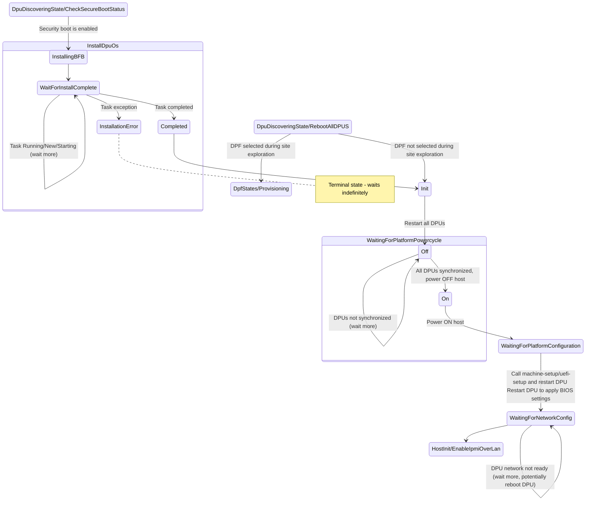

## Host Initialization State Details (HostInitState)

`DisableOnboardNics` applies only to Vera Rubin hosts with managed DPUs. Other
SKUs do not support disabling onboard NICs through the BMC and skip this state.
After enabling IPMI over LAN, eligible hosts enter `DisableOnboardNics`.
The controller enables onboard NICs, waits at least ten seconds, disables them,
and waits at least ten more seconds before platform configuration. Each wait uses
its persisted substate-entry timestamp, so controller restarts preserve progress.
Libredfish checks that host power is On before writing. Setter errors, including
power-state failures, leave the configure substate
in place for retry. No AUX-cycle delay is required. The waits allow settings to
apply, but they do not verify physical NIC state through boot options.

Hosts without managed DPUs, including hosts whose DPUs are ignored or operated in
NIC mode, skip this sequence and retain their onboard NIC settings. The existing
no-DPU paths into platform configuration remain unchanged.
For Vera Rubin hosts that skip `DisableOnboardNics` and keep onboard NICs enabled,
`machine_setup_status` reports "not done" with a `HostManagementNetworkAccess` diff
expecting `Disabled`, which is expected for these configurations.

Shows host initialization including boot order and UEFI setup:

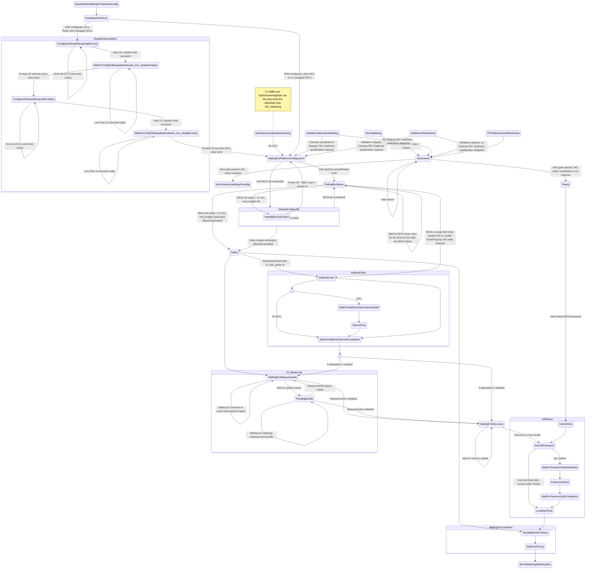

## BOM Validation State Details (BomValidating)

Shows the BOM (Bill of Materials) validation process:

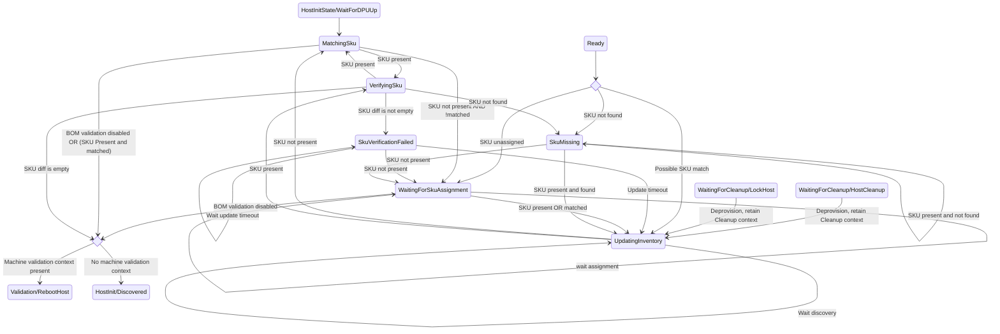

## Machine Validation State Details (ValidationState)

Shows the machine validation process. Deprovision cleanup preserves the `Cleanup` context through BOM and machine validation. After Cleanup validation succeeds or is skipped by configuration, the host returns to platform preparation when NIC readiness qualification remains required. The later preparation cycle uses `Discovery` validation.

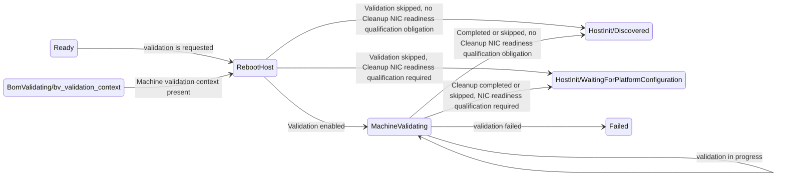

## Ready State Details (Ready)

For hosts already provisioned through DPF, a reprovisioning request can remain
in `Ready` while NICo checks compatibility or retries a failed DPU restart.
Refer to [DPU Firmware Updates](../../operations/firmware-updates/dpu-firmware.md#eligibility-and-scheduling)
for the start checks, saved start timestamps, and retry behavior behind the
reprovisioning transitions in these diagrams.

Shows what can happen in Ready state:

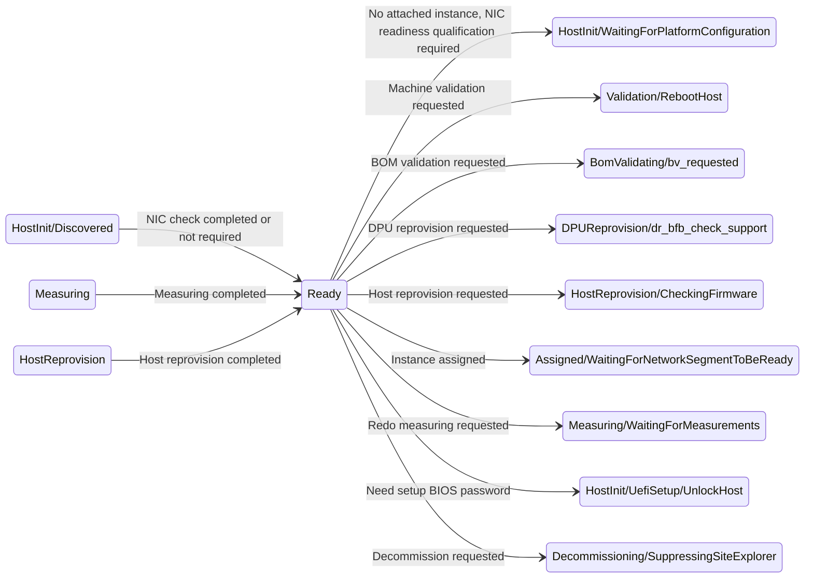

## Decommissioning State Details

Decommissioning starts only from `Ready` and follows this top-level sequence:

```mermaid
stateDiagram-v2
    direction LR

    state "SuppressingSiteExplorer" as SuppressingSiteExplorer
    state "DeconfiguringHost" as DeconfiguringHost
    state "DeconfiguringDpus" as DeconfiguringDpus
    state "SuppressingOobDhcp" as SuppressingOobDhcp
    state "PowerCyclingHost" as PowerCyclingHost
    state "PoweringOnHost" as PoweringOnHost
    state "WaitingForOobDhcpAcknowledgement" as WaitingForOobDhcpAcknowledgement
    state "SuppressingBmcDhcp" as SuppressingBmcDhcp
    state "FactoryResettingBmcs" as FactoryResettingBmcs
    state "WaitingForBmcDhcpAcknowledgement" as WaitingForBmcDhcpAcknowledgement
    state "DeletingManagedCredentials" as DeletingManagedCredentials
    state "Decommissioned (terminal)" as Decommissioned

    [*] --> SuppressingSiteExplorer
    SuppressingSiteExplorer --> DeconfiguringHost : Site Explorer acknowledges suppressions
    DeconfiguringHost --> DeconfiguringDpus : Host firmware configuration reset
    DeconfiguringDpus --> SuppressingOobDhcp : DPUs run preingestion BFB
    SuppressingOobDhcp --> PowerCyclingHost : OOB DHCP suppressions recorded
    PowerCyclingHost --> PoweringOnHost : AC power cycle accepted
    PoweringOnHost --> WaitingForOobDhcpAcknowledgement : Host power state is On after power cycle
    WaitingForOobDhcpAcknowledgement --> WaitingForOobDhcpAcknowledgement : OOB DHCP acknowledgement pending
    WaitingForOobDhcpAcknowledgement --> SuppressingBmcDhcp : No OOB DHCP acknowledgements pending
    SuppressingBmcDhcp --> FactoryResettingBmcs : BMC DHCP suppressions recorded
    FactoryResettingBmcs --> WaitingForBmcDhcpAcknowledgement : BMC resets accepted
    WaitingForBmcDhcpAcknowledgement --> WaitingForBmcDhcpAcknowledgement : BMC DHCP acknowledgement pending
    WaitingForBmcDhcpAcknowledgement --> DeletingManagedCredentials : No BMC DHCP acknowledgements pending
    DeletingManagedCredentials --> Decommissioned : Per-device credentials deleted
```

`DeconfiguringHost` disables lockdown, unlocks managed SuperNICs, resets UEFI
settings, and clears the host UEFI password. `DeconfiguringDpus` removes DPF
resources when applicable and installs the vanilla `preingestion.bfb` on every
DPU.

The OOB DHCP wait checks the host and DPU OOB interface MACs, and the BMC DHCP
wait checks the host and DPU BMC MACs. Each DHCP wait advances after every MAC
it checks has a recorded suppression acknowledgement or qualifies to advance
without one. Refer to
[DHCP Suppression Acknowledgement](../../decommissioning/index.md#dhcp-suppression-acknowledgement)
for the shared rule.

Refer to [Decommission Managed Hosts and DPUs](../../decommissioning/hosts.md) for the
operator procedure, platform limitations, and intended post-reset state.

## Instance Assignment State Details (InstanceState)

Shows the complete instance assignment and management flow:

```mermaid
stateDiagram-v2
    state Ready
    state "DPUReprovision/DR_RebootHost" as DPUReprovision_DR_RebootHost
    state "HostReprovision/HR_CheckingFirmware" as HostReprovision_HR_CheckingFirmware

    state "WaitingForNetworkSegmentToBeReady" as A_WaitingForNetworkSegmentToBeReady
    state "WaitingForNetworkConfig" as A_WaitingForNetworkConfig
    state "WaitingForStorageConfig (legacy recovery)" as A_WaitingForStorageConfig
    state "WaitingForExtensionServicesConfig (legacy recovery)" as A_WaitingForExtensionServicesConfig
    state "WaitingForRebootToReady" as A_WaitingForRebootToReady
    state "Assigned/Ready" as A_Ready
    state "WaitingForDpusToUp" as A_WaitingForDpusToUp
    state "BootingWithDiscoveryImage" as A_BootingWithDiscoveryImage
    state "SwitchToAdminNetwork" as A_SwitchToAdminNetwork
    state "WaitingForNetworkReconfig" as A_WaitingForNetworkReconfig
    state a_release_instance <<choice>>
    state "Assigned/Failed" as A_Failed
    state "NetworkConfigUpdate" as A_NetworkConfigUpdate {
        state "WaitingForNetworkSegmentToBeReady" as A_NCU_WaitingForNetworkSegmentToBeReady
        state "WaitingForConfigSynced" as A_NCU_WaitingForConfigSynced
        state "ReleaseOldResources" as A_NCU_ReleaseOldResources
    }
    state "HostPlatformConfiguration" as A_HostPlatformConfiguration {
        state "FactoryResetBmc" as A_HPC_FactoryResetBmc
        state "PowerCycle" as A_HPC_PowerCycle
        state "UnlockHost" as A_HPC_UnlockHost {
            state "DisableLockdown" as A_HPC_UH_DisableLockdown
            state "RebootHost" as A_HPC_UH_RebootHost
            state "WaitForUefiBoot" as A_HPC_UH_WaitForUefiBoot
        }
        state "CheckHostConfig" as A_HPC_CheckHostConfig
        state "ConfigureBios" as A_HPC_ConfigureBios
        state "WaitingForBiosJob" as A_HPC_WaitingForBiosJob {
            state "HandleBiosJobFailure" as A_HPC_WBJ_HandleBiosJobFailure
        }
        state "PollingBiosSetup" as A_HPC_PollingBiosSetup
        state "SetBootOrder" as A_HPC_SetBootOrder {
            state "SetBootOrder" as A_HPC_SBO_SetBootOrder
            state "WaitForSetBootOrderJobScheduled" as A_HPC_SBO_WaitForSetBootOrderJobScheduled
            state "RebootHost" as A_HPC_SBO_RebootHost
            state "WaitForSetBootOrderJobCompletion" as A_HPC_SBO_WaitForSetBootOrderJobCompletion
        }
        state "LockHost" as A_HPC_LockHost
    }

    state "PostAssignedMeasuring/WaitingForMeasurements" as PostAssignedMeasuring_M_WaitingForMeasurements
    state "WaitingForCleanup/Init" as WaitingForCleanup_C_Init
    state "DPUReprovision/dr_bfb_check_support" as DPUReprovision_dr_bfb_check_support

    Ready --> A_WaitingForNetworkSegmentToBeReady : Instance assigned

    A_WaitingForNetworkSegmentToBeReady --> A_WaitingForNetworkSegmentToBeReady : segments not ready
    A_WaitingForNetworkSegmentToBeReady --> A_WaitingForNetworkConfig : No segment OR segments ready

    A_WaitingForNetworkConfig --> A_WaitingForNetworkConfig : An assigned provisioning gate is not ready
    A_WaitingForNetworkConfig --> A_WaitingForRebootToReady : Deletion requested OR all assigned provisioning gates clear

    A_WaitingForStorageConfig --> A_WaitingForExtensionServicesConfig : Recover a persisted legacy state
    A_WaitingForExtensionServicesConfig --> A_WaitingForExtensionServicesConfig : Extension services not ready
    A_WaitingForExtensionServicesConfig --> A_WaitingForRebootToReady : No managed DPU OR no configured services OR services ready
    A_WaitingForRebootToReady --> A_WaitingForRebootToReady : Aggregate PreventHostStateChanges OR managed DPU PXE signal
    A_WaitingForRebootToReady --> A_Ready : Readiness checks pass OR deletion or custom iPXE bypass; ForceRestart

    A_Ready --> A_NCU_WaitingForNetworkSegmentToBeReady : Update network request
    A_Ready --> A_HPC_FactoryResetBmc : Instance deleted
    A_Ready --> A_HPC_UH_DisableLockdown : Host or DPU reprovisioning, firmware update, or custom iPXE requested
    A_HPC_FactoryResetBmc --> A_HPC_PowerCycle : Factory reset completes or is disabled

    A_WaitingForDpusToUp --> A_WaitingForRebootToReady : DPUs ready or absent AND custom iPXE requested
    A_WaitingForDpusToUp --> A_BootingWithDiscoveryImage : DPUs ready or absent AND no custom iPXE request
    A_WaitingForDpusToUp --> A_WaitingForDpusToUp : Managed DPUs not ready

    A_BootingWithDiscoveryImage --> A_BootingWithDiscoveryImage : Retry reboot if needed
    A_BootingWithDiscoveryImage --> A_SwitchToAdminNetwork : If instance deleted
    A_BootingWithDiscoveryImage --> DPUReprovision_dr_bfb_check_support : DPU reprovision needed
    A_BootingWithDiscoveryImage --> HostReprovision_HR_CheckingFirmware : Host reprovision needed
    A_BootingWithDiscoveryImage --> A_BootingWithDiscoveryImage : Nothing is needed. Stuck.

    DPUReprovision_DR_RebootHost --> A_Ready : Reprovision completed
    state "HostReprovision/hr_completed" as HostReprovision_hr_completed
    HostReprovision_hr_completed --> A_Ready : Reprovision not needed

    A_SwitchToAdminNetwork --> A_WaitingForNetworkReconfig : Update network config

    A_WaitingForNetworkReconfig --> A_WaitingForNetworkReconfig : Network not synced
    A_WaitingForNetworkReconfig --> a_release_instance : Delete instance & clean network config
    a_release_instance --> PostAssignedMeasuring_M_WaitingForMeasurements : attenstation enabled
    a_release_instance --> WaitingForCleanup_C_Init : attenstation disabled

    A_NCU_WaitingForNetworkSegmentToBeReady --> A_NCU_WaitingForConfigSynced : No segments OR All ready
    A_NCU_WaitingForNetworkSegmentToBeReady --> A_NCU_WaitingForNetworkSegmentToBeReady : Not all segments ready

    A_NCU_WaitingForConfigSynced --> A_NCU_ReleaseOldResources : No associated DPU OR managed-host and instance versions current with no blocking health
    A_NCU_WaitingForConfigSynced --> A_NCU_WaitingForConfigSynced : Missing or stale acknowledgement OR blocking health
    A_NCU_ReleaseOldResources --> A_NCU_ReleaseOldResources : Missing or stale acknowledgement OR blocking health
    A_NCU_ReleaseOldResources --> A_Ready : Same checks pass and old-resource cleanup commits

    A_HPC_PowerCycle --> A_HPC_PowerCycle : Wait Power Off
    A_HPC_PowerCycle --> A_HPC_UH_DisableLockdown : Power On
    A_HPC_UH_DisableLockdown --> A_HPC_UH_RebootHost : BMC lockdown disabled
    A_HPC_UH_RebootHost --> A_HPC_UH_WaitForUefiBoot : ForceRestart issued
    A_HPC_UH_WaitForUefiBoot --> A_HPC_UH_WaitForUefiBoot : Waiting for UEFI boot (5 min)
    A_HPC_UH_WaitForUefiBoot --> A_HPC_CheckHostConfig : UEFI boot wait complete
    A_HPC_CheckHostConfig --> A_HPC_CheckHostConfig : Wait DPU Up
    A_HPC_CheckHostConfig --> A_HPC_ConfigureBios : Need config host boot order
    A_HPC_CheckHostConfig --> A_HPC_LockHost : No need config host boot order
    A_HPC_ConfigureBios --> A_HPC_PollingBiosSetup : Config BIOS
    A_HPC_ConfigureBios --> A_HPC_WaitingForBiosJob : Dell BIOS job scheduled
    A_HPC_WaitingForBiosJob --> A_HPC_PollingBiosSetup : BIOS job completed
    A_HPC_WaitingForBiosJob --> A_HPC_WBJ_HandleBiosJobFailure : BIOS job failed
    A_HPC_WaitingForBiosJob --> A_Failed : Retry budget exhausted (BiosSetupFailed)
    A_HPC_WBJ_HandleBiosJobFailure --> A_HPC_ConfigureBios : Power off + BMC reset + power on
    A_HPC_PollingBiosSetup --> A_HPC_PollingBiosSetup : Wait for BIOS setup, then for the host to boot after the BIOS reboot
    A_HPC_PollingBiosSetup --> A_HPC_WBJ_HandleBiosJobFailure : BIOS not setup > 15 min, retry budget left
    A_HPC_PollingBiosSetup --> A_Failed : BIOS not setup > 15 min, retry budget exhausted (BiosSetupFailed)
    A_HPC_PollingBiosSetup --> A_HPC_SBO_SetBootOrder : BIOS is setup AND (host booted OR no usable BootProgress OR settle timeout)
    A_HPC_SBO_SetBootOrder --> A_HPC_SBO_WaitForSetBootOrderJobScheduled : Set boot order job scheduled
    A_HPC_SBO_WaitForSetBootOrderJobScheduled --> A_HPC_SBO_RebootHost : Job scheduled
    A_HPC_SBO_RebootHost --> A_HPC_SBO_WaitForSetBootOrderJobCompletion : Reboot
    A_HPC_SBO_WaitForSetBootOrderJobCompletion --> A_HPC_LockHost : Job completed
    A_HPC_LockHost --> A_WaitingForDpusToUp : BMC lockdown enabled

    state AnyState
    AnyState --> A_Failed : Any failure condition
    A_Failed --> A_Failed : Wait (stuck, manual action needed)
    A_Failed --> A_HPC_SBO_SetBootOrder : BiosSetupFailed AND is_bios_setup ok
```

### Network Readiness Gates

During initial provisioning, `WaitingForNetworkConfig` waits for all required
network configuration observations to match their desired versions. For a host
with associated DPUs, it also waits for aggregate health alerts that prevent
host state changes to clear. A host without associated DPUs skips both the DPU
observation and aggregate health checks in this state.

The normal agent report gives a p0 transport failure the combination of
`BgpPeeringTor` and `PreventAllocations`. The PXE gate matches that probe ID and
classification; it does not inspect the alert target. A host `Replace` report
takes precedence for this check. Without one, the primary DPU `Replace` report
takes precedence over that DPU's `Merge` reports. Refer to
[DPU ToR Uplink Health](../../dpu-management/dpu_configuration.md#dpu-tor-uplink-health)
for the uplink policy and classifications.

`WaitingForRebootToReady` repeats the aggregate health and primary p0 checks
immediately before the normal PXE `ForceRestart`. This closes the interval in
which health can change after the configuration check. Hosts without managed
DPUs skip this PXE signal check, including one supplied by a host `Replace`
report, but still receive the aggregate health check. In
`WaitingForNetworkConfig`, a host `Replace` report can supply the matching
signal before NICo looks for a primary DPU, including on a host without managed
DPUs.

Normal success proceeds directly from `WaitingForNetworkConfig` to
`WaitingForRebootToReady`. `WaitingForStorageConfig` and
`WaitingForExtensionServicesConfig` remain only so NICo can recover hosts that
persisted those states on an older release.

The following requests bypass these initial provisioning readiness checks:

- Instance deletion proceeds through its required restart without waiting for
  network health.
- An explicit custom iPXE request proceeds through its requested restart.

### Live Network Update Resource Release

A live network update keeps old network resources until the required DPU
reports and health checks pass. It does not restart the host or apply the
primary p0 PXE gate.

For a host with associated DPUs, NICo checks these conditions in order:

1. Every DPU in the host topology reports the current managed-host network
   configuration version. A missing DPU snapshot, observation, or version does
   not count as an acknowledgement.
1. The number of instance network observations matches the number of DPUs
   required by the current instance configuration. Every recorded instance
   observation reports the current instance network configuration version.
1. The aggregate health report has no `PreventHostStateChanges` alert.

A host without associated DPUs skips these acknowledgement and aggregate health
checks.

`NetworkConfigUpdate/WaitingForConfigSynced` runs the checks first. If they pass,
the host enters `NetworkConfigUpdate/ReleaseOldResources`, which repeats them.
Another DPU report can arrive after NICo saves the state change.

Missing or stale acknowledgements cause a wait. Blocking health causes a
handler error. In either case, NICo keeps the same state, old resources, and
pending update request, then checks again on a later iteration. Instance
deletion does not bypass these checks for a pending live update.

After the repeated checks pass, NICo completes cleanup in one transaction. It
releases old addresses and unused VPC loopbacks, marks removed generated
segments for deletion, and clears the pending update request. The host returns
to `Assigned/Ready`. To troubleshoot a pending update, refer to
[Diagnose a Live Network Update](../../playbooks/stuck_objects/waiting_for_network_config.md#diagnose-a-live-network-update).

A DPU that loses all tenant interfaces still belongs to the host
topology. It must acknowledge its Admin configuration before NICo can release
the old resources.

Until that DPU reports again, its old instance observation can leave more
instance observations than required DPUs, even if its managed-host version
still matches. If applying Admin fails, the instance observation can disappear
without proving that the old tenant configuration was removed. A healthy
report or an absent instance observation is therefore not enough: NICo still
needs the managed-host acknowledgement.

NICo uses the versions and health that the agents report. It does not
independently verify hardware forwarding. Refer to
[Wait for Removed DPUs Before Releasing Instance Network Resources](https://github.com/dsx-ai-factory/infra-controller/issues/3895)
for background on this removed-DPU scenario.

## Host Reprovision State Details (HostReprovisionState)

Shows the host firmware reprovision process:

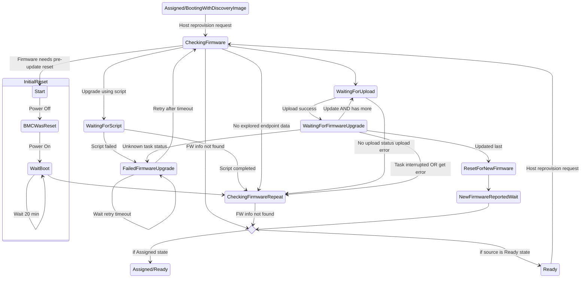

## DPU Reprovision State Details (DpuReprovisionState)

Shows the DPU firmware reprovision process:

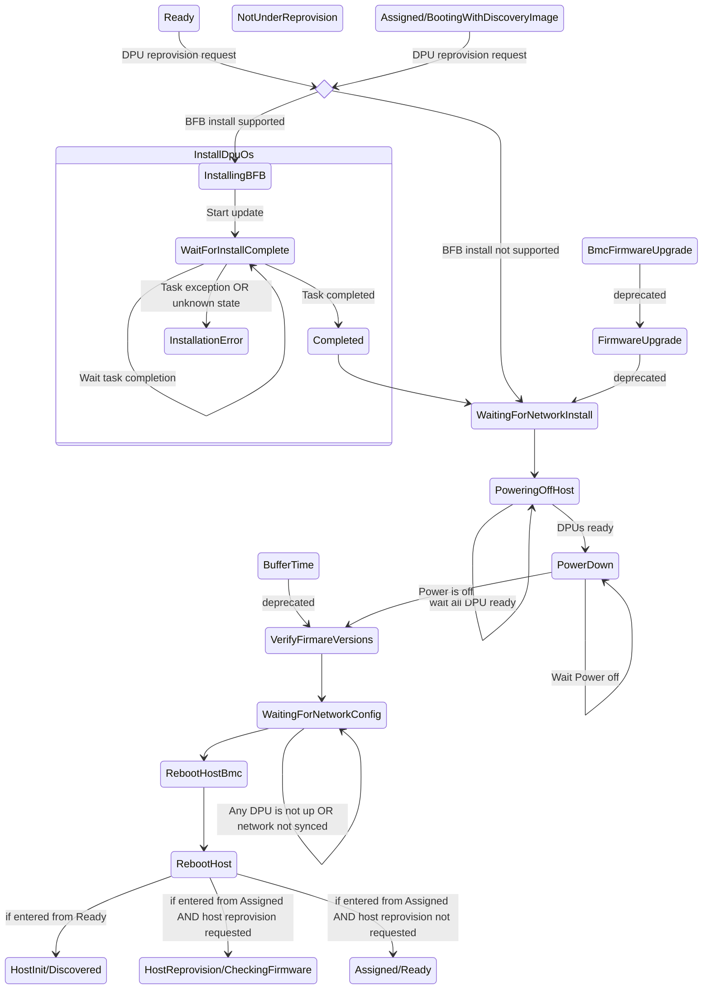

## WaitingForCleanup State Details

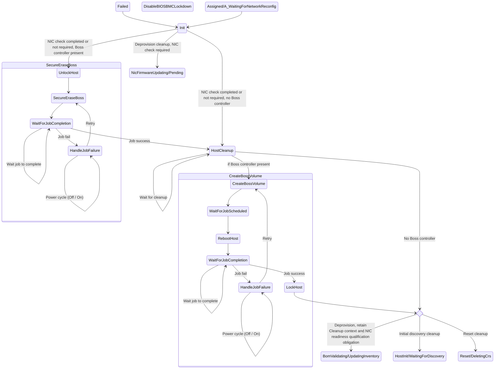

## Measuring and PostAssignedMeasuring State Details

Shows the attestation measurement process.

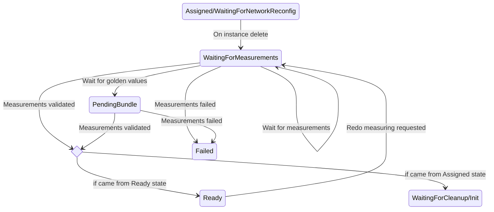

## Failed State

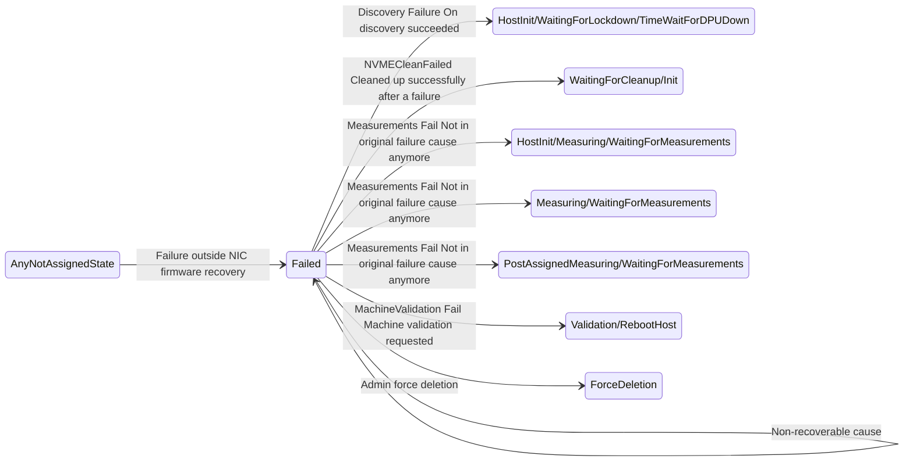
