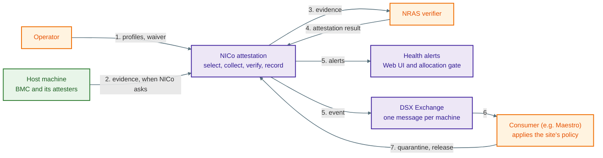
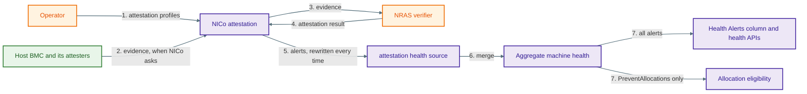

# SPDM Attestation Health Alerts

**Implements:** [dsx-ai-factory/infra-controller#4613](https://github.com/dsx-ai-factory/infra-controller/issues/4613)

**Depends on:** [dsx-ai-factory/infra-controller#7664](https://github.com/dsx-ai-factory/infra-controller/pull/7664), which re-keys attestation from the machine to a job. This document assumes that change has landed.

**Status:** In progress

## Revision History

| Version | Date       | Modified By       | Description                                            |
| ------- | ---------- | ----------------- | ------------------------------------------------------ |
| 0.1     | 10/15/2026 | Binu Ramakrishnan | Initial version, scoped to issue 4613 only             |
| 0.2     | 10/16/2026 | Binu Ramakrishnan | Rebased onto job-driven attestation, #7664             |
| 0.3     | 10/16/2026 | Binu Ramakrishnan | Restructured around how each system works today        |
| 0.4     | 10/20/2026 | Binu Ramakrishnan | Build the source from results and the current selection |
| 0.5     | 11/09/2026 | Binu Ramakrishnan | Reconciled against the implementation                  |

## 1 Purpose

Three machines look the same in the Health Alerts column today:

- one that attested every attester it has and passed
- one whose attestation failed
- one that was never attested because no profile covers its hardware

A failure shows up only as a generic `Failed` host state that an operator has to open the host to understand. A coverage gap shows up only as a per-class count of explored endpoints, which says how many machines are uncovered but not which ones.

This phase makes attestation a health-report source, so those three machines stop reading the same.

### 1.1 How it fits together

NICo **reports** attestation state. It does not decide what to do about it.

| Who | Does what |
| --- | --- |
| NICo | Collects evidence, gets a result from the verifier, checks that result, records per-attester state, and reports it |
| Operator | Writes the policy that says which outcomes matter |
| Consumer | Reads the state, applies that policy, and calls NICo APIs such as `SetManagedHostQuarantineState` |

Two rules follow.

**Report what happened, not what to do.** NICo says a certificate chain was revoked. It does not say to update firmware or quarantine the machine. Those are policy decisions. If NICo made them too, the same policy would live in two places and drift apart.

**Report each attester.** A consumer might be told "quarantine a machine if two of its attesters fail". It can only apply a rule like that if NICo reports every attester, not just the machine-level rollup. A summary alone would hide information the consumer needs.

This is the whole picture attestation reporting is building toward, across every phase. The event bus, the consumer, and the standing waiver are all follow-up work (§7). §5 shows the part this phase builds.



The numbers follow one attestation around the loop. An operator writes a profile, NICo attests, the result reaches the health alerts and the bus, and the consumer applies the site's policy by calling NICo back. Both arrows out of NICo are numbered 5 because they are two outputs of the same step, not one after the other.

### 1.2 Current scope

This document covers the part of issue 4613 that can ship as one unit:

- an `attestation` health-report source
- one failure alert per failed attester, which blocks tenant allocation
- coverage alerts where a profile applied but attestation covered less than it asked for, and no alert where no profile applied at all (§5.5)
- storing the few scheduling facts the coverage alerts need

A follow-up design handles the rest: typed failure reasons, the event-bus topic, the API snapshot, and the standing waiver. §7 lists both the gaps this leaves and the work that closes them.

## 2 Terms

| Term           | Meaning                                                                                       |
| -------------- | --------------------------------------------------------------------------------------------- |
| SPDM           | Security Protocol and Data Model, the DMTF standard for authenticating a hardware component and collecting signed measurements from it. NICo drives it through the BMC's Redfish interface |
| Attester       | An SPDM-capable component that a machine's BMC reports, such as a GPU or a NIC. Attestation selects, collects, and verifies per attester |
| Profile        | An operator-authored policy, one per hardware class, holding the selection below and carrying a version. The reserved class `any` is the fallback for classes with no profile of their own |
| Selection      | The part of a profile that says which attesters to attest: none of them, all of them, only the IDs matching a pattern, or all except those |
| Attester override | The attesters an operator names on one trigger, as regex patterns, in place of the profile's selection. It applies to that attempt alone and is never stored as a profile (§5.3). Distinct from a waiver, which changes what an attestation concluded rather than what gets attested |
| Scheduling     | The step that decides what to attest. It resolves the machine's hardware class, finds the profile for that class, matches the profile's selection against the attesters the BMC reports, and creates a job if any were selected. It always produces an outcome saying why it scheduled what it did (§5.5) |
| Job            | One scheduling attempt. A job covers the attesters selected for one machine at one moment and carries its own ID |
| Source         | The name a health report is stored under, such as `site-explorer` or `forge-dpu-agent`. A machine holds one report per source, and NICo merges them into the machine's overall health |
| Failure alert  | `SpdmAttestationFailed`, raised once for each selected attester whose newest finished result counts as a failure (§5.3). It blocks tenant allocation (§5.2) |
| Coverage       | How much of what a profile asked for was actually attested, which is a separate question from whether it passed. It falls short when a profile applies but the attesters the BMC reports cannot satisfy it. A machine whose hardware class has no profile is instead called uncovered: nothing was asked of it, so nothing was attested (§5.5) |
| Coverage alert | `AttestationNoAttesters` or `AttestationPolicyUnsatisfied`, raised when attestation did not cover what the profile asked for. A machine carries at most one, and it does not block allocation (§5.2) |
| Consumer       | The layer above NICo that applies the site's policy and calls NICo back, for example to quarantine a machine |
| Waiver         | An operator's decision to accept an attestation despite its result. #7664 provides one per job, which covers one machine's attesters for that attempt alone. A standing exception that outlives the attempt does not exist (§7) |

## 3 How health alerts work today

Every machine stores one health report per source. `site-explorer`, `sku-validation`, and `forge-dpu-agent` are existing sources. NICo merges them into one aggregate report per machine, and a DPU's sources merge into its host's aggregate as well, so a DPU's alerts reach the host it belongs to.

An alert carries an ID, a target, a message, and any classifications. Its identity is the ID and target together, so several alerts with the same ID coexist as long as their targets differ. The Health Alerts UI renders and filters whatever alert IDs it finds, so adding an ID needs no UI, protobuf, or OpenAPI change.

Two kinds of code read these alerts, and they do not apply the same test.

**Allocation reads an alert's classification.** `is_usable_as_instance` refuses a machine for several reasons of its own, but it refuses over an alert only when that alert carries `PreventAllocations`, so an alert with no classification cannot stop a machine from being handed to a tenant. A caller that asks to allow unhealthy machines skips the alert check altogether.

**The Managed Hosts view, the admin CLI, the fleet healthy-count metric, and the republisher check only whether a machine has any alerts at all.** To all four, one alert of any kind makes a machine unhealthy. The republisher is the background job that re-sends each host's state to the event bus in case a consumer missed an update; it publishes unhealthy hosts on every sweep and healthy ones only as often as its configured scope allows, which may be never.

So an alert deliberately left unclassified shows its machine as unhealthy to all four while still letting it be allocated. This design raises that kind of alert and changes none of these tests, so a machine with a coverage alert looks unhealthy in all four and stays that way. §6 accepts that, and §5.5 limits it by raising no alert at all where no profile applied.

## 4 How SPDM attestation works today

Nothing runs until `spdm.enabled` is on, and it defaults to `false`. The one exception is the job-scoped `FailAttestation` and `WaiveAttestation` overrides, which stay available for a retained job while SPDM is off.

An operator writes attestation profiles keyed by hardware class, plus a reserved `any` profile that covers classes with no profile of their own.

Scheduling then works in two stages. It first **resolves a profile**: it looks up the class recorded for the machine's BMC and finds the profile for that class, falling back to `any`. If neither exists, scheduling stops there, because there is no policy to apply. It then **evaluates that profile's selection** against the attesters the BMC reports, which decides which of them to attest.

Either way, scheduling returns an outcome saying what it decided and why (§5.5). When attesters were selected, it also writes one database row per attester under a new job ID. When none were, it creates no job and no rows.

The SPDM controller then works each row on its own: firmware version, certificate, evidence collection from the BMC, verification by NRAS, appraisal, and finally `Passed`, `Failed`, or `Cancelled`. A machine with eight GPUs has eight of these running independently and possibly at different stages. Asking how a whole job turned out is a single query. Completed jobs are not deleted right away: the newest ten per machine are kept, along with any job holding an attester's latest row or an attester's newest finished result, so a machine can hold rows from several past jobs.

### 4.1 When attestation can start

Attestation starts from two places:

- the host state machine, at ingestion, before assignment, and at release
- the `TriggerMachineAttestation` RPC, whenever an operator asks. It checks only that SPDM is on and the machine exists, so it reaches any machine in any state, including a host idling in `Ready` and a host assigned to a tenant

A failure has two signals. The host state machine sets the host's `ManagedHostState` to `Failed`, which is what happens today. This phase adds a health alert beside it.

The state change reaches only the first case above, because only there is the state machine driving the attestation. An operator's trigger never gets there: the state machine polls the job it started itself, so it ignores one the RPC created. A host assigned to a tenant must not be failed anyway, because taking it back from the tenant is the consumer's decision (§1.1).

An alert needs no state change, so it covers both cases. A lifecycle failure raises an alert as well as moving the host. An operator-triggered failure raises the alert alone.

### 4.2 The subject is a host or DPU

A machine row is either a host or a DPU. Each has its own row and its own BMC, and the attestation tables key on the machine without caring which kind it is.

Starting attestation and carrying it out are done by different code. That is how a DPU gets attested even though the host state machine never attests one:

- **The host state machine starts attestation for hosts only.** It loads its work by excluding every machine whose ID carries the DPU prefix, so a DPU row is never in the set it drives.
- **The `TriggerMachineAttestation` RPC starts it for any machine.** It looks the machine up by ID and uses that machine's own BMC, with no host check. An operator who names a DPU attests that DPU through the DPU's BMC.
- **The SPDM controller carries out whatever was started.** It sweeps every device row that has not completed, with no machine-type filter at all, so it drives a DPU's rows the same as a host's.

So a DPU is attested today whenever an operator asks for it, and reporting in this phase has to work for a DPU subject as well as a host one.

## 5 Deriving health alerts from attestation

The source is named `attestation`. It holds what NICo claims about the machine right now, not a history of what each job did.

Its alert list has two parts. The first is one failure alert for every selected attester whose newest finished result counts as a failure (§5.3). The second is the coverage alert that the stored scheduling decision calls for (§5.4).

A result is finished once it has passed, failed, or been cancelled. An operator override from #7664 can still change the answer after that: a waiver clears a failure, and an operator failure creates one. NICo decides this with the same rule the rest of the codebase uses.

The selected attesters come from resolving the profile for the machine's hardware class and evaluating it against the attesters the machine has results for.

Every update builds that whole list and writes it over the stored one. Nothing edits a single alert in place. So no writer (§5.1) has to know what the others left behind, and an update that lands twice leaves the same report as one that lands once. An update holds the machine row while it rebuilds, because a whole-list write made from a stale read would drop whatever landed in between.

The report is stored on the row of the machine being attested, so a DPU's alerts live on the DPU's own row. When the list comes out empty, NICo deletes the source rather than storing it with no alerts in it.



The two arrows numbered 7 share a number because the aggregate feeds both at once. Everything in this diagram already exists except the health source itself: this phase adds the source and the alerts it writes, and the aggregate, the column, and the allocation gate all consume it with no changes of their own.

### 5.1 When the source is updated

Three places update the `attestation` source, because what it reports becomes known at three different moments.

**Scheduling updates it, because the outcomes that most need reporting create no job.** `NoProfile`, `ClassNotRecorded`, `NoAttestersFound`, `PolicyMatchedNothing`, and `AttestationDisabled` all end immediately, with no job and no rows, so there is no later moment for them.

**The SPDM controller updates it as results arrive, because only then do results exist.** Every time a device in the job reaches `Passed`, `Failed`, or `Cancelled`, it rebuilds the source, so a failed attester is reported as soon as it fails rather than waiting on devices still running.

**An operator override updates it, because a device that already finished produces no further transition.** Waiving or failing a job changes what its stored results mean (§5) without changing the results themselves, so the controller has nothing to carry it through. The RPC handler rebuilds instead, on the transaction that records the request.

An edited profile is the usual reason to trigger again, and per-attester scheduling ([#4488](https://github.com/dsx-ai-factory/infra-controller/issues/4488)) will make that routine. So every update resolves the profile again rather than trusting the selection an earlier one used (§5.6).

### 5.2 Alert IDs

| Alert ID                       | Raised when                                         | Target                      | Classification       |
| ------------------------------ | --------------------------------------------------- | --------------------------- | -------------------- |
| `SpdmAttestationFailed`        | Each selected attester whose newest finished result counts as a failure (§5) | Attester ID | `PreventAllocations` |
| `AttestationNoAttesters`       | `NoAttestersFound`                                  | Hardware class, if recorded | None                 |
| `AttestationPolicyUnsatisfied` | `PartiallySatisfied` or `PolicyMatchedNothing`      | Hardware class, if recorded | None                 |

A machine can carry several `SpdmAttestationFailed` alerts at the same time, one for every attester that failed. They stay separate instead of merging into one, because an alert is identified by its ID and its target together, and each of these targets a different attester.

The other two IDs behave the opposite way. A machine carries at most one of them, because each comes from a single scheduling decision rather than from a device. There is no component for such an alert to point at, so it targets the hardware class instead. These two are the coverage alerts (§2).

Both kinds can appear together. `PartiallySatisfied` still schedules the attesters that did match, so a machine can carry a coverage alert for the pattern that matched nothing and a failure alert for each scheduled attester that then failed. They answer different questions: one is about what the profile asked for, the other about what a device reported.

Messages explain the decision rather than repeat the alert ID. A coverage alert names the profile that applied, the requirement that went unsatisfied, and the profile version, so an operator can see which revision decided. Only a profile raises one, so no message here describes an attester override. A failure alert carries the stored failure text as its message, which this phase neither categorizes nor caps.

### 5.3 Deciding that an attester failed

This is the main thing the phase reports, and nothing new is stored for it. Attestation already leaves one row per attester, so the report reads each device's newest finished result. Finished means passed, failed, or waived, with no evidence collection claim left.

Failing is not the same as the state being `Failed`. An operator override is stored beside the result and wins: a waiver clears the failure, and an operator failure counts as one over a stored pass, reported as `Failed by operator`. Neither rewrites the result. So the report asks the row for its failure reason instead of reading its state, as every other status view does.

Only the attesters the machine's latest decision selects are reported. Usually that is the profile, resolved again each time, so dropping an attester from the policy removes its alert even though the result is still stored.

The profile is applied to every attester the machine has a result for, not to what the BMC reported last. An attester the BMC stops reporting keeps its failure, so a BMC that reports nothing cannot reopen allocation. An operator clears such a failure by waiving its job or by editing the profile.

An operator can instead name the attesters on the trigger itself, an attester override, which replaces the profile for that attempt. Those attesters are then the selection, so their failures are reported and keep blocking allocation exactly as a profile's would, long after the job ends. The next profile-based attempt takes the selection back, the same way editing a profile does. Nothing stores such an override as a profile, so the attesters it picked are kept with the decision (§5.4).

An override whose patterns matched nothing decided nothing, so scheduling records it nowhere and the previous decision stands. The operator who asked gets the outcome in the trigger's response. Storing it instead would narrow the selection to nothing: every failure alert on the machine would go, and its allocation gate would reopen, over a mistyped pattern.

A device being attested again keeps its previous result until the new one finishes, so a failure keeps blocking allocation while NICo checks it again. The job status view differs here: it ranks an unfinished device above a failed one.

Each failure is its own `SpdmAttestationFailed` alert, targeting the attester, with the stored failure text as the message (§5.2). Three failed GPUs give three alerts, so an operator sees which component failed and why.

One failed attester, as stored in `machines.health_reports`. The other sources sit beside `attestation` under `merges`. `in_alert_since` is when this attester's alert was first raised, and a rebuild keeps it:

```json
{
  "merges": {
    "attestation": {
      "source": "attestation",
      "observed_at": "2026-11-10T18:08:46.715149530Z",
      "successes": [],
      "alerts": [
        {
          "id": "SpdmAttestationFailed",
          "target": "HGX_ERoT_GPU_3",
          "in_alert_since": "2026-11-10T18:08:46.715149530Z",
          "message": "Exceeded redfish retry limit while attempting to collect evidence",
          "classifications": ["PreventAllocations"]
        }
      ]
    }
  }
}
```

### 5.4 Storing the scheduling decision

While scheduling runs, it learns five things: the outcome, the hardware class, the profile version, whether the `any` profile supplied the policy, and which requirement went unsatisfied. An attempt an operator overrode also learns the pattern it was given and the attesters that matched.

Two readers need them later: the report builder, to raise a coverage alert, and an operator, to ask which machines are uncovered. So scheduling stores them on the machine, in one nullable `jsonb` column holding the latest decision and no history. A machine that has never been scheduled has `NULL`. The record also names the job it created.

The record goes on the machine rather than the job because most of the outcomes in §5.5 create no job.

This is a different column from the alerts in §5.3, with nothing in common between the two shapes. This one records what scheduling decided; that one is what an operator reads.

The migration is one statement, additive, and applies while a `nico-api` instance is still writing:

```sql
-- Records what attestation scheduling decided, so health alerts can be built
-- from it. The decision depends on which attesters the BMC reported at the
-- time, and those are not stored, so it cannot be derived from the profile.
ALTER TABLE machines
    ADD COLUMN attestation_scheduling jsonb;
```

The column holds one object with the same seven keys every time. A value that does not apply is `null` rather than a missing key.

| Key                 | Type              | Value                                                                                                     |
| ------------------- | ----------------- | --------------------------------------------------------------------------------------------------------- |
| `outcome`           | string            | One of the outcomes in §5.5, spelled as the enum is                                                       |
| `hardware_class`    | string or `null`  | The class recorded for the machine's BMC, in `<manufacturer>_<model>` form. `null` when none is recorded  |
| `used_any_fallback` | boolean           | Whether the reserved `any` profile supplied the policy                                                    |
| `profile_version`   | string or `null`  | The version of the profile that decided, in `V<number>-T<microseconds>` form. `null` when none applied    |
| `unsatisfied`       | see below         | Which requirement went unsatisfied. `null` for every other outcome                                        |
| `attester_override` | see below         | The attesters an attester override put in scope in place of the profile. `null` when a profile decided    |
| `job_id`            | string or `null`  | UUID of the job this attempt created. `null` when it created none                                         |

`unsatisfied` is what lets a coverage alert name the requirement (§5.2) rather than only the class. It is set for the two outcomes that raise `AttestationPolicyUnsatisfied`, and holds `UnsatisfiedRequirement` as serde tags it externally, so it takes one of two shapes:

- `{"allowlist_patterns": [{"exact": "HGX_ERoT_GPU_7"}]}` when patterns matched no eligible attester
- `"denylist_excluded_everything"` when a denylist removed every attester the BMC offered

`PartiallySatisfied` reports its unmatched patterns without that wrapper. They are allowlist patterns, so they store under `allowlist_patterns` too.

`attester_override` holds `["HGX_ERoT_GPU_0", "HGX_ERoT_GPU_2"]`: the attesters the override matched, in ascending order. They are stored nowhere else, and §5.3 reads them to decide whose failures it reports. Only an override that matched something is recorded, so the list is never empty.

Where this record stores `null` for a missing `hardware_class`, the proto response reports an empty string. The record does not copy that.

A machine whose profile named an attester the BMC did not offer, with the ones that did match scheduled anyway, as stored in `machines.attestation_scheduling`:

```json
{
  "outcome": "PartiallySatisfied",
  "hardware_class": "nvidia_dgx-h100",
  "used_any_fallback": false,
  "profile_version": "V7-T1760631000000000",
  "unsatisfied": { "allowlist_patterns": [{ "exact": "HGX_ERoT_GPU_7" }] },
  "attester_override": null,
  "job_id": "7c3f1f0e-1d2a-4f7b-9a21-0b5e3c8d41a6"
}
```

The coverage alert that record produces, in `machines.health_reports`. The target is the hardware class rather than a component, and the empty `classifications` is what leaves the machine allocatable:

```json
{
  "merges": {
    "attestation": {
      "source": "attestation",
      "observed_at": "2026-11-10T18:08:46.715149530Z",
      "successes": [],
      "alerts": [
        {
          "id": "AttestationPolicyUnsatisfied",
          "target": "nvidia_dgx-h100",
          "in_alert_since": "2026-11-10T18:08:46.715149530Z",
          "message": "Attesting less than requested: attestation profile 'nvidia_dgx-h100' version V7-T1760631000000000 requires attesters matching 'HGX_ERoT_GPU_7', which the BMC did not report.",
          "classifications": []
        }
      ]
    }
  }
}
```

This machine also carries a `SpdmAttestationFailed` alert for every attester that was scheduled and then failed, in the same list.

A machine whose class has no profile. It raises no alert (§5.5), so this record is what answers the uncovered-machines query:

```json
{
  "outcome": "NoProfile",
  "hardware_class": "nvidia_mgx-power-shelf",
  "used_any_fallback": false,
  "profile_version": null,
  "unsatisfied": null,
  "attester_override": null,
  "job_id": null
}
```

No read API returns this record. Its only reader is the report builder, so an operator sees its fields as text in the alert message: the class as the alert target, and the profile version and the unsatisfied requirement in the message. The uncovered-machines query is a database query.

The job cleanup function (§8) is the only other schema change in this phase. Health reports already live in `machines.health_reports`, which holds one report per source, so a new source is one more entry in it. Building the list does need two new queries, both keyed by the machine rather than by job: the newest finished result for each attester, and the attesters the machine has results for.

### 5.5 Which coverage alert each outcome raises

A failed attester is reported from its result instead (§5.3).

Scheduling always ends in one of nine outcomes. Four raise an alert. The other five raise none, and the rest of this section is why.

| Outcome                                     | Meaning                                                                             | Alert                          |
| ------------------------------------------- | ----------------------------------------------------------------------------------- | ------------------------------ |
| `PartiallySatisfied`                        | Some allowlist patterns matched nothing; the matched attesters were still scheduled | `AttestationPolicyUnsatisfied` |
| `PolicyMatchedNothing`                      | A requirement the operator wrote matched nothing, leaving nothing to attest         | `AttestationPolicyUnsatisfied` |
| `AttesterOverrideMatchedNothing`            | An attester override matched no eligible attester the BMC reported                 | None, and nothing recorded     |
| `NoAttestersFound`                          | A profile applied, but the BMC offered no eligible attester                         | `AttestationNoAttesters`       |
| `Scheduled`                                 | Every selected requirement was satisfied and a job was created                      | None                           |
| `AttesterOverrideScheduled`                 | An attester override matched attesters and a job was created                       | None                           |
| `AttestationDisabled`                       | The applicable profile uses `mode: NONE`                                            | None                           |
| `ClassNotRecorded`                          | Exploration has recorded no hardware class, and no `any` profile applied            | None                           |
| `NoProfile`                                 | A class was recorded, but neither it nor `any` has a profile                        | None                           |

`Scheduled` and `AttesterOverrideScheduled` have nothing to report, and `AttestationDisabled` is an operator's decision rather than a gap.

An attester override is one operator's request rather than the machine's standing policy, so patterns matching nothing are not the machine's gap. That attempt records nothing and raises nothing (§5.3); its outcome goes back to the caller who asked, which is also what tells them the pattern was mistyped.

`NoProfile` and `ClassNotRecorded` raise no alert **in this phase**, which narrows what issue 4613 describes. The issue asks for a label when attestation did not cover what the policy asked for, and in these two cases no policy applied at all.

It also avoids a fleet-wide effect. At a site that enables SPDM before writing any profile, every machine lands on one of these two outcomes, and most surfaces read emptiness rather than classifications (§3). An alert on each machine would show the whole fleet as unhealthy while leaving it allocatable.

Neither outcome passes silently. Every scheduling attempt emits `attestation_scheduled` at info level and counts `carbide_attestation_scheduling_total` by outcome, so both show up on a graph.

Uncovered machines are still findable: the stored decision (§5.4) records the outcome on every machine, so which ones are uncovered is a query. An `AttestationNotCovered` alert can be added later if that is not enough.

### 5.6 Clearing alerts

No alert is ever cleared on its own. Each update replaces the whole source (§5), so an alert goes away by not being in the next one.

- **Starting a job clears nothing.** A job that has not yet finished an attester leaves that attester's newest finished result unchanged, so a failure stays reported while that attester is attested again.
- **A change of selection can clear an alert.** An attester the profile no longer selects drops out of the report at the next update, even though its failed result is still recorded. An attester override, and the next profile-based attempt that replaces it, change the selection the same way (§5.3).
- **An operator override changes an alert without a new result.** Waiving a job drops the failure alerts of the attesters it covers, and failing one raises them. The request applies the change itself (§5.1) rather than leaving it for a later update. Neither rewrites the stored result, so the override and the result it overrides both survive.

An attestation that creates no job updates the report once, at scheduling, since no result ever follows.

So a failure alert clears when that attester is attested again and passes, when the selection stops including it, or when an operator waives it. Not when an operator fixes the machine, and not merely because a new job started.

**A missing alert does not mean the problem is fixed.** An operator can narrow an allowlist so NICo no longer attests a given attester. The next job does not select it, so its earlier failure disappears from the report even though nothing changed on the machine. That is intended, because NICo should not keep making claims about an attester it is not attesting. But a missing failure means "NICo is not claiming anything right now", not "the problem is fixed".

## 6 Decisions and consequences

**Only failure alerts block allocation.** A failed attestation did not show that the machine is safe to hand to a tenant, so NICo refuses to allocate it. A coverage alert reports a gap between the profile and the hardware rather than a bad result from a device, so the problem is in the profile or the inventory. Blocking on it would make a newly racked hardware class unallocatable over a configuration mistake.

Blocking allocation rarely matters today. A host that fails attestation already stops in `ManagedHostState::Failed`, so it never joins the pool at ingestion and never reaches cleanup at release. The alert only stops a machine that is already `Ready` from being picked.

**A coverage alert still shows as unhealthy.** Such a machine is neither healthy nor unhealthy: nothing found a bad device, and nothing verified it either. Health reports have no third value for that, so the alert reads as unhealthy to a person while the machine stays allocatable. Raising no alert where no profile applied (§5.5) is what keeps this from reaching a whole fleet.

**Scheduling is gated by `spdm.enabled`.** The flag defaults to `false` and gates every path that schedules attestation, so a site that has not enabled SPDM gets no new attestation and nothing newly stored from one. The job-scoped `FailAttestation` and `WaiveAttestation` overrides are the exception: neither reads the flag, so an operator can still override a retained job, and each rebuilds that machine's alerts from what is stored.

## 7 Not in this phase

These are known gaps, listed so nobody expects more from the Health Alerts column than it delivers.

**There is no standing waiver.** #7664 lets an operator waive a job, which clears the alerts for that attempt's results on that machine. It does not carry forward: the next attestation writes rows with no override, so an attester that fails again is reported again. The other ways out are attesting that attester again and passing, or removing it from the profile, which affects every machine of that hardware class. A waiver that outlives one attempt is follow-up work.

**Turning `spdm.enabled` off does not clear a failure alert.** Today it is an escape hatch: the recovery handler returns the host from `ManagedHostState::Failed` to its measuring state, which then skips, and the host reaches `Ready`. Once this phase ships, turning the flag off erases no stored failure alert, and `is_usable_as_instance` never reads the SPDM config, so the machine leaves `Failed` and stays unallocatable. The way out while the flag is off is to waive the job that failed, which clears the alerts for its results as it does with SPDM on, for as long as retention keeps that job. Passing the attester again needs the flag back on. Clearing attestation alerts when the flag goes off is follow-up work.

**Failure text stays unstructured.** Two very different failures read the same to software: a device whose evidence the verifier rejected, and a verifier NICo could not reach. A person can read the message and tell them apart. A program cannot match on it safely. Typed failure categories and reasons are follow-up work, and they can improve the message without changing the alert ID, target, or classification this phase establishes.

**A green column does not prove verification happened.** When the Redfish driver cannot read an attester's firmware version, the pipeline records that attester as `Passed` without fetching a certificate, collecting evidence, or calling the verifier. The default `libredfish` implementation answers that way for every component, so on a BMC with no vendor driver every selected attester passes this way and the outcome still says `Scheduled`. This phase reports those machines as healthy because that is what the pipeline decides. Changing it turns them into failures, which cannot ship before a standing waiver.

**Uncovered machines look the same in the column.** A machine whose class has no profile raises no alert (§5.5), so it looks like one that attested everything. The stored decision and the scheduling metric answer that question instead.

**Nothing reaches the event bus.** A consumer has to read the API. The attestation event topic, and the API snapshot and revision that go with it, are follow-up work.

**A long-lived coverage alert republishes a host on every sweep.** The republisher re-sends each host's state on a timer so a consumer that missed a transition can self-heal, and it puts a host with any alert on every sweep instead of the slower healthy cadence. A coverage alert can last for days, so a mismatched hardware class takes the fast path the whole time while its state never changes. Any long-lived alert from any source does this. The fix is not to skip unchanged payloads, which is what the republisher exists to send; it is to pace on how recently a host's state changed rather than on whether it has an alert. That needs its own issue against the republisher.

**Scheduling stays per machine.** #7664 makes attestation job driven, and [dsx-ai-factory/infra-controller#9143](https://github.com/dsx-ai-factory/infra-controller/pull/9143) lets an operator name the attesters on a trigger, tracked by [dsx-ai-factory/infra-controller#4488](https://github.com/dsx-ai-factory/infra-controller/issues/4488). Two things here still assume one decision covers the machine: §5.4 stores a single decision per machine, and §5.2 allows at most one coverage alert on it. That holds because an attester override is recorded as the machine's latest decision like any other, which is also why it replaces the profile's selection until the next attempt (§5.3). A machine carrying two decisions at once would need both revisiting.

**A review proposal would replace `Failed` with a Wait substate.** A failed attestation moves the host to a generic `ManagedHostState::Failed`, and a recovery handler reconstructs where to send it back by resolving the profile again and re-evaluating the selection. Design review proposed parking the host at the attestation point that failed instead, as `Trigger -> Poll -> (Wait if failed) -> next state`, so the return path needs no reconstruction. It is not tracked anywhere yet, and it was written against pre-job-driven attestation, so it needs revisiting against #7664.

## 8 Implementation

Seven steps, each one commit. All have landed.

| #   | What lands                                                                                            | Crates                                                | Status      |
| --- | ------------------------------------------------------------------------------------------------------ | ----------------------------------------------------- | ----------- |
| 1   | `attestation_scheduling` column and the record type, plus `ATTESTATION_SOURCE`, the three alert IDs, and the alert constructors | `api-db` migration, `api-model`, `health-report` | Landed      |
| 2   | `update_attestation_health_report`, the builder that turns a stored decision and the stored results into the whole list, and the alert IDs in [`health_probe_ids.md`](../../architecture/health/health_probe_ids.md) | `api-db`, `api-model`, documentation | Landed      |
| 3   | Scheduling recording what it decided                                                                  | `machine-controller`, `api-core`                      | Landed      |
| 4   | Scheduling storing the report on the transaction that records the decision                            | `machine-controller`                                  | Landed      |
| 5   | The result update, which rebuilds the same list each time a device finishes                           | `spdm-controller`                                     | Landed      |
| 6   | The override update, which rebuilds the list for the machines a waive or fail request covers          | `api-db`, `api-core`                                  | Landed      |
| 7   | Recording an attester override as the attempt's selection, and leaving the record alone when it matched nothing | `api-model`, `machine-controller`, `api-db` | Landed |

**Step 1 is the first of two migrations**, and it is additive with nothing reading the column yet, so it stands alone. It also moves `SchedulingOutcome` from `machine-controller` to `api-model`, because `spdm-controller` has to read the outcome back in step 5 and both crates already depend on `api-model`. `api-model` already depends on `carbide-instrument`, so the enum keeps its `carbide_instrument::LabelValue` derive through the move and the metric label keeps the same strings. `UnsatisfiedRequirement` gains serde derives for the `unsatisfied` key (§5.4).

**Steps 1 and 2 add library functions before their caller exists.** Both are library crates, so neither widens visibility for the sake of it.

**One write point covers both trigger paths.** They do not share an entry point: the `TriggerMachineAttestation` RPC calls `trigger_attestation`, while the state machine calls `schedule` directly, because it has a machine transition to persist alongside the new job. Both reach `schedule`, which records the decision and stores the report on one transaction its caller commits, so the RPC needs nothing of its own.

**Step 5 writes where every transition already passes.** The handler returns its transitions from a dozen places, so the update hangs off `persist_controller_state`, which the state controller calls once per transition on the transaction it commits. It rebuilds only for a state that settles the device, since attestation passes through several states per device and the rest change nothing the report says.

**Step 6 covers the case step 5 cannot reach.** An override on a device still running reaches a terminal state through the controller, so step 5 already republishes it. An override on a device that has finished does not, because the handler makes no transition for an already-terminal state. The two handlers rebuild for themselves, over the machines `request_attestation_cancellation` reports it updated, so the set is the one the write actually covered rather than a second read of the job.

**Scheduling takes the state-history advisory before it writes the machine row.** The state transition sharing its transaction takes that advisory first, so both orders have to match.

**The second migration keeps what the report reads.** Cleanup now also keeps each device's newest finished job, which a retry would otherwise leave unprotected.

**Scheduling and the controller's writes are gated by `spdm.enabled`.** The two operator overrides are not, so they rebuild a retained job's alerts whatever the flag says. Nothing here changes behavior for another health source.

## 9 Testing

| Proof                                                                                                                                 | Where                                 | Status      |
| --------------------------------------------------------------------------------------------------------------------------------------- | ------------------------------------- | ----------- |
| Each of the nine scheduling outcomes raises the alert §5.5 lists for it, including the five that raise none                          | `api-model` tests                     | Landed      |
| With SPDM on and no profiles written, no machine carries an attestation alert                                                        | `api-core` tests                      | Landed      |
| Each failed attester gets its own `SpdmAttestationFailed` alert, targeted at that attester and carrying `PreventAllocations`         | `health-report` and `api-db` tests    | Landed      |
| A coverage alert on a machine with no recorded hardware class has no target                                                          | `health-report` tests                 | Landed      |
| An `AttestationPolicyUnsatisfied` message names the unsatisfied requirement, for both an allowlist pattern and a denylist that excluded everything | `api-model` tests         | Landed      |
| An attester override's attesters are the ones whose failures are reported, in place of the profile's                                | `api-db` tests                        | Landed      |
| A trigger carrying an attester override records it with the attesters it matched, and a profile-based one records none                | `machine-controller` and `api-core` tests | Landed |
| An override that matched nothing changes neither the stored decision nor the alerts, and allocation stays blocked                    | `api-core` tests                      | Landed      |
| An attestation with no alerts to report deletes the source instead of storing an empty one                                           | `api-db` tests                        | Landed      |
| A machine with a failed older job and a passed newer job reports only the newer result                                               | `api-db` tests                        | Landed      |
| A settled device rebuilds the whole list, the coverage alert from the stored decision plus one failure alert per failed attester, leaving out a device still being attested | `spdm-controller` tests | Landed      |
| A transition that does not settle the device leaves the source untouched                                                            | `spdm-controller` tests               | Landed      |
| A result arriving from an older job while a newer one is running still produces the correct list                                     | `spdm-controller` tests               | Landed      |
| A failure alert survives while that attester is attested again, and clears only when the new result passes                          | `spdm-controller` tests               | Landed      |
| Waiving a job that already failed drops its alerts, failing one that already passed raises them, and neither disturbs the rest of the list | `api-core` tests            | Landed      |
| A cancellation request names each machine it updated once, however many devices it covered                                          | `api-db` tests                        | Landed      |
| A rebuild makes a second rebuild of the same machine wait, rather than both building from one snapshot                              | `api-db` tests                        | Landed      |
| Cleanup keeps a device's newest finished result while its retry is unfinished                                                       | `api-db` tests                        | Landed      |
| A failed attester on a DPU stores its alert on the DPU's row and blocks allocation of the DPU's host                                 | `api-core` integration test           | Landed      |
| Coverage alerts do not prevent allocation                                                                                            | `api-core` integration test           | Landed      |
| The trigger RPC updates the source just as a state-machine trigger does                                                             | `api-core` integration test           | Outstanding |
| Scheduling a new job keeps the failure alert for an attester it selects again, and drops it for one the new profile excludes        | `api-core` integration test           | Outstanding |
| The `attestation` source merges with `site-explorer` and `forge-dpu-agent` without replacing either                                  | `api-core` health aggregation tests   | Outstanding |
