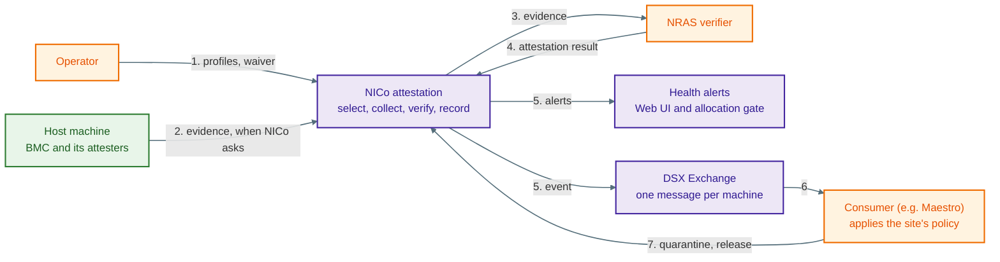
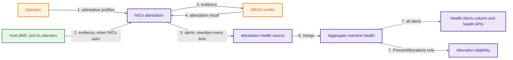

# SPDM Attestation Health Alerts

**Implements:** [dsx-ai-factory/infra-controller#4613](https://github.com/dsx-ai-factory/infra-controller/issues/4613)

**Depends on:** [dsx-ai-factory/infra-controller#7664](https://github.com/dsx-ai-factory/infra-controller/pull/7664), which re-keys attestation from the machine to a job. This document assumes that change has landed.

**Status:** Proposed

## Revision History

| Version | Date       | Modified By       | Description                                            |
| ------- | ---------- | ----------------- | ------------------------------------------------------ |
| 0.1     | 10/15/2026 | Binu Ramakrishnan | Initial version, scoped to issue 4613 only             |
| 0.2     | 10/16/2026 | Binu Ramakrishnan | Rebased onto job-driven attestation, #7664             |
| 0.3     | 10/16/2026 | Binu Ramakrishnan | Restructured around how each system works today        |
| 0.4     | 10/20/2026 | Binu Ramakrishnan | Build the source from results and the current selection |
| 0.5     | 11/09/2026 | Binu Ramakrishnan | Reconciled against the implementation                  |

## 1 Purpose

Three machines look the same in the Health Alerts column today:

- one that attested every attester it has and passed
- one whose attestation failed
- one that was never attested because no profile covers its hardware

A failure shows up only as a generic `Failed` host state that an operator has to open the host to understand. A coverage gap shows up only as a fleet-wide counter that says how many machines are uncovered, not which ones.

This phase makes attestation a health-report source. A failed attester raises an alert, and that alert also blocks tenant allocation. Hardware that had a profile and could not satisfy it raises an alert that does not block allocation. Hardware that no profile covers raises no alert, and §5.4 explains why.

### 1.1 How it fits together

NICo **reports** attestation state. It does not decide what to do about it.

| Who | Does what |
| --- | --- |
| NICo | Collects evidence, gets a result from the verifier, checks that result, records per-attester state, and reports it |
| Operator | Writes the policy that says which outcomes matter |
| Consumer | Reads the state, applies that policy, and calls NICo APIs such as `SetManagedHostQuarantineState` |

Two rules follow.

**Report what happened, not what to do.** NICo says a certificate chain was revoked. It does not say to update firmware or quarantine the machine. Those are policy decisions. If NICo made them too, the same policy would live in two places and drift apart.

**Report each attester.** A consumer might be told "quarantine a machine if two of its attesters fail". It can only apply a rule like that if NICo reports every attester, not just the machine-level rollup. A summary alone would hide information the consumer needs.

This is the whole picture attestation reporting is building toward, across every phase. The event bus, the consumer, and the waiver are all follow-up work (§7). §5 shows the part this phase builds.



The numbers follow one attestation around the loop. An operator writes a profile, NICo attests, the result reaches the health alerts and the bus, and the consumer applies the site's policy by calling NICo back. Both arrows out of NICo are numbered 5 because they are two outputs of the same step, not one after the other.

### 1.2 Current scope

This document covers the part of issue 4613 that can ship as one unit:

- an `attestation` health-report source
- one failure alert per failed attester, which blocks tenant allocation
- coverage alerts where a profile applied but attestation covered less than it asked for, and no alert where no profile applied at all (§5.4)
- storing the few scheduling facts the coverage alerts need

A follow-up design handles the rest: typed failure reasons, the event-bus topic, the API snapshot, and the per-machine waiver. §7 lists both the gaps this leaves and the work that closes them.

## 2 Terms

| Term           | Meaning                                                                                       |
| -------------- | --------------------------------------------------------------------------------------------- |
| SPDM           | Security Protocol and Data Model, the DMTF standard for authenticating a hardware component and collecting signed measurements from it. NICo drives it through the BMC's Redfish interface |
| Attester       | An SPDM-capable component that a machine's BMC reports, such as a GPU or a NIC. Attestation selects, collects, and verifies per attester |
| Profile        | An operator-authored policy, one per hardware class, holding the selection below and carrying a version. The reserved class `any` is the fallback for classes with no profile of their own |
| Selection      | The part of a profile that says which attesters to attest: none of them, all of them, only the IDs matching a pattern, or all except those |
| Scheduling     | The step that decides what to attest. It resolves the machine's hardware class, finds the profile for that class, matches the profile's selection against the attesters the BMC reports, and creates a job if any were selected. It always produces an outcome saying why it scheduled what it did (§5.4) |
| Job            | One scheduling attempt. A job covers the attesters selected for one machine at one moment and carries its own ID |
| Source         | The name a health report is stored under, such as `site-explorer` or `forge-dpu-agent`. A machine holds one report per source, and NICo merges them into the machine's overall health |
| Failure alert  | `SpdmAttestationFailed`, raised once for each selected attester that failed attestation. It blocks tenant allocation (§5.2) |
| Coverage alert | `AttestationNoAttesters` or `AttestationPolicyUnsatisfied`, raised when attestation did not cover what the profile asked for. A machine carries at most one, and it does not block allocation (§5.2) |
| Consumer       | The layer above NICo that applies the site's policy and calls NICo back, for example to quarantine a machine |
| Waiver         | A future per-machine exception that would let an operator accept a failed attestation for one machine. It does not exist yet (§7) |

## 3 How health alerts work today

Every machine stores one health report per source. `site-explorer`, `sku-validation`, and `forge-dpu-agent` are existing sources. NICo merges them into one aggregate report per machine, and a DPU's sources merge into its host's aggregate as well, so a DPU's alerts reach the host it belongs to.

An alert carries an ID, a target, a message, and an optional classification. Its identity is the ID and target together, so several alerts with the same ID coexist as long as their targets differ. The Health Alerts UI renders and filters whatever alert IDs it finds, so adding an ID needs no UI, protobuf, or OpenAPI change.

Two kinds of code read these alerts, and they do not apply the same test.

**Allocation reads an alert's classification.** `is_usable_as_instance` rejects a machine only when one of its alerts carries `PreventAllocations`, so an alert with no classification cannot stop a machine from being handed to a tenant.

**The Managed Hosts view, the admin CLI, the fleet healthy-count metric, and the republisher check only whether a machine has any alerts at all.** To all four, one alert of any kind makes a machine unhealthy. The republisher is the background job that re-sends each host's state to the event bus in case a consumer missed an update; it publishes unhealthy hosts on every sweep and healthy ones only as often as its configured scope allows, which may be never.

So an alert deliberately left unclassified shows its machine as unhealthy to all four while still letting it be allocated. This design raises that kind of alert and changes none of these tests, so a machine with a coverage alert looks unhealthy in all four and stays that way. §6 accepts that, and §5.4 limits it by raising no alert at all where no profile applied.

## 4 How SPDM attestation works today

Nothing runs until `spdm.enabled` is on, and it defaults to `false`.

An operator writes attestation profiles keyed by hardware class, plus a reserved `any` profile that covers classes with no profile of their own.

Scheduling then works in two stages, and which stage decided matters later. It first **resolves a profile**: it looks up the class recorded for the machine's BMC and finds the profile for that class, falling back to `any`. If neither exists, scheduling stops there, because there is no policy to apply. It then **evaluates that profile's selection** against the attesters the BMC reports, which decides which of them to attest.

Either stage can end the attempt, and either way scheduling returns an outcome saying what it decided and why (§5.4). When attesters were selected, it also writes one database row per attester under a new job ID. When none were, it creates no job and no rows.

The SPDM controller then works each row on its own: firmware version, certificate, evidence collection from the BMC, verification by NRAS, appraisal, and finally `Passed`, `Failed`, or `Cancelled`. A machine with eight GPUs has eight of these running independently and possibly at different stages. Asking how a whole job turned out is a single query. Completed jobs are not deleted right away: the newest ten per machine are kept, so a machine can hold rows from several past jobs.

### 4.1 When attestation can start

The host state machine starts attestation at ingestion, before assignment, and at release. The `TriggerMachineAttestation` RPC starts one whenever an operator asks, including on a host sitting idle in `Ready`. Periodic attestation is a stated requirement and is not built yet; when it arrives, attestation can begin in any lifecycle state, including while a host is assigned to a tenant.

That matters for this design. Attestation tied to a lifecycle stage can report failure by moving the host to `ManagedHostState::Failed`, which is what happens today. Attestation that starts while a host is assigned cannot: nothing can usefully move that host, so a health alert is the only thing NICo can produce. Health alerts are therefore the one reporting mechanism that works from every starting point, which is the reason this phase exists.

### 4.2 The subject is a host or DPU

A machine row is either a host or a DPU. Each has its own row and its own BMC, and the attestation tables key on the machine without caring which kind it is.

Starting attestation and carrying it out are done by different code. That is how a DPU gets attested even though the host state machine never attests one:

- **The host state machine starts attestation for hosts only.** It loads its work by excluding every machine whose ID carries the DPU prefix, so a DPU row is never in the set it drives.
- **The `TriggerMachineAttestation` RPC starts it for any machine.** It looks the machine up by ID and uses that machine's own BMC, with no host check. An operator who names a DPU attests that DPU through the DPU's BMC.
- **The SPDM controller carries out whatever was started.** It sweeps every device row that has not completed, with no machine-type filter at all, so it drives a DPU's rows the same as a host's.

So a DPU is attested today whenever an operator asks for it, and reporting in this phase has to work for a DPU subject as well as a host one.

## 5 Deriving health alerts from attestation

The source is named `attestation`. It is what NICo claims about the machine right now, not a log of what each job did. Every update replaces all of its alerts at once. NICo builds the complete list from the coverage alert the stored decision calls for (§5.3), plus one failure alert for each selected attester whose newest finished result counts as a failure, and stores that list over whatever was there before. It never adds or removes a single alert inside an existing report.

A result is finished once it has passed, failed, or been cancelled. Whether it counts as a failure is a different question from whether it is `Failed`, because #7664 lets an operator override a result without rewriting it: a waiver suppresses a stored failure, and an operator failure counts as one even over a stored pass. Both answers come from the single rule the rest of the codebase already uses, so an override reads the same way in a health alert as in the machine's attestation status.

The selection comes from resolving the profile for the machine's hardware class and evaluating it against the attesters the machine has results for.

Each update is therefore self-contained. Each one builds the full list and stores it, so it never has to know which alerts the other (§5.1) left behind, and an update that lands twice produces the same report as one that lands once.

Each update goes on the row of the machine being attested, so a DPU's alerts are stored on the DPU's own row. When the list comes out empty, the source is deleted rather than stored with no alerts in it.



The two arrows numbered 7 share a number because the aggregate feeds both at once. Everything in this diagram already exists except the health source itself: this phase adds the source and the alerts it writes, and the aggregate, the column, and the allocation gate all consume it with no changes of their own.

### 5.1 Why two places update it

Two places update the source, because the two halves of what it reports become known at different moments.

**Scheduling updates it, because the outcomes that most need reporting create no job.** `NoProfile`, `ClassNotRecorded`, `NoAttestersFound`, `PolicyMatchedNothing`, and `AttestationDisabled` all end immediately, with no job and no rows, so there is no later moment for them.

**The SPDM controller updates it as results arrive, because only then do results exist.** Every time a device in the job reaches `Passed`, `Failed`, or `Cancelled`, it rebuilds the source, so a failed attester is reported as soon as it fails rather than waiting on devices still running.

Both build the list the same way, using the rule in §5, so it does not matter which of them updated it last.

An edited profile is the usual reason to trigger again, so the selection often changes, and per-attester scheduling ([#4488](https://github.com/dsx-ai-factory/infra-controller/issues/4488)) will make that routine. The report covers only the attesters the current profile selects, so one it no longer selects stops being reported, whether or not an earlier job found a failure on it (§5.5).

### 5.2 Alert IDs

| Alert ID                       | Raised when                                         | Target                      | Classification       |
| ------------------------------ | --------------------------------------------------- | --------------------------- | -------------------- |
| `SpdmAttestationFailed`        | Each selected attester whose newest finished result counts as a failure (§5) | Attester ID | `PreventAllocations` |
| `AttestationNoAttesters`       | `NoAttestersFound`                                  | Hardware class, if recorded | None                 |
| `AttestationPolicyUnsatisfied` | `PartiallySatisfied` or `PolicyMatchedNothing`      | Hardware class, if recorded | None                 |

A machine can carry several `SpdmAttestationFailed` alerts at the same time, one for every attester that failed. They stay separate instead of merging into one, because an alert is identified by its ID and its target together, and each of these targets a different attester.

The other two IDs behave the opposite way. A machine carries at most one of them, because each comes from a single scheduling decision rather than from a device. There is no component for such an alert to point at, so it targets the hardware class instead. These two are the coverage alerts (§2).

Both kinds can appear together. `PartiallySatisfied` still schedules the attesters that did match, so a machine can carry a coverage alert for the pattern that matched nothing and a failure alert for each scheduled attester that then failed. They answer different questions: one is about what the profile asked for, the other about what a device reported.

Messages explain the decision rather than repeat the alert ID. A coverage alert names the profile that applied, the requirement that went unsatisfied, and the profile version, so an operator can see which revision decided. A failure alert carries the stored failure text as its message, which this phase neither categorizes nor caps.

### 5.3 Storing what scheduling decided

Scheduling works out the outcome, the hardware class, the profile version, whether the `any` profile supplied the policy, and which requirement went unsatisfied. It returns the first four to its caller, logs the fifth, and writes none of them down. The result updates need them to build a coverage alert, and an operator needs them to ask which machines are uncovered.

So scheduling stores them on the machine, in one nullable `jsonb` column rewritten in full on every run. Latest decision only, no history. A machine that has never been scheduled has `NULL`. The record also names the job it created.

It is stored rather than worked out later, for two reasons. The outcome depends on which attesters the BMC reported at that moment, and that list is never kept. And `attestation_profiles` holds one row per hardware class with no history, so a later lookup returns whatever that profile says at the time of the lookup, not the revision that decided.

It is stored on the machine rather than on the job because five of the seven outcomes in §5.4 create no job, so for those there would be no job to attach it to.

The migration is one statement, additive, and applies while a `nico-api` instance is still writing:

```sql
-- Records what attestation scheduling decided, so health alerts can be built
-- from it. The decision depends on which attesters the BMC reported at the
-- time, and those are not stored, so it cannot be derived from the profile.
ALTER TABLE machines
    ADD COLUMN attestation_scheduling jsonb;
```

The column holds one object with the same six keys every time. A value that does not apply is `null` rather than a missing key.

| Key                 | Type              | Value                                                                                                     |
| ------------------- | ----------------- | --------------------------------------------------------------------------------------------------------- |
| `outcome`           | string            | One of the seven outcomes in §5.4, spelled as the enum is                                                 |
| `hardware_class`    | string or `null`  | The class recorded for the machine's BMC, in `<manufacturer>_<model>` form. `null` when none is recorded  |
| `used_any_fallback` | boolean           | Whether the reserved `any` profile supplied the policy                                                    |
| `profile_version`   | string or `null`  | The version of the profile that decided, in `V<number>-T<microseconds>` form. `null` when none applied    |
| `unsatisfied`       | see below         | Which requirement went unsatisfied. `null` for the five outcomes that satisfied one or applied none       |
| `job_id`            | string or `null`  | UUID of the job this attempt created. `null` when it created none                                         |

`unsatisfied` is what lets a coverage alert name the requirement (§5.2) rather than only the class. It is set for the two outcomes that raise `AttestationPolicyUnsatisfied`, and holds `UnsatisfiedRequirement` as serde tags it externally, so it takes one of two shapes:

- `{"allowlist_patterns": [{"exact": "HGX_ERoT_GPU_7"}]}` when patterns matched no eligible attester
- `"denylist_excluded_everything"` when a denylist removed every attester the BMC offered

`PartiallySatisfied` carries a bare pattern list rather than an `UnsatisfiedRequirement`. Those patterns come from the allowlist, so they are stored under `allowlist_patterns`.

`hardware_class` is `null` when no class was recorded. The proto response reports that same case as an empty string, and this record does not copy that.

A machine whose profile named an attester the BMC did not offer, with the ones that did match scheduled anyway:

```json
{
  "outcome": "PartiallySatisfied",
  "hardware_class": "nvidia_dgx-h100",
  "used_any_fallback": false,
  "profile_version": "V7-T1760631000000000",
  "unsatisfied": { "allowlist_patterns": [{ "exact": "HGX_ERoT_GPU_7" }] },
  "job_id": "7c3f1f0e-1d2a-4f7b-9a21-0b5e3c8d41a6"
}
```

A machine whose class has no profile. It raises no alert (§5.4), so this record is what answers the uncovered-machines query:

```json
{
  "outcome": "NoProfile",
  "hardware_class": "nvidia_mgx-power-shelf",
  "used_any_fallback": false,
  "profile_version": null,
  "unsatisfied": null,
  "job_id": null
}
```

Nothing else in this phase changes the schema. Health reports already live in `machines.health_reports`, which holds one report per source, so a new source is one more entry in it. The queries these updates need already exist, keyed by job.

### 5.4 Which alert each outcome raises

Scheduling always ends in one of seven outcomes. Four of them raise no alert, and the rest of this section is about why.

| Outcome                | Decided by         | Meaning                                                                             | Alert                          |
| ---------------------- | ------------------ | ----------------------------------------------------------------------------------- | ------------------------------ |
| `Scheduled`            | Selection          | Every selected requirement was satisfied and a job was created                       | None                           |
| `PartiallySatisfied`   | Selection          | Some allowlist patterns matched nothing; the matched attesters were still scheduled | `AttestationPolicyUnsatisfied` |
| `PolicyMatchedNothing` | Selection          | A requirement the operator wrote matched nothing, leaving nothing to attest         | `AttestationPolicyUnsatisfied` |
| `NoAttestersFound`     | Selection          | A profile applied, but the BMC offered no eligible attester                         | `AttestationNoAttesters`       |
| `AttestationDisabled`  | Selection          | The applicable profile uses `mode: NONE`                                            | None                           |
| `ClassNotRecorded`     | Profile resolution | Exploration has recorded no hardware class, and no `any` profile applied            | None                           |
| `NoProfile`            | Profile resolution | A class was recorded, but neither it nor `any` has a profile                        | None                           |

`Scheduled` has nothing to report, and `AttestationDisabled` is an operator's decision rather than a gap.

`NoProfile` and `ClassNotRecorded` raise no alert **in this phase**, which narrows what issue 4613 describes. The issue asks for a label when attestation did not cover what the policy asked for, and in these two cases no policy applied at all.

It also avoids a fleet-wide effect. At a site that enables SPDM before writing any profile, every machine lands on one of these two outcomes, and most surfaces read emptiness rather than classifications (§3). An alert on each machine would show the whole fleet as unhealthy while leaving it allocatable.

Uncovered machines are still findable: the stored decision (§5.3) records the outcome on every machine, so which ones are uncovered is a query. An `AttestationNotCovered` alert can be added later if that is not enough.

### 5.5 Clearing alerts

No alert is ever cleared on its own. Each update replaces the whole source (§5), so an alert goes away by not being in the next one.

- **Starting a job clears nothing.** A job that has not yet finished an attester leaves that attester's newest finished result unchanged, so a failure stays reported while that attester is attested again.
- **A profile change can clear an alert.** An attester the profile no longer selects drops out of the report at the next update, even though its failed result is still recorded.
- **An operator override changes an alert without a new result.** A waiver drops that attester's failure alert at the next update, and an operator failure raises one. Neither rewrites the stored result, so the override and the result it overrides both survive.

An attestation that creates no job updates the report once, at scheduling, since no result ever follows. It selects no attester, so it reports no failure alert.

So a failure alert clears when that attester is attested again and passes, when a profile stops selecting it, or when an operator waives it. Not when an operator fixes the machine, and not merely because a new job started.

**A missing alert does not mean the problem is fixed.** An operator can narrow an allowlist so NICo no longer attests a given attester. The next job does not select it, so its earlier failure disappears from the report even though nothing changed on the machine. That is intended, because NICo should not keep making claims about an attester it is not attesting. But a missing failure means "NICo is not claiming anything right now", not "the problem is fixed".

## 6 Decisions and consequences

**Only failure alerts block allocation.** A failed attestation did not show that the machine is safe to hand to a tenant, so NICo refuses to allocate it. A coverage alert reports a gap between the profile and the hardware rather than a bad result from a device, so the problem is in the profile or the inventory. Blocking on it would make a newly racked hardware class unallocatable over a configuration mistake.

Blocking allocation rarely matters today. A host that fails attestation already stops in `ManagedHostState::Failed`, so it never joins the pool at ingestion and never reaches cleanup at release. The alert only stops a machine that is already `Ready` from being picked.

**A coverage alert still shows as unhealthy.** Such a machine is neither healthy nor unhealthy: nothing found a bad device, and nothing verified it either. Health reports have no third value for that, so the alert reads as unhealthy to a person while the machine stays allocatable. Raising no alert where no profile applied (§5.4) is what keeps this from reaching a whole fleet.

**Nothing happens until SPDM is on.** `spdm.enabled` defaults to `false` and gates every trigger point, so a site that has not enabled SPDM sees no new alerts and nothing stored. Everything above applies only to sites that have it on.

## 7 Not in this phase

These are known gaps, listed so nobody expects more from the Health Alerts column than it delivers.

**There is no per-machine override.** The only ways out of a failed attestation are attesting that attester again and passing, or removing it from the profile, which affects every machine of that hardware class. A per-machine waiver is follow-up work.

**Turning `spdm.enabled` off does not clear a failure alert.** Today it is an escape hatch: the recovery handler returns the host from `ManagedHostState::Failed` to its measuring state, which then skips, and the host reaches `Ready`. Once this phase ships, nothing erases a stored failure alert, and `is_usable_as_instance` never reads the SPDM config, so the machine leaves `Failed` and stays unallocatable. An operator has to clear it by attesting again, which the flag now blocks. Clearing attestation alerts when the flag goes off is follow-up work.

**Failure text stays unstructured.** Two very different failures read the same to software: a device whose evidence the verifier rejected, and a verifier NICo could not reach. A person can read the message and tell them apart. A program cannot match on it safely. Typed failure categories and reasons are follow-up work, and they can improve the message without changing the alert ID, target, or classification this phase establishes.

**A green column does not prove verification happened.** When the Redfish driver cannot read an attester's firmware version, the pipeline records that attester as `Passed` without fetching a certificate, collecting evidence, or calling the verifier. The default `libredfish` implementation answers that way for every component, so on a BMC with no vendor driver every selected attester passes this way and the outcome still says `Scheduled`. This phase reports those machines as healthy because that is what the pipeline decides. Changing it turns them into failures, which cannot ship before the waiver.

**Uncovered machines look the same in the column.** A machine whose class has no profile raises no alert (§5.4), so it looks like one that attested everything. The stored decision and the scheduling metric answer that question instead.

**Nothing reaches the event bus.** A consumer has to read the API. The attestation event topic, and the API snapshot and revision that go with it, are follow-up work.

**A long-lived coverage alert republishes a host on every sweep.** The republisher re-sends each host's state on a timer so a consumer that missed a transition can self-heal, and it puts a host with any alert on every sweep instead of the slower healthy cadence. A coverage alert can last for days, so a mismatched hardware class takes the fast path the whole time while its state never changes. Any long-lived alert from any source does this. The fix is not to skip unchanged payloads, which is what the republisher exists to send; it is to pace on how recently a host's state changed rather than on whether it has an alert. That needs its own issue against the republisher.

**Scheduling stays per machine.** #7664 makes attestation job driven, and a later change will let an operator schedule a single attester instead of the whole machine, tracked by [dsx-ai-factory/infra-controller#4488](https://github.com/dsx-ai-factory/infra-controller/issues/4488). Two things here assume one decision covers the machine: §5.3 stores a single decision per machine, and §5.2 allows at most one coverage alert on it. Both need revisiting when that change lands.

**A review proposal would replace `Failed` with a Wait substate.** A failed attestation moves the host to a generic `ManagedHostState::Failed`, and a recovery handler reconstructs where to send it back by resolving the profile again and re-evaluating the selection. Design review proposed parking the host at the attestation point that failed instead, as `Trigger -> Poll -> (Wait if failed) -> next state`, so the return path needs no reconstruction. It is not tracked anywhere yet, and it was written against pre-job-driven attestation, so it needs revisiting against #7664.

## 8 Implementation

Five steps, each one commit. Four have landed; the result update remains.

| #   | What lands                                                                                            | Crates                                                | Status      |
| --- | ------------------------------------------------------------------------------------------------------ | ----------------------------------------------------- | ----------- |
| 1   | `attestation_scheduling` column and the record type, plus `ATTESTATION_SOURCE`, the three alert IDs, and the alert constructors | `api-db` migration, `api-model`, `health-report` | Landed      |
| 2   | `update_attestation_health_report`, the builder that turns a stored decision and the stored results into the whole list, and the alert IDs in [`health_probe_ids.md`](../../architecture/health/health_probe_ids.md) | `api-db`, `api-model`, documentation | Landed      |
| 3   | Scheduling recording what it decided                                                                  | `machine-controller`, `api-core`                      | Landed      |
| 4   | Scheduling storing the report on the transaction that records the decision                            | `machine-controller`                                  | Landed      |
| 5   | The result update, which rebuilds the same list each time a device finishes                           | `spdm-controller`                                     | Outstanding |

**Step 1 is the only migration**, and it is additive with nothing reading the column yet, so it stands alone. It also moves `SchedulingOutcome` from `machine-controller` to `api-model`, because `spdm-controller` has to read the outcome back in step 5 and both crates already depend on `api-model`. `api-model` already depends on `carbide-instrument`, so the enum keeps its `carbide_instrument::LabelValue` derive through the move and the metric label keeps the same seven strings. `UnsatisfiedRequirement` gains serde derives for the `unsatisfied` key (§5.3).

**Steps 1 and 2 add library functions before their caller exists.** Both are library crates, so neither widens visibility for the sake of it.

**One write point covers both trigger paths.** They do not share an entry point: the `TriggerMachineAttestation` RPC calls `trigger_attestation`, while the state machine calls `schedule` directly, because it has a machine transition to persist alongside the new job. Both reach `schedule`, which records the decision and stores the report on one transaction its caller commits, so the RPC needs nothing of its own.

**Every step is gated by `spdm.enabled`.** Nothing here changes behavior for a site that has not turned SPDM on, and nothing changes behavior for another health source.

## 9 Testing

| Proof                                                                                                                                 | Where                                  |
| --------------------------------------------------------------------------------------------------------------------------------------- | -------------------------------------- |
| Each of the seven scheduling outcomes raises the alert §5.4 lists for it, including the four that raise none                         | `api-model` tests                      |
| With SPDM on and no profiles written, no machine carries an attestation alert                                                        | `api-core` integration test            |
| Each failed attester gets its own `SpdmAttestationFailed` alert, targeted at that attester and carrying `PreventAllocations`         | `spdm-controller` tests                |
| Each device result rebuilds the whole list: the coverage alert from the stored decision, plus one failure alert per failed attester  | `spdm-controller` tests                |
| A failed attester is reported while other devices in the job are still running                                                       | `spdm-controller` tests                |
| A failed attester on a DPU stores its alert on the DPU's row and blocks allocation of the DPU's host                                 | `api-core` integration test            |
| A machine with a failed older job and a passed newer job reports only the newer result                                               | `spdm-controller` tests                |
| A result arriving from an older job while a newer one is running still produces the correct list                                     | `spdm-controller` tests                |
| A coverage alert on a machine with no recorded hardware class has no target                                                          | `api-model` tests                      |
| An `AttestationPolicyUnsatisfied` message names the unsatisfied requirement, for both an allowlist pattern and a denylist that excluded everything | `api-model` tests          |
| Coverage alerts do not prevent allocation                                                                                            | `api-core` health aggregation tests    |
| An attestation with no alerts to report deletes the source instead of storing an empty one                                           | `api-core` health aggregation tests    |
| The trigger RPC updates the source just as a state-machine trigger does                                                             | `api-core` integration test            |
| Scheduling a new job keeps the failure alert for an attester it selects again, and drops it for one the new profile excludes        | `api-core` integration test            |
| A failure alert survives while that attester is attested again, and clears only when the new result passes                          | `spdm-controller` tests                |
| The `attestation` source merges with `site-explorer` and `forge-dpu-agent` without replacing either                                  | `api-core` health aggregation tests    |
