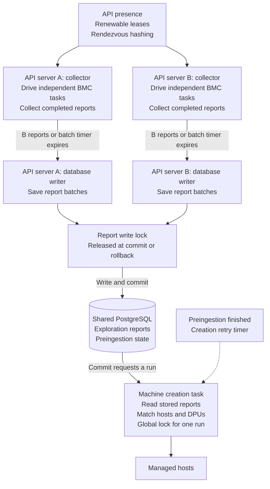
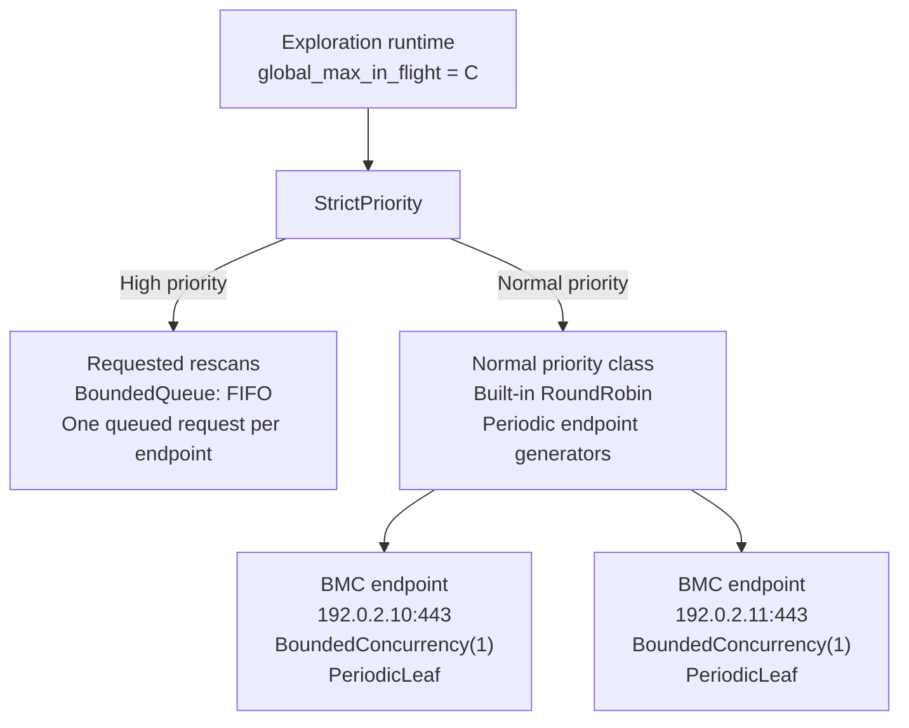

# Barrier-Free Site Exploration

**Status:** Proposed. **Issue:** [#5963](https://github.com/dsx-ai-factory/infra-controller/issues/5963).

## Problem

Site Explorer waits for every exploration in a run. It saves reports and starts
machine creation only when the run is complete. One BMC that does not respond
can hold up work for the whole site.

[PR #6040](https://github.com/dsx-ai-factory/infra-controller/pull/6040) proposed
a fixed exploration deadline to solve #5963. That deadline could stop slow
explorations that would finish.

## Solution

1. The collector drives the nv-redfish dispatcher to run independent BMC tasks
   in parallel. It receives exploration reports as their tasks finish.
2. The collector groups completed reports into batches. It sends a batch to a
   separate database writer when the report count limit is reached or the batch
   timer expires.
3. The writer commits the batch and requests machine creation. A separate task
   reads all stored reports with completed preingestion and creates managed hosts.

The collector keeps polling the dispatcher while the writer and creation task
work. A slow BMC occupies one dispatcher slot. Reports from finished tasks can
still be saved, and free slots can start other BMC tasks.

See [Appendix B](#appendix-b-behavior-changes) for a summary of behavior changes.



### Exploration reports

A completed endpoint task returns a `Report` message. The task includes the BMC
scan and any recovery actions. The message contains:

- Hardware data or an exploration error.
- The BMC address.
- The report version read before exploration, if a stored report exists.
- Recovery action times, if recovery was performed.

A failed scan still returns `Some(Report)`. A skipped scan returns `None`.
The writer keeps earlier hardware data when a new scan fails.

## Dispatcher

### Settings

| Name | Meaning |
| --- | --- |
| **C** | Maximum number of endpoint tasks the dispatcher runs in parallel on one API server. Each task includes scanning and recovery. |
| **B** | Maximum number of exploration reports in one batch. |
| **T** | Maximum time the collector waits to collect reports for one batch. |

The collector chooses **T** from recent exploration report arrival times.
Its maximum value must be much smaller than `site_explorer.run_interval`.
See [Appendix A](#appendix-a-choosing-t).

### Scheduler tree

This is the scheduler inside one API server. The leaf generators scan two example
BMC endpoints at `192.0.2.10:443` and `192.0.2.11:443`.



- **Periodic scans:** use one `PeriodicLeaf` per assigned endpoint. Set its period
  to `site_explorer.run_interval`. Wrap it in `BoundedConcurrency(1)` to allow one
  running scan. Add the generator to the normal priority class of `StrictPriority`.
  Its `RoundRobin` picks generators in turn.
- **Requested rescans:** use a bounded FIFO queue with one queued request per
  endpoint. `StrictPriority` gives this queue higher priority. Running scans continue.

### Scan interval

The current `run_interval` applies to the whole Site Explorer run. This design
uses the same interval for each endpoint. A slow BMC no longer delays the next
scan of a fast BMC, so fast BMCs may receive more requests.

Example with a 120-second interval and a free dispatcher slot:

| Scan and recovery duration | Earliest next scan | Reason |
| --- | --- | --- |
| 20 seconds | 120 seconds from the previous start | The interval ends. |
| 180 seconds | 180 seconds from the previous start | The running scan must finish. |

### Exploration steps

1. Try to mark the endpoint as busy using the existing local guard.
   Checking and marking must happen as one operation.
2. Return `None` if the endpoint is busy.
3. Explore the BMC.
4. Run recovery if the scan error or the report's `remediation_error` requires it
   and the existing checks allow it.
5. Release the guard and return `Some(Report)`.

`RefreshEndpointReport` uses the same guard. A busy rescan request is skipped;
it does not require another scan when the current scan finishes.
The dispatcher and `BoundedConcurrency(1)` free their slots automatically.

### Recovery actions

Recovery runs in the same task as the scan, under the same local guard.
Read current endpoint state before recovery. Keep the existing checks for paused
recovery, preingestion, created managed hosts, and reset limits. Skip recovery if
the stored report was changed, inserted, or deleted since the scan started.

Return the scan's report or error; recovery does not make a failed scan successful.
The next scan checks the effect of recovery. Scanning and recovery occupy one
dispatcher slot. The report from this endpoint waits for recovery to finish.
Other endpoint tasks and the writer continue.

Recovery can run before the writer accepts the report. This changes the current
order: rejecting a report cannot undo a BMC action. Version checks still protect
report writes.

Keep recovery action times in memory when the endpoint has no database row or a
timestamp write fails. Save those times with report writes, including the first
insert, so reset limits still work. The writer does not call BMCs.

## Collector

The collector polls `Runtime::next()` in one Tokio task. This drives the
dispatcher: it starts ready endpoint tasks and polls running tasks.
Use `select!` to handle `SleepUntil` and the batch timer while explorations keep
running.

### Collect reports

1. Ignore `None`.
2. Add each `Some(Report)` to the batch and record its arrival time.
3. Choose **T** and start the batch timer when the first report arrives.

### Send a batch

Send the batch to the writer when either condition is met:

- The batch contains **B** exploration reports.
- The batch timer ends. Send the reports collected so far.

The collector keeps polling while the writer saves the batch.
**B** can be larger than **C**.

## Writer

### Report write lock

All API writers use the same lock. Only one report write transaction can run at
a time. Reports for different BMCs can use the same
[attester inventory entries](../attestation/attestation-profiles.md#75-the-attester-inventory).
Serial writes prevent deadlocks between report writers.

### Write steps

1. Begin a database transaction.
2. Take one global PostgreSQL advisory lock.
3. Save each exploration report under its version check. An initial insert must
   return whether it added the row. Keep the existing firmware and attester
   writes in this transaction. Roll back those writes if the report was rejected.
4. Commit. Commit or rollback releases the report write lock.
5. Request a machine creation run.

`RefreshEndpointReport` takes the same lock when saving a report.
Retry a batch if the transaction failed. Keep the original report versions.
Discard reports rejected by the version or insert checks.

## Machine creation

Each API runs a new machine creation Tokio task. The task owns a periodic retry
timer with period `site_explorer.run_interval`.

### Run triggers

- A batch has been committed.
- Preingestion has finished for an endpoint.
- The task's retry timer fires.

### Waiting for a trigger

The batch writer and the preingestion task send local notifications with
`Notify::notify_one()`. The creation task waits for a notification or its retry
timer using `select!`. A notification received during a run leaves one more run
pending.

The timer starts a run even without a notification. The run reads the database
again to retry machine creation and find changes made by another API.
If another API holds the creation work lock, skip this attempt and wait for
another trigger.

### Run steps

1. Take the global work lock for machine creation.
2. Read **all stored reports with completed preingestion**.
3. Match hosts with DPUs using the existing rules.
4. Create hosts that pass the existing checks for required refreshes and host/DPU data.
5. Release the work lock.

### Existing BMC checks

The first version keeps the current power checks, Lenovo setup, DPU mode changes,
and host powercycles inside the creation task. One BMC can delay creation of other
hosts. Exploration and report writes continue while the creation task waits.

Moving these checks into independent host preparation steps needs a separate
design. The current preingestion runner also waits for all endpoint jobs in a
run; moving calls there alone would keep another barrier.

## Multiple APIs

Each API with Site Explorer enabled has a coordinator for its endpoint list.

### Registration

1. Generate an instance UUID at process startup.
2. When Site Explorer is enabled, create a `work_locks` entry named `api-presence/<uuid>`.
3. Renew the entry with the existing keepalive.

Expired entries are excluded from the active API list.
Add registration code and a query for active API UUIDs.

Disabling Site Explorer releases the registration and stops new scans.
Running tasks finish. Enabling it again registers the same instance UUID.

### Coordinator timing

1. API registration triggers the first endpoint assignment immediately.
2. Use a separate Tokio task to reload active API UUIDs, endpoints, and endpoint
   filters every `site_explorer.run_interval`.
3. Repeat assignment only when these lists or filters change.

The coordinator runs independently of scans, report writes, and machine creation.
New endpoints and APIs are detected on the next successful reload. A failed API's
endpoints move when a reload detects its expired registration.
If a database query fails, keep the previous assignment and retry on the next
timer tick.

### Endpoint assignment

1. Read the active API UUIDs.
2. For each endpoint, compute `hash(BMC MAC, API UUID)` for every active API.
3. Assign the endpoint to the API with the highest value. This is rendezvous hashing.
4. Add or remove generators to match the assignments and existing endpoint filters.
   Let running explorations finish.

All APIs use the same hash function.
Add support to remove generators from `StrictPriority`; adding them already works.

The busy guard works inside one API process. Assignment changes can cause two
APIs to scan the same BMC. Version checks allow only one report from attempts
that used the same original version.

Host and DPU reports can come from different APIs. Machine creation reads their
shared database.

## Future work

Scan report sections separately. Track when each section was last updated.

## Appendix A: Choosing T

**T** is how long the collector waits for more reports in a batch.
A short **T** sends reports sooner. A longer **T** can produce larger batches.

### Keep an arrival window

Each API's collector stores the last **B** report arrival timestamps.

1. Add a timestamp for each `Some(Report)`. Ignore `None`.
2. Remove the oldest timestamp when the window contains more than **B** entries.
3. Keep this window when sending batches, including batches with fewer than **B**
   reports.

Start a new window if an idle pause with no endpoint tasks running separates
report arrivals. This excludes the wait for the next periodic scan.
Use a short default **T** until the window contains **B** timestamps.

### Calculate T

1. Use the first timestamp as the start of the window.
2. Build an array of durations: `durations[i] = timestamps[i] - timestamps[0]`.
   The first duration is zero.
3. Take the 80th percentile of this array.
4. Keep **T** between the minimum and maximum wait. Use a small positive minimum;
   keep the maximum much smaller than `site_explorer.run_interval`.

Timestamps are stored in arrival order, so the durations are already sorted.
Round `0.8 * B` up to a whole number for the position, counting from one.
Subtract one for the array index: `ceil(0.8 * B) - 1`.

Example with **B = 5**, using seconds:

```text
timestamps = [0.0, 0.1, 0.2, 0.4, 2.0]
durations  = [0.0, 0.1, 0.2, 0.4, 2.0]
index      = 3
T          = durations[3] = 0.4 seconds
```

Four of these five reports arrived within **0.4 seconds** of the first report.
Choose **T = 0.4 seconds** if the wait limits allow it.
Use 80% as a starting point for testing; future batches may contain fewer than
**B** reports.

### Use T for a batch

1. Choose **T** and start the timer when the first report enters the batch.
2. Keep this timer unchanged. New report arrivals affect **T** for the next batch.
3. Send the batch when it has **B** reports or the timer expires.

If **B** is one, send each report immediately.
**T** limits waiting in the collector. Database writes may take longer.
Explorations continue while the batch timer runs.

## Appendix B: Behavior changes

| Area | Current behavior | Proposed behavior |
| --- | --- | --- |
| Report publication | Wait for every exploration in the site run. | Save batches of up to **B** completed reports. Send fewer reports when **T** expires. Choose **T** from recent report arrival times. |
| Routine scan selection | Select endpoints for each run under the `explorations_per_run` budget. | `RoundRobin` selects ready endpoint generators. No site-wide run budget. |
| Scan interval | The interval applies to the whole site run. | Each endpoint has its own interval. Fast BMCs may be scanned more often. |
| Requested rescans | Priority requests wait for a site run. | The priority queue supplies work when a dispatcher slot is free. A busy endpoint is skipped without requiring another scan. |
| Recovery | Run recovery sequentially for committed reports. | Run scan and recovery in one endpoint task, under one local guard and one dispatcher slot. That endpoint's report waits for recovery. |
| Recovery and report acceptance | Rejecting a report prevents its recovery. | Recovery may happen before the writer rejects the report or a write fails. Read current endpoint state and check the version before recovery. |
| Multiple APIs | A global work lock allows one site run at a time. | APIs register and divide endpoints by hashing. Expired API registrations cause reassignment. Each API can run **C** dispatcher tasks in parallel, including recovery. |
| Global locks | The iteration lock covers exploration and machine creation; direct report refreshes run outside it. | All report writers share a lock for one transaction. Machine creation uses a separate work lock. Exploration runs outside both locks. |
| Failed batch write | A failed run drops its collected reports; later runs scan again. | Keep the batch and retry the write without repeating its BMC scans. |
| Conflicting initial insert | The caller cannot tell whether the insert added a row. Related writes can continue. | Detect a rejected insert and roll back its related writes. |
| Machine creation triggers | Creation waits for exploration and recovery in the site run. | A separate task starts on commit, preingestion completion, or its retry timer. Notifications received during a run leave one more run pending. |
| Machine creation rate | `machines_created_per_run` limits creation in each site run. | The same limit applies to each creation run. More frequent runs can create more machines per minute. |

Machine creation still reads all stored reports with completed preingestion and
uses the existing host/DPU rules. Its live BMC checks can still delay other hosts.
Exploration and report writes continue while the creation task waits.
