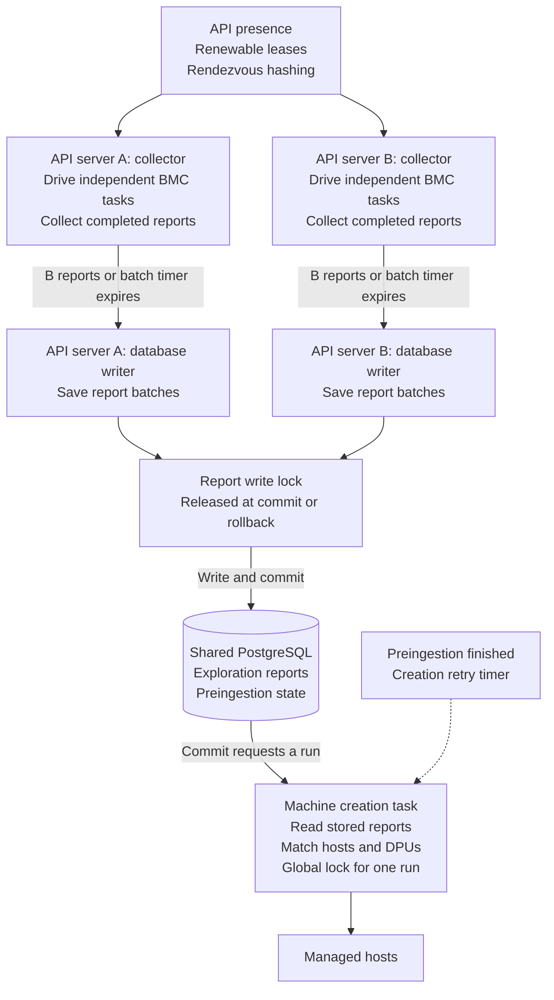
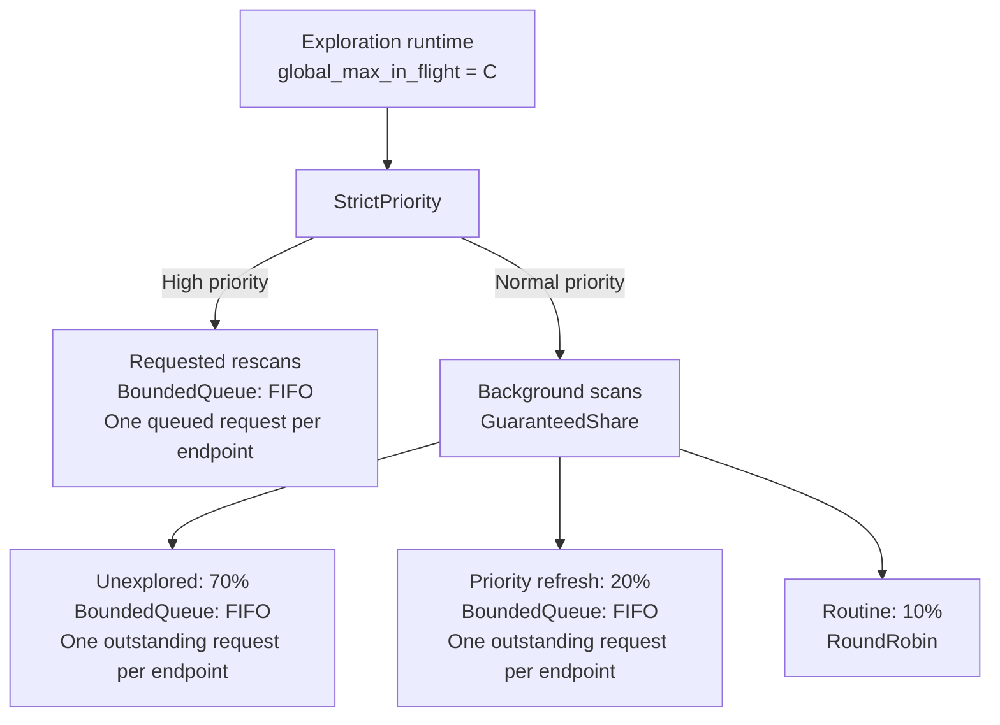

# Barrier-Free Site Exploration

**Status:** Proposed. **Issue:** [#5963](https://github.com/dsx-ai-factory/infra-controller/issues/5963).

## Problem

Site Explorer waits for every exploration in a run. It saves reports and starts
machine creation only when the run is complete. One BMC that does not respond
can hold up work for the whole site.

[PR #6040](https://github.com/dsx-ai-factory/infra-controller/pull/6040) proposed
a fixed exploration deadline to solve #5963. That deadline could stop slow
explorations that would finish.

## Solution

1. The collector drives the nv-redfish dispatcher to run independent BMC tasks
   in parallel. It receives exploration reports as their tasks finish.
2. The collector groups completed reports into batches. It sends a batch to a
   separate database writer when the report count limit is reached or the batch
   timer expires.
3. The writer commits the batch and requests machine creation. A separate task
   reads all stored reports with completed preingestion and creates managed hosts.

The collector keeps polling the dispatcher while the writer and creation task
work. A slow BMC occupies one dispatcher slot. Reports from finished tasks can
still be saved, and free slots can start other BMC tasks.

See [Appendix B](#appendix-b-behavior-changes) for a summary of behavior changes.



### Exploration reports

A completed endpoint task returns a `Report` message. The task includes the BMC
scan and any recovery actions. The message contains:

- Hardware data or an exploration error.
- The BMC address.
- The report version read before exploration, if a stored report exists.
- Recovery action times, if recovery was performed.

A failed scan still returns `Some(Report)`. A skipped scan returns `None`.
The writer keeps earlier hardware data when a new scan fails.

## Dispatcher

### Settings

| Name | Meaning |
| --- | --- |
| **C** | Maximum number of endpoint tasks the dispatcher runs in parallel on one API server. Each task includes scanning and recovery. |
| **B** | Maximum number of exploration reports in one batch. |
| **T** | Maximum time the collector waits to collect reports for one batch. |

The collector chooses **T** from recent exploration report arrival times.
Its maximum value must be much smaller than `site_explorer.run_interval`.
See [Appendix A](#appendix-a-choosing-t).

### Scheduler tree

This is the scheduler inside one API server.



- **Routine scans:** use one `PeriodicLeaf` per routine endpoint. Set its period
  to `site_explorer.run_interval`. Wrap it in `BoundedConcurrency(1)` to allow one
  running scan. Use `RoundRobin` across these generators.
- **Unexplored:** use a bounded FIFO queue for endpoints with no stored report.
- **Priority refresh:** use a bounded FIFO queue for endpoints with
  `waiting_for_explorer_refresh = true`, regardless of preingestion state.
- **Background shares:** `GuaranteedShare` divides starts between unexplored,
  priority refresh, and routine work, and lends unused shares in that order.
  See [Appendix C](#appendix-c-guaranteedshare-scheduler).
- **Requested rescans:** use a bounded FIFO queue with one queued request per
  endpoint. `StrictPriority` gives this queue higher priority. Running scans continue.

Unexplored and priority refresh requests do not wait for the periodic interval.
Keep one outstanding request per endpoint until the writer commits or rejects
its report. `take_next()` removes the request from the FIFO, but the outstanding
marker prevents coordinator reloads from adding it again while its scan or
report write is pending. After the writer commits or rejects the report, clear
the marker. The writer does not enqueue another scan. The next coordinator
reload reads the endpoint state and updates its queue or routine generator.
If a queue is full, retry admission on the next coordinator reload.

### Scan interval

The current `run_interval` applies to the whole Site Explorer run. This design
uses the same interval for each routine endpoint generator. Unexplored,
priority refresh, and explicit rescan requests bypass this interval. A slow BMC
no longer delays the next scan of a fast BMC, so fast BMCs may receive more requests.

Example with a 120-second interval and a free dispatcher slot:

| Scan and recovery duration | Earliest next scan | Reason |
| --- | --- | --- |
| 20 seconds | 120 seconds from the previous start | The interval ends. |
| 180 seconds | 180 seconds from the previous start | The running scan must finish. |

### Exploration steps

1. Try to mark the endpoint as busy using the existing local guard.
   Checking and marking must happen as one operation.
2. Return `None` if the endpoint is busy.
3. Explore the BMC.
4. Run recovery if the scan error or the report's `remediation_error` requires it
   and the existing checks allow it.
5. Release the guard and return `Some(Report)`.

`RefreshEndpointReport` uses the same guard. A busy rescan request is skipped;
it does not require another scan when the current scan finishes.
The dispatcher and `BoundedConcurrency(1)` free their slots automatically.
Unexplored and priority refresh use the same guard, but keep their requests
pending if the endpoint is busy.

### Recovery actions

Recovery runs in the same task as the scan, under the same local guard.
Read current endpoint state before recovery. Keep the existing checks for paused
recovery, preingestion, created managed hosts, and reset limits. Skip recovery if
the stored report was changed, inserted, or deleted since the scan started.

Return the scan's report or error; recovery does not make a failed scan successful.
The next scan checks the effect of recovery. Scanning and recovery occupy one
dispatcher slot. The report from this endpoint waits for recovery to finish.
Other endpoint tasks and the writer continue.

Recovery can run before the writer accepts the report. This changes the current
order: rejecting a report cannot undo a BMC action. Version checks still protect
report writes.

Keep recovery action times in memory when the endpoint has no database row or a
timestamp write fails. Save those times with report writes, including the first
insert, so reset limits still work. The writer does not call BMCs.

## Collector

The collector polls `Runtime::next()` in one Tokio task. This drives the
dispatcher: it starts ready endpoint tasks and polls running tasks.
Use `select!` to handle `SleepUntil` and the batch timer while explorations keep
running.

### Collect reports

1. Ignore `None`.
2. Add each `Some(Report)` to the batch and record its arrival time.
3. Choose **T** and start the batch timer when the first report arrives.

### Send a batch

Send the batch to the writer when either condition is met:

- The batch contains **B** exploration reports.
- The batch timer ends. Send the reports collected so far.

The collector keeps polling while the writer saves the batch.
**B** can be larger than **C**.

## Writer

### Report write lock

All API writers use the same lock. Only one report write transaction can run at
a time. Reports for different BMCs can use the same
[attester inventory entries](../attestation/attestation-profiles.md#75-the-attester-inventory).
Serial writes prevent deadlocks between report writers.

### Write steps

1. Begin a database transaction.
2. Take one global PostgreSQL advisory lock.
3. Save each exploration report under its version check. An initial insert must
   return whether it added the row. Keep the existing firmware and attester
   writes in this transaction. Roll back those writes if the report was rejected.
4. Commit. Commit or rollback releases the report write lock.
5. Request a machine creation run.

`RefreshEndpointReport` takes the same lock when saving a report.
Retry a batch if the transaction failed. Keep the original report versions.
Discard reports rejected by the version or insert checks.

## Machine creation

Each API runs a new machine creation Tokio task. The task owns a periodic retry
timer with period `site_explorer.run_interval`.

### Run triggers

- A batch has been committed.
- Preingestion has finished for an endpoint.
- The task's retry timer fires.

### Waiting for a trigger

The batch writer and the preingestion task send local notifications with
`Notify::notify_one()`. The creation task waits for a notification or its retry
timer using `select!`. A notification received during a run leaves one more run
pending.

The timer starts a run even without a notification. The run reads the database
again to retry machine creation and find changes made by another API.
If another API holds the creation work lock, skip this attempt and wait for
another trigger.

### Run steps

1. Take the global work lock for machine creation.
2. Read **all stored reports with completed preingestion**.
3. Match hosts with DPUs using the existing rules.
4. Create hosts that pass the existing checks for required refreshes and host/DPU data.
5. Release the work lock.

### Existing BMC checks

The first version keeps the current power checks, Lenovo setup, DPU mode changes,
and host powercycles inside the creation task. One BMC can delay creation of other
hosts. Exploration and report writes continue while the creation task waits.

Moving these checks into independent host preparation steps needs a separate
design. The current preingestion runner also waits for all endpoint jobs in a
run; moving calls there alone would keep another barrier.

## Multiple APIs

Each API with Site Explorer enabled has a coordinator for its endpoint list.

### Registration

1. Generate an instance UUID at process startup.
2. When Site Explorer is enabled, create a `work_locks` entry named `api-presence/<uuid>`.
3. Renew the entry with the existing keepalive.

Expired entries are excluded from the active API list.
Add registration code and a query for active API UUIDs.

Disabling Site Explorer releases the registration and stops new scans.
Running tasks finish. Enabling it again registers the same instance UUID.

### Coordinator timing

1. API registration triggers the first endpoint assignment immediately.
2. Use a separate Tokio task to reload active API UUIDs, endpoints, endpoint
   filters, refresh flags, and BMC suppressions every `site_explorer.run_interval`.
3. Update ownership, scan classes, and refresh queue membership from these inputs.

The coordinator runs independently of scans, report writes, and machine creation.
New endpoints and APIs are detected on the next successful reload. A failed API's
endpoints move when a reload detects its expired registration.
If a database query fails, keep the previous assignment and retry on the next
timer tick.

### Endpoint assignment

1. Read the active API UUIDs.
2. For each endpoint, compute `hash(BMC MAC, API UUID)` for every active API.
3. Assign the endpoint to the API with the highest value. This is rendezvous hashing.
4. Add or remove generators to match the assignments and existing endpoint filters.
   Do not add generators for suppressed BMCs; remove any already present.
   Remove their queued requests and block new queue entries.
   Keep their assignments so the owning API can acknowledge suppression.
   Let running explorations finish.
5. For each assigned, unsuppressed endpoint, choose work in this order:
   - `waiting_for_explorer_refresh = true`: enqueue a priority refresh and
     remove any periodic generator.
   - No stored report: enqueue an unexplored request and remove any periodic
     generator.
   - Otherwise: use a periodic generator in the routine class.
6. Update generators and queued requests when these conditions change. Keep
   the same API owner and endpoint guard. Cancel queued refresh requests when
   their flag is cleared. Let running tasks and pending report writes finish.

All APIs use the same hash function.
Add support to remove generators from `StrictPriority`; adding them already works.

The busy guard works inside one API process. Assignment changes can cause two
APIs to scan the same BMC. Version checks allow only one report from attempts
that used the same original version.

Host and DPU reports can come from different APIs. Machine creation reads their
shared database.

#### Suppression and acknowledgement

The endpoint coordinator manages suppression for the BMCs assigned to its API.

##### Algorithm

1. Read suppression requests with the endpoint list.
2. Keep each suppressed BMC's assignment, but remove its periodic generators
   and queued requests.
3. Start one acknowledgement task per suppressed BMC. The task waits to acquire
   its endpoint guards and the machine creation work lock. The coordinator
   continues processing assignment changes while the task waits.
4. After acquiring the guards and creation lock, set `acknowledged_at`, then
   release them. Stop the task if its suppression is removed before acknowledgement.
5. Restore queue entries or routine generators when suppression is removed,
   using the endpoint assignment rules.

Queued scans and direct refreshes check suppression after taking the
endpoint guard. Creation checks suppression after taking its work lock and
skips suppressed BMCs.

Creation lock acquisition must use a queue that guarantees progress. Repeated
`try_lock` calls on coordinator ticks are insufficient: every attempt could
find the lock busy. The existing work lock needs a waiting mechanism or explicit
coordination with the creation task to provide this guarantee.

##### Why this works

Removing generators and queue entries prevents new scheduled scans. Taking the endpoint
guards proves that scans and recovery on this API have finished. Taking the
creation lock proves that the active creation run has finished. Suppression
checks prevent new refresh or creation work from starting after acknowledgement.
Guards are per IP, so the coordinator takes one for each known IP of the BMC.

This guarantee requires stable endpoint ownership. After reassignment, a task
may still run on the previous owner, outside the new owner's local guards.
The existing implementation also has no acknowledgement from every API: one
API checks its local guards and sets the shared timestamp. Its global iteration
lock serializes ordinary site runs, but does not cover direct refreshes on
other APIs.

## Future work

Scan report sections separately. Track when each section was last updated.

## Appendix A: Choosing T

**T** is how long the collector waits for more reports in a batch.
A short **T** sends reports sooner. A longer **T** can produce larger batches.

### Keep an arrival window

Each API's collector stores the last **B** report arrival timestamps.

1. Add a timestamp for each `Some(Report)`. Ignore `None`.
2. Remove the oldest timestamp when the window contains more than **B** entries.
3. Keep this window when sending batches, including batches with fewer than **B**
   reports.

Start a new window if an idle pause with no endpoint tasks running separates
report arrivals. This excludes the wait for the next periodic scan.
Use a short default **T** until the window contains **B** timestamps.

### Calculate T

1. Use the first timestamp as the start of the window.
2. Build an array of durations: `durations[i] = timestamps[i] - timestamps[0]`.
   The first duration is zero.
3. Take the 80th percentile of this array.
4. Keep **T** between the minimum and maximum wait. Use a small positive minimum;
   keep the maximum much smaller than `site_explorer.run_interval`.

Timestamps are stored in arrival order, so the durations are already sorted.
Round `0.8 * B` up to a whole number for the position, counting from one.
Subtract one for the array index: `ceil(0.8 * B) - 1`.

Example with **B = 5**, using seconds:

```text
timestamps = [0.0, 0.1, 0.2, 0.4, 2.0]
durations  = [0.0, 0.1, 0.2, 0.4, 2.0]
index      = 3
T          = durations[3] = 0.4 seconds
```

Four of these five reports arrived within **0.4 seconds** of the first report.
Choose **T = 0.4 seconds** if the wait limits allow it.
Use 80% as a starting point for testing; future batches may contain fewer than
**B** reports.

### Use T for a batch

1. Choose **T** and start the timer when the first report enters the batch.
2. Keep this timer unchanged. New report arrivals affect **T** for the next batch.
3. Send the batch when it has **B** reports or the timer expires.

If **B** is one, send each report immediately.
**T** limits waiting in the collector. Database writes may take longer.
Explorations continue while the batch timer runs.

## Appendix B: Behavior changes

| Area | Current behavior | Proposed behavior |
| --- | --- | --- |
| Report publication | Wait for every exploration in the site run. | Save batches of up to **B** completed reports. Send fewer reports when **T** expires. Choose **T** from recent report arrival times. |
| Routine scan selection | Select endpoints for each run under the `explorations_per_run` budget. | `GuaranteedShare` selects a class. Unexplored and priority refresh use FIFO queues; routine uses periodic generators. No site-wide run budget. |
| Scan interval | The interval applies to the whole site run. | Each routine generator has its own interval. Queued scans bypass it. |
| Requested rescans | Priority requests wait for a site run. | The priority queue supplies work when a dispatcher slot is free. A busy endpoint is skipped without requiring another scan. |
| Scan shares | Unexplored, preingestion, and routine scans receive 70%, 20%, and 10% of the run budget. Unused slots go to those tiers in that order. | `GuaranteedShare` uses 70/20/10 for unexplored, priority refresh, and routine starts. Priority refresh includes every endpoint with `waiting_for_explorer_refresh = true`. Explicit rescans have higher priority. |
| Recovery | Run recovery sequentially for committed reports. | Run scan and recovery in one endpoint task, under one local guard and one dispatcher slot. That endpoint's report waits for recovery. |
| Recovery and report acceptance | Rejecting a report prevents its recovery. | Recovery may happen before the writer rejects the report or a write fails. Read current endpoint state and check the version before recovery. |
| Multiple APIs | A global work lock allows one site run at a time. | APIs register and divide endpoints by hashing. Expired API registrations cause reassignment. Each API can run **C** dispatcher tasks in parallel, including recovery. |
| Global locks | The iteration lock covers exploration and machine creation; direct report refreshes run outside it. | All report writers share a lock for one transaction. Machine creation uses a separate work lock. Exploration runs outside both locks. |
| Failed batch write | A failed run drops its collected reports; later runs scan again. | Keep the batch and retry the write without repeating its BMC scans. |
| Conflicting initial insert | The caller cannot tell whether the insert added a row. Related writes can continue. | Detect a rejected insert and roll back its related writes. |
| Machine creation triggers | Creation waits for exploration and recovery in the site run. | A separate task starts on commit, preingestion completion, or its retry timer. Notifications received during a run leave one more run pending. |
| Machine creation rate | `machines_created_per_run` limits creation in each site run. | The same limit applies to each creation run. More frequent runs can create more machines per minute. |

Machine creation still reads all stored reports with completed preingestion and
uses the existing host/DPU rules. Its live BMC checks can still delay other hosts.
Exploration and report writes continue while the creation task waits.

## Appendix C: GuaranteedShare scheduler

`GuaranteedShare` is a Site Explorer scheduler that implements the existing
nv-redfish-dispatcher `Scheduler` trait. It gives each child a minimum share of
task starts, then lends unused starts in priority order. Keep its implementation
in the site-explorer crate; no new public dispatcher scheduler is required.

### Children and settings

Each child is a scheduler for one class. Site Explorer uses:

| Child | Minimum share | Borrowing priority |
| --- | --- | --- |
| Unexplored | 70% | First |
| Priority refresh | 20% | Second |
| Routine | 10% | Third |

Unexplored and priority refresh use bounded FIFO queues. Routine uses
`RoundRobin` over periodic endpoint generators. An endpoint belongs to one class
at a time. The endpoint coordinator selects the class from the refresh flag
and the presence of a stored report.

The scheduler counts starts in rounds of **Q** tasks. Site Explorer uses
**Q = 10**, giving quotas of **7**, **2**, and **1** starts. **Q** is independent
of concurrency **C**, report batch size **B**, and the old
`explorations_per_run` budget. It does not limit starts per time interval.

For other shares or round sizes, compute each quota as
`floor(Q * share / 100)`. Give rounding leftovers to the first child in
borrowing order. Shares must sum to 100%. Use a round size that gives every
positive share at least one start; reject settings that give it zero.

### Selection algorithm

At the start of a round, set each child's remaining quota and set the round's
start count to zero. Each `take_next()` call selects at most one task:

1. Try ready children with remaining quota, in borrowing priority order.
2. If none returns work, try the ready children in borrowing priority order,
   including children that have used their quota. This is borrowing.
3. If a child returns work, count one start. Reduce its remaining quota by one
   if the quota is above zero. Return the work to the runtime.
4. After **Q** successful starts, begin a new round on the next selection.

The runtime decides when to call `take_next()`. The scheduler does not know
how many runtime slots are free and does not reserve slots or return batches.

Check remaining quotas before borrowing on every selection. A child that becomes
ready during a round can still use its remaining quota. A borrowed start does
not reduce another child's quota, but it uses one of the round's **Q** starts.

If no child returns work, return `None` and end the round. Do not carry unused
quota into the next round. A child that returns `None` consumes no start or
quota; continue trying the other children. Readiness updates must retain the
earliest child wakeup time so sleeping generators can become eligible again.

### Why this works

With all classes continuously ready, each round starts **7 unexplored**,
**2 priority refresh**, and **1 routine** task. A class cannot borrow while another
ready class still has quota. This protects routine scans even during ingestion.

When a class has no ready work, its unused starts go first to unexplored,
then priority refresh, then routine. The scheduler does not leave a runtime slot
idle while a child can return work.

Examples for one round of ten starts, with enough ready work in each named class:

| Ready classes | Unexplored starts | Priority refresh starts | Routine starts |
| --- | --- | --- | --- |
| All three | 7 | 2 | 1 |
| Priority refresh and routine | 0 | 9 | 1 |
| Unexplored and routine | 9 | 0 | 1 |
| Unexplored and priority refresh | 8 | 2 | 0 |
| Only priority refresh | 0 | 10 | 0 |

Unlike WRR, borrowing follows priority rather than the relative shares of the
remaining classes. With no unexplored work, priority refresh receives nine starts
and routine receives one, rather than splitting starts in a 2:1 ratio.

### Scope of the guarantee

A round counts selections; it never waits for task completion. Running tasks
keep their slots, and completions return to the child that started the work,
even if the endpoint has since moved to another class.

Shares apply to successful background task starts on one API. They do not reserve
concurrent slots, control task duration, or shorten endpoint scan intervals.
There is no catch-up credit for a class that was empty, busy, or not yet due.
An endpoint that becomes ready late in a round may wait for the next round
before receiving its full share. Different task durations and ready endpoint
counts can therefore change the observed shares.

Explicit rescans stay above this scheduler in `StrictPriority`. They consume
runtime capacity but do not use background quotas. The share guarantees apply
only when that parent allows background work to run; a continuous stream of
explicit rescans can delay all background classes.
