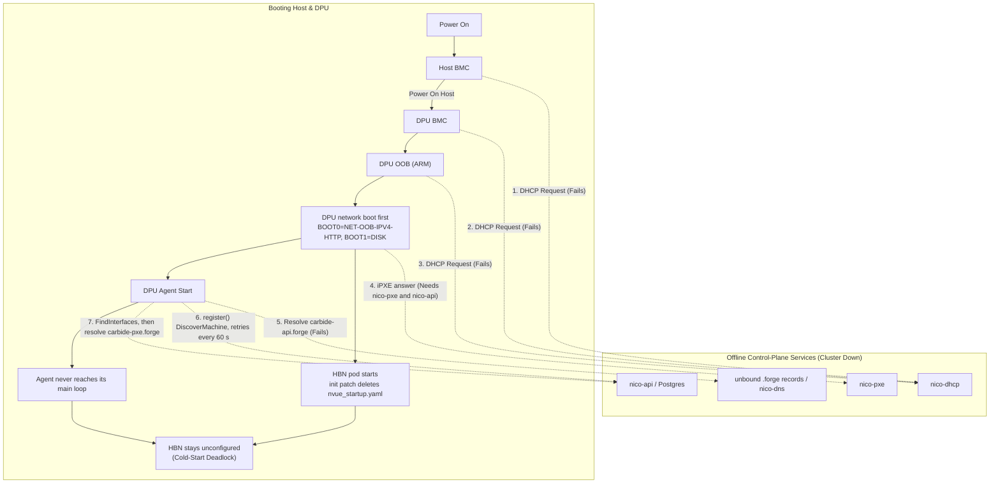

# Boot Designated Machines Without NICo DHCP, DNS or API

- **Issue:** [#7568](https://github.com/dsx-ai-factory/infra-controller/issues/7568)
- **Documentation Task:** [#7573](https://github.com/dsx-ai-factory/infra-controller/issues/7573)
- **Sub-tasks:** [#7569](https://github.com/dsx-ai-factory/infra-controller/issues/7569), [#7570](https://github.com/dsx-ai-factory/infra-controller/issues/7570), [#7571](https://github.com/dsx-ai-factory/infra-controller/issues/7571), [#7572](https://github.com/dsx-ai-factory/infra-controller/issues/7572)
- **Status:** Scoping
- **Code links:** pinned to commit `5207e5a672b53c253d0428d12df080200b77bb7e`. Every "what the code does" statement in
  section 2 describes the code at that commit.

This document scopes the work. It proposes no code changes.

---

## 1. Summary

NICo must let a site admin designate selected machines as **control-plane**
machines. A control-plane machine and its DPU must complete a full power-on cycle
and reach the network when `nico-api`, `nico-dhcp`, `nico-dns` and `unbound` are
all unavailable. The designation is named `control-plane` on issue
[#7569](https://github.com/dsx-ai-factory/infra-controller/issues/7569) and is
implemented as `HostLifecycleProfile.control_plane` in
[PR #8390](https://github.com/dsx-ai-factory/infra-controller/pull/8390).

The main use case is a cold start. NICo manages the hosts and DPUs that run the
NICo control plane. When the cluster is fully down, these hosts cannot start,
because every network step depends on the control plane that they must host.

The designation must stay per machine. If all machines were control-plane
machines, a repair or a reallocation would frequently cause an IP conflict. A move
of a host to a different network would then need a manual reset at the machine.

Five dependencies block a cold start:

| # | Dependency | Effect when the control plane is down |
|---|---|---|
| 1 | The host BMC and the DPU BMC get their address from DHCP. | The BMC has no address after a BMC reboot. The lease state does not help. |
| 2 | The DPU OOB interface gets its address from DHCP. | The DPU ARM OS has no management address. |
| 3 | The DPU agent needs `nico-api` before it can configure HBN. On every start it registers (`DiscoverMachine`), looks up the host machine ID (`FindInterfaces`) and fetches the network configuration. Separately, the HBN init patch deletes `nvue_startup.yaml` on every HBN pod start. | HBN comes up blank after any DPU reboot until the API answers. The agent does not reach its main loop while the API is down. |
| 4 | The `.forge` service names that the agent resolves (`carbide-api.forge`, `carbide-pxe.forge`, `carbide-ntp.forge`) are served by in-cluster `unbound` or by site DNS, and DPUs reach them through the DHCP-served resolver. | The agent cannot resolve its API endpoint or `carbide-pxe.forge`. Section 2.5 explains who serves which names. |
| 5 | A normal boot of a DPU is network-boot first, and the answer comes from `nico-pxe` and `nico-api`. | Whether the DPU falls through to its disk without an answer is not established. See Q8. |

Items 1 to 3 need new persistent, machine-local configuration. Item 4 needs a
design decision, because NICo has no DNS data path that survives a control-plane
outage. Item 5 is an open question that code reading cannot close.

---

## 2. What the code does

### 2.1 Address allocation is a database record, not a device configuration

NICo already has a per-interface IP allocation policy. See
[`ExpectedInterfaceIpAllocation`](https://github.com/dsx-ai-factory/infra-controller/blob/5207e5a672b53c253d0428d12df080200b77bb7e/crates/api-model/src/expected_machine.rs#L322)
with the values `Dynamic`, `Fixed` and `Retained`, and the host-BMC compatibility
enum [`BmcIpAllocationType`](https://github.com/dsx-ai-factory/infra-controller/blob/5207e5a672b53c253d0428d12df080200b77bb7e/crates/api-model/src/expected_machine.rs#L144).

`Fixed` and `Retained` only pin the address **in the NICo database**. The device
still learns the address through DHCP. The allocation decision runs in
[`ensure_dhcp_address_for_family`](https://github.com/dsx-ai-factory/infra-controller/blob/5207e5a672b53c253d0428d12df080200b77bb7e/crates/api-core/src/dhcp/discover.rs#L258)
and in
[`discover_dhcp`](https://github.com/dsx-ai-factory/infra-controller/blob/5207e5a672b53c253d0428d12df080200b77bb7e/crates/api-core/src/dhcp/discover.rs#L539).

Therefore a `Fixed` BMC with a stable address still cannot boot when `nico-dhcp`
or `nico-api` is down. This is the central gap. The new work must push the
address **into the device**.

### 2.2 The DHCP data path has no offline mode

`nico-dhcp` is a Kea hooks library. Every DISCOVER and REQUEST goes to `nico-api`
over gRPC. The hook cache in
[`crates/dhcp/src/cache.rs`](https://github.com/dsx-ai-factory/infra-controller/blob/5207e5a672b53c253d0428d12df080200b77bb7e/crates/dhcp/src/cache.rs#L39-L44)
caches positive machine records for only 60 seconds (`MACHINE_CACHE_TIMEOUT`) and negative
discovery failures for 5 minutes (`MACHINE_DISC_FAILED_CACHE_TIMEOUT`). After `MAX_DISCOVERY_FAILS = 5`,
negative caching halts calling `nico-api` and returns `TooManyFailuresError` to Kea.
The cache provides transient resiliency, not an offline fallback pool. The operator documentation states this explicitly in
[`docs/provisioning/ip-and-network-configuration.md`](../provisioning/ip-and-network-configuration.md):
the cache is "a degraded-mode safety net, not a fallback pool".

The DPU-local DHCP server is different. It runs in DPU mode and answers from a
file on the DPU. See
[`crates/dhcp-server/src/modes/dpu.rs`](https://github.com/dsx-ai-factory/infra-controller/blob/5207e5a672b53c253d0428d12df080200b77bb7e/crates/dhcp-server/src/modes/dpu.rs#L127)
and the `host.yaml` path in
[`crates/agent/src/dhcp.rs`](https://github.com/dsx-ai-factory/infra-controller/blob/5207e5a672b53c253d0428d12df080200b77bb7e/crates/agent/src/dhcp.rs#L32).
This local path does not call `nico-api` while it answers, as long as the file
stays on disk. Work item W4 protects that file.

### 2.3 The DPU OOB address is hard-coded to DHCP

The iPXE command line for a DPU sets `ip=dhcp` and `bfnet=oob_net0:dhcp`. See
[`crates/api-core/src/ipxe.rs#L221`](https://github.com/dsx-ai-factory/infra-controller/blob/5207e5a672b53c253d0428d12df080200b77bb7e/crates/api-core/src/ipxe.rs#L221).
The value is a literal in a `format!` call. It has no per-machine variant.

The DPU cloud-init payload is rendered in
[`render_user_data`](https://github.com/dsx-ai-factory/infra-controller/blob/5207e5a672b53c253d0428d12df080200b77bb7e/crates/pxe/src/routes/cloud_init/dpu.rs#L94).
It carries the API URL, the PXE URL and the HBN bridge settings, but no OOB
address configuration.

### 2.4 The DPU agent needs the API before it configures HBN

Issue #7568 describes the protection that W4 must preserve: "NICo specifically
prevents this behavior so stale nodes don't come back from the dead and cause IP
conflict problems". The agent's reset of a deleted DPU is that protection.

A cold start does not reach the agent's "blank configuration" reset. Three
separate mechanisms keep HBN down while `nico-api` is unreachable.

**The agent blocks on the API before its main loop.** The agent calls
[`register()`](https://github.com/dsx-ai-factory/infra-controller/blob/5207e5a672b53c253d0428d12df080200b77bb7e/crates/agent/src/lib.rs#L469) (defined at
[`lib.rs#L886`](https://github.com/dsx-ai-factory/infra-controller/blob/5207e5a672b53c253d0428d12df080200b77bb7e/crates/agent/src/lib.rs#L886)) before it starts the main loop.
`register()` retries `DiscoverMachine` against `nico-api` with a fixed backoff
of 60 seconds for up to 10080 attempts, which is one week. See
[`registration.rs`](https://github.com/dsx-ai-factory/infra-controller/blob/5207e5a672b53c253d0428d12df080200b77bb7e/crates/host-support/src/registration.rs#L162-L163) and the
defaults in
[`agent_config.rs`](https://github.com/dsx-ai-factory/infra-controller/blob/5207e5a672b53c253d0428d12df080200b77bb7e/crates/host-support/src/agent_config.rs#L522-L545). After
that, [`get_host_machine_id_retry`](https://github.com/dsx-ai-factory/infra-controller/blob/5207e5a672b53c253d0428d12df080200b77bb7e/crates/agent/src/main_loop.rs#L335)
(implemented in
[`host_machine_id.rs`](https://github.com/dsx-ai-factory/infra-controller/blob/5207e5a672b53c253d0428d12df080200b77bb7e/crates/agent/src/host_machine_id.rs#L75)) calls
`FindInterfaces` for about 10 seconds and returns an error, which ends the agent,
when the call fails. Only after both calls succeed does
[`ServiceAddresses::build`](https://github.com/dsx-ai-factory/infra-controller/blob/5207e5a672b53c253d0428d12df080200b77bb7e/crates/agent/src/util.rs#L172) run, called from
[`main_loop.rs#L372`](https://github.com/dsx-ai-factory/infra-controller/blob/5207e5a672b53c253d0428d12df080200b77bb7e/crates/agent/src/main_loop.rs#L372). The agent's default
API endpoint is the `.forge` name `carbide-api.forge`
([`agent_config.rs#L33`](https://github.com/dsx-ai-factory/infra-controller/blob/5207e5a672b53c253d0428d12df080200b77bb7e/crates/host-support/src/agent_config.rs#L33)), so these
calls also need the DNS path of section 2.5 unless the PXE-rendered agent
configuration overrides the endpoint.

**The HBN init patch deletes the NVUE file on every HBN pod start.** The DPU
cloud-init script patches the HBN pod so that its init step runs
`rm -f /host/var/lib/hbn/var/support/nvue_startup.yaml` ("Fix 6" in
[`pxe/templates/user-data`](https://github.com/dsx-ai-factory/infra-controller/blob/5207e5a672b53c253d0428d12df080200b77bb7e/pxe/templates/user-data#L213-L222), patch code at
[`#L345-L358`](https://github.com/dsx-ai-factory/infra-controller/blob/5207e5a672b53c253d0428d12df080200b77bb7e/pxe/templates/user-data#L345-L358); the same patch is in
[`crates/api/files/bf.cfg`](https://github.com/dsx-ai-factory/infra-controller/blob/5207e5a672b53c253d0428d12df080200b77bb7e/crates/api/files/bf.cfg#L374-L383), patch code at
[`#L504-L516`](https://github.com/dsx-ai-factory/infra-controller/blob/5207e5a672b53c253d0428d12df080200b77bb7e/crates/api/files/bf.cfg#L504-L516)). The reason in the
template is that the agent writes the file and runs `nv config apply` only when
the file content changes, so deleting it forces a re-apply into the new
container. The effect for a cold start is that HBN has no configuration after any
reboot until the agent has fetched a configuration and rewritten the file, and
the agent cannot do that while the API is down.

**The agent holds the network configuration only in memory.** The agent fetches
the configuration in
[`PeriodicConfigFetcher`](https://github.com/dsx-ai-factory/infra-controller/blob/5207e5a672b53c253d0428d12df080200b77bb7e/crates/agent/src/periodic_config_fetcher.rs#L41).
The field `netconf` is an in-memory `ArcSwapOption`. Nothing is written to disk.
A successful fetch stores the response at
[line 239](https://github.com/dsx-ai-factory/infra-controller/blob/5207e5a672b53c253d0428d12df080200b77bb7e/crates/agent/src/periodic_config_fetcher.rs#L239). Only a gRPC
`NotFound` answer clears it, at
[line 258](https://github.com/dsx-ai-factory/infra-controller/blob/5207e5a672b53c253d0428d12df080200b77bb7e/crates/agent/src/periodic_config_fetcher.rs#L258). Any other
failure leaves the stored value unchanged. This holds for every DPU.

The main loop reads that value. The `None` arm at
[`crates/agent/src/main_loop.rs#L1552`](https://github.com/dsx-ai-factory/infra-controller/blob/5207e5a672b53c253d0428d12df080200b77bb7e/crates/agent/src/main_loop.rs#L1552)
waits one iteration and then calls
[`ethernet_virtualization::reset`](https://github.com/dsx-ai-factory/infra-controller/blob/5207e5a672b53c253d0428d12df080200b77bb7e/crates/agent/src/ethernet_virtualization.rs#L1516).
That function writes blank DHCP files and deletes `var/support/nvue_startup.yaml`.
The arm is correct for a `NotFound` answer, which means the API no longer knows
the DPU, for example after a force delete. A cold start does not reach it,
because the agent is still blocked in `register()`. By reading the code, the arm
is also reachable when the API fails only after registration and before the first
successful fetch, because `netconf` is then still `None`. That narrow case is a
transport error that ends in a reset, and W4 removes it.

### 2.5 DNS has no path that survives a control-plane outage

`nico-dns` is authoritative only. It answers each query with a `lookup_record`
gRPC call to `nico-api`. See
[`crates/dns/src/lib.rs`](https://github.com/dsx-ai-factory/infra-controller/blob/5207e5a672b53c253d0428d12df080200b77bb7e/crates/dns/src/lib.rs#L21)
and the handler
[`lookup_record`](https://github.com/dsx-ai-factory/infra-controller/blob/5207e5a672b53c253d0428d12df080200b77bb7e/crates/api-core/src/handlers/dns.rs#L334).
It keeps a negative cache only, in
[`crates/dns/src/negative_cache.rs`](https://github.com/dsx-ai-factory/infra-controller/blob/5207e5a672b53c253d0428d12df080200b77bb7e/crates/dns/src/negative_cache.rs).
It serves A, AAAA, PTR, SOA, NS, CNAME, MX and TXT records
([`content_to_rdata`](https://github.com/dsx-ai-factory/infra-controller/blob/5207e5a672b53c253d0428d12df080200b77bb7e/crates/dns/src/lib.rs#L281)). It does not recurse. It
does not implement zone transfer (AXFR); the query handler lists it among the
query types that it does not implement.

Recursive DNS is a separate `unbound` deployment in the same cluster. See
[`helm/charts/unbound`](https://github.com/dsx-ai-factory/infra-controller/blob/5207e5a672b53c253d0428d12df080200b77bb7e/helm/charts/unbound/values.yaml).

The `.forge` service names are **not** `nico-api` data and `nico-dns` does not
serve them. They are static records, in one of two forms:

- In the cluster, `unbound` `local-data` entries. The chart renders them from the
  `unbound.localData` Helm values
  ([`configmap.yaml`](https://github.com/dsx-ai-factory/infra-controller/blob/5207e5a672b53c253d0428d12df080200b77bb7e/helm/charts/unbound/templates/configmap.yaml#L35-L45);
  example values in
  [`nico-core-10k-hosts.yaml`](https://github.com/dsx-ai-factory/infra-controller/blob/5207e5a672b53c253d0428d12df080200b77bb7e/helm-prereqs/values/nico-core-10k-hosts.yaml#L717-L790)).
- Site DNS. A site may serve the `.forge` names from its own DNS server instead
  ("Option B" in
  [`helm-prereqs/README.md`](../../helm-prereqs/README.md#option-b--external-dns)).

The operator documentation says that DPU agents and unallocated hosts do not
contact `nico-dns` directly
([`dns-service-endpoints.md`](../configuration/dns-service-endpoints.md#common-properties)).
They resolve through the DHCP-served resolver
([DPU compatibility DNS](../../helm-prereqs/README.md#dpu-compatibility-dns-forge-zone--required-for-dpu-bring-up)).

Therefore a cluster outage takes down the in-cluster `unbound` VIP and `nico-dns`
together. This matches the issue comment that both recursive and authoritative
DNS are in scope. It also means that a change to `nico-dns` alone does not help
the agent (see W5, Approach 2).

DNS is a hard start dependency for the DPU agent in two places. The default API
endpoint is `carbide-api.forge` (section 2.4).
[`ServiceAddresses::build`](https://github.com/dsx-ai-factory/infra-controller/blob/5207e5a672b53c253d0428d12df080200b77bb7e/crates/agent/src/util.rs#L183) also resolves
`carbide-pxe.forge` and propagates the error, so the agent stops when that name
does not resolve. That lookup depends on the `unbound` `local-data` entries or
on site DNS, not on `nico-dns` or on data in `nico-api`.

### 2.6 NICo can already write BMC settings through Redfish

The Redfish client wrapper already declares a write method for BMC time settings:
[`set_ntp_servers`](https://github.com/dsx-ai-factory/infra-controller/blob/5207e5a672b53c253d0428d12df080200b77bb7e/crates/redfish/src/libredfish/instrumented.rs#L396).
The wrapper in `instrumented.rs` only delegates and adds instrumentation. The
method itself comes from the external `libredfish` crate, which the workspace pins
at tag `v0.47.19` in
[`Cargo.toml`](https://github.com/dsx-ai-factory/infra-controller/blob/5207e5a672b53c253d0428d12df080200b77bb7e/Cargo.toml#L30). The pre-ingestion state machine calls it from
[`crates/preingestion-manager/src/lib.rs#L1793`](https://github.com/dsx-ai-factory/infra-controller/blob/5207e5a672b53c253d0428d12df080200b77bb7e/crates/preingestion-manager/src/lib.rs#L1793).

NICo also reads the BMC `EthernetInterfaces` collection during exploration. See
[`crates/bmc-explorer/src/manager.rs#L72`](https://github.com/dsx-ai-factory/infra-controller/blob/5207e5a672b53c253d0428d12df080200b77bb7e/crates/bmc-explorer/src/manager.rs#L72)
and
[`get_manager_ethernet_interface`](https://github.com/dsx-ai-factory/infra-controller/blob/5207e5a672b53c253d0428d12df080200b77bb7e/crates/redfish/src/libredfish/instrumented.rs#L351).

NICo writes `IPv4StaticAddresses` in one place only: the GB200 repair of the
BMC-to-host interface `hostusb0`
([`ensure_gb200_host_interface_static_ipv4`](https://github.com/dsx-ai-factory/infra-controller/blob/5207e5a672b53c253d0428d12df080200b77bb7e/crates/redfish/src/libredfish/host_interface.rs#L116),
called from the machine controller in
[`gb200_host_interface.rs`](https://github.com/dsx-ai-factory/infra-controller/blob/5207e5a672b53c253d0428d12df080200b77bb7e/crates/machine-controller/src/handler/gb200_host_interface.rs#L54)).
It writes the fixed address `10.0.1.1/24` for the host link, not a management
address. It sends a raw `PATCH` through the `libredfish` HTTP client with an
`If-Match` ETag, and it reads the resource again to verify the change. No NICo code writes
`DHCPv4.DHCPEnabled` or `StaticNameServers`, and no code writes a static
management address into a BMC.

The read path, the state machine hook and the raw `PATCH` pattern all exist, so
the new write path can reuse them. A new write method can follow the GB200 raw
`PATCH` pattern inside `crates/redfish`, or it can be a typed method in
`libredfish`, which needs a `libredfish` release and a tag bump in `Cargo.toml`.

---

## 3. Proposed work items

The items are ordered. W1 is a prerequisite for W2, W3 and W4.

### W1 — The `control-plane` designation ([#7569](https://github.com/dsx-ai-factory/infra-controller/issues/7569))

The designation is `HostLifecycleProfile.control_plane`, implemented in
[PR #8390](https://github.com/dsx-ai-factory/infra-controller/pull/8390).
`ExpectedMachineData.host_lifecycle_profile` is a JSONB column, and the model
says that new per-host knobs go there and not into new flat columns
([`expected_machine.rs`](https://github.com/dsx-ai-factory/infra-controller/blob/5207e5a672b53c253d0428d12df080200b77bb7e/crates/api-model/src/expected_machine.rs#L1010-L1014)).
The designation needs no migration.

That pull request also validates the designation: it rejects a `control-plane`
machine whose Host BMC, DPU BMC or DPU OS interface resolves to `Dynamic`. The
check uses `resolved_ip_allocation`, so it also rejects an omitted policy that
resolves to `Dynamic`. This describes the diff of that pull request at head
`b45626854f0d61328523939f4403085b7dedb3ab`. The code was not run.

W1 work that remains after that pull request, if the merged code leaves it open:

- Keep the omitted-policy rejection. With the field omitted, a DPU BMC or DPU OS
  interface resolves to `Dynamic` unless it has a `fixed_ip`
  ([`resolved_ip_allocation`](https://github.com/dsx-ai-factory/infra-controller/blob/5207e5a672b53c253d0428d12df080200b77bb7e/crates/api-model/src/expected_machine.rs#L528),
  field documentation at
  [`#L383-L387`](https://github.com/dsx-ai-factory/infra-controller/blob/5207e5a672b53c253d0428d12df080200b77bb7e/crates/api-model/src/expected_machine.rs#L383-L387)).
  An omitted policy on those roles must therefore stay rejected for a
  `control-plane` machine.
- Validation must also require that the DPU declarations exist. A
  `control-plane` machine needs a declared `DpuBmc` and `DpuOs` interface, each
  with a `Fixed` or `Retained` policy, because W2 and W3 need an address to push
  for each of them. The reviewed diff checks the Host BMC through
  `effective_host_bmc`, but it checks only the DPU interfaces that are declared.
  It does not require a DPU declaration to exist.

### W2 — Write a static address into the host BMC and the DPU BMC ([#7570](https://github.com/dsx-ai-factory/infra-controller/issues/7570))

Push the address that NICo already reserved into the BMC, so that the BMC does
not need DHCP after a reset.

Scope:

- New Redfish write methods beside
  [`set_ntp_servers`](https://github.com/dsx-ai-factory/infra-controller/blob/5207e5a672b53c253d0428d12df080200b77bb7e/crates/redfish/src/libredfish/instrumented.rs#L396):
  set `DHCPv4.DHCPEnabled = false`, set `IPv4StaticAddresses`, set
  `StaticNameServers`, and the matching IPv6 properties. Add a read-back method
  for verification, and a method that restores DHCP. Section 2.6 lists the two
  places these methods can live: a raw `PATCH` in `crates/redfish`, as the GB200
  `hostusb0` repair does, or typed methods in `libredfish` with a release and a
  tag bump.
- A vendor compatibility layer in
  [`crates/bmc-vendor`](https://github.com/dsx-ai-factory/infra-controller/blob/5207e5a672b53c253d0428d12df080200b77bb7e/crates/bmc-vendor).
  Redfish `EthernetInterface` support is not uniform across BMC vendors.
- A new state in the pre-ingestion state machine in
  [`crates/preingestion-manager/src/lib.rs`](https://github.com/dsx-ai-factory/infra-controller/blob/5207e5a672b53c253d0428d12df080200b77bb7e/crates/preingestion-manager/src/lib.rs#L420),
  beside `SetNtpServers`. Use the same bounded retry shape. A pre-ingestion state
  only covers BMCs that are not yet ingested. For machines that are already
  ingested, add a re-push path that runs when the designation is set or when the
  address changes, because those BMCs never pass through pre-ingestion again.
- Reconciliation. The static value must follow a later address change. The
  address write path in
  [`crates/api-core/src/handlers/machine_interface_address.rs`](https://github.com/dsx-ai-factory/infra-controller/blob/5207e5a672b53c253d0428d12df080200b77bb7e/crates/api-core/src/handlers/machine_interface_address.rs#L305)
  is the trigger point.
- Rollback. Decommissioning and factory reset must restore DHCP on the BMC,
  otherwise a repaired machine keeps a stale static address and causes the IP
  conflict that the issue warns about. See
  [`crates/machine-controller/src/handler/decommissioning.rs`](https://github.com/dsx-ai-factory/infra-controller/blob/5207e5a672b53c253d0428d12df080200b77bb7e/crates/machine-controller/src/handler/decommissioning.rs)
  and
  [`factory_reset.rs`](https://github.com/dsx-ai-factory/infra-controller/blob/5207e5a672b53c253d0428d12df080200b77bb7e/crates/machine-controller/src/handler/factory_reset.rs).

Risk: a wrong static write makes the BMC unreachable over the network. Recovery
then needs physical access. Verify the read-back before the change is committed,
and keep the operation behind the W1 designation.

### W3 — Give the DPU OOB interface a static address ([#7571](https://github.com/dsx-ai-factory/infra-controller/issues/7571))

Scope:

- Make the `bfnet=oob_net0:dhcp` literal at
  [`crates/api-core/src/ipxe.rs#L221`](https://github.com/dsx-ai-factory/infra-controller/blob/5207e5a672b53c253d0428d12df080200b77bb7e/crates/api-core/src/ipxe.rs#L221)
  conditional. For a designated DPU, render the static BlueField kickstart form
  with the address, the mask and the gateway that NICo reserved.
- Add the same address to the DPU cloud-init context in
  [`render_user_data`](https://github.com/dsx-ai-factory/infra-controller/blob/5207e5a672b53c253d0428d12df080200b77bb7e/crates/pxe/src/routes/cloud_init/dpu.rs#L94),
  and write a persistent interface configuration in the template
  [`pxe/templates/user-data`](https://github.com/dsx-ai-factory/infra-controller/blob/5207e5a672b53c253d0428d12df080200b77bb7e/pxe/templates/user-data).
  The kickstart value only covers the installer. The installed DPU OS needs its
  own persistent configuration.
- Write the DPU OS resolver configuration (the static nameservers of W5,
  Approach 1) in the same persistent configuration, so that the installed DPU OS
  does not depend on a DHCP-served resolver.
- Carry the address in the `DiscoveryInstructions` message, so the PXE service
  does not need a second API call.
- A DPU that is already installed has an already-rendered configuration. Decide
  whether such a DPU is reinstalled, or whether the agent applies the OOB
  configuration from the API response (see W4).

### W4 — Keep the DPU HBN configuration across a control-plane outage ([#7572](https://github.com/dsx-ai-factory/infra-controller/issues/7572))

This item removes the cold-start blockers of section 2.4.

Scope:

- Persist the DPU machine ID and the host machine ID on the DPU, and start the
  agent without `DiscoverMachine` and `FindInterfaces` when the persisted IDs
  exist. The existing `register()` and `get_host_machine_id_retry` calls block the
  agent while the API is down, so no HBN work can start without this.
- Persist the last successful network configuration to disk, beside the periodic
  fetch in
  [`periodic_config_fetcher.rs`](https://github.com/dsx-ai-factory/infra-controller/blob/5207e5a672b53c253d0428d12df080200b77bb7e/crates/agent/src/periodic_config_fetcher.rs#L239),
  and load it at agent start before the first fetch finishes. The value exists
  only in memory at the pinned commit. Only designated DPUs persist and load it;
  other DPUs keep the existing behavior. The Security section lists what to write.
- Handle the HBN init patch. The "Fix 6" patch deletes `nvue_startup.yaml` on every
  HBN pod start, so a persisted file is not enough. Either skip Fix 6 for
  designated DPUs, or have the agent re-apply the persisted configuration at start
  without waiting for the API.
- Keep `NotFound` as a true "this DPU is gone" signal. A transport error already
  leaves the stored value unchanged on every DPU (section 2.4). The
  `None` arm at
  [`main_loop.rs#L1552`](https://github.com/dsx-ai-factory/infra-controller/blob/5207e5a672b53c253d0428d12df080200b77bb7e/crates/agent/src/main_loop.rs#L1552)
  must only call
  [`reset`](https://github.com/dsx-ai-factory/infra-controller/blob/5207e5a672b53c253d0428d12df080200b77bb7e/crates/agent/src/ethernet_virtualization.rs#L1516)
  after a `NotFound` answer, and not when no successful fetch has happened yet.
- For a designated DPU, keep the persisted configuration across an unreachable
  API for a configurable maximum retention window. The proposed default is 48 hours.
  Reset immediately when `nico-api` answers `NotFound`. The window starts at the
  last successful fetch. The agent records that time with the persisted
  configuration, so that a reboot does not restart the window. When the agent
  starts and the window has already expired, it does not apply the persisted
  configuration. It resets networking, as it does for an expired window while
  running. The consequence is that a control-plane cluster that stays down longer
  than the window needs manual recovery of its hosts, so the window must be longer
  than the longest outage that the site accepts. The clock used for the window is
  open question Q9.
- Deliver the designation and the window to the DPU. The cloud-init agent
  configuration is rendered when the DPU is installed
  ([`generate_forge_agent_config`](https://github.com/dsx-ai-factory/infra-controller/blob/5207e5a672b53c253d0428d12df080200b77bb7e/crates/pxe/src/routes/cloud_init/dpu.rs#L77)),
  so a DPU that is already ingested never receives a later change. Also carry both
  values in `ManagedHostNetworkConfigResponse`, and persist them with the
  configuration. The cloud-init value then covers the first boot of a new
  installation, and the response covers every DPU that is already installed. The
  agent applies the rule before it reaches the API by reading the persisted values.
- Confirm that the HBN configuration file `var/support/nvue_startup.yaml` and the
  DHCP file `var/support/forge-dhcp/conf/host.yaml` are on persistent DPU storage.
  The HBN patch already treats `/var/lib/hbn` on the DPU as a persistent hostPath
  for the NVUE file (section 2.4), but the `host.yaml` location is not confirmed.
  If a file is not persistent, the persistence from the second bullet must cover it.

Safety note: the existing behavior prevents a stale node from rejoining the
network. The new behavior keeps that protection. Non-designated DPUs keep the existing
behavior. They persist nothing, and they reset after the second blank fetch, as
before. Designated DPUs keep bounded retention and record the age of the applied
configuration in the DPU health report.

### W5 — Make DNS answerable during a control-plane outage

This item needs a design decision first. Three candidate approaches:

1. **Static resolver configuration for designated machines.** Write the resolver
   addresses into the BMC with `StaticNameServers` (part of W2) and into the DPU
   OS (part of W3). Point them at an off-cluster resolver. This is the smallest
   change, but it moves the dependency to site infrastructure. A recursive
   resolver that forwards `.forge` queries to the in-cluster `unbound` VIP or to
   `nico-dns` still fails when the cluster is down.
2. **A positive cache in `nico-dns`.** Extend
   [`crates/dns/src/negative_cache.rs`](https://github.com/dsx-ai-factory/infra-controller/blob/5207e5a672b53c253d0428d12df080200b77bb7e/crates/dns/src/negative_cache.rs)
   to a persistent snapshot of the zone, and serve it when `nico-api` is
   unreachable. This keeps the answers inside NICo, but `nico-dns` still runs in
   the cluster that is down. It would also not help the agent's start-up lookup,
   because the agent resolves `carbide-pxe.forge` from `unbound` `local-data` or
   site DNS and does not query `nico-dns`.
3. **A secondary off-cluster authoritative server.** `nico-dns` has no zone
   transfer support at the pinned commit. This is the largest change.

Approach 1 is the recommended first step. It removes the start dependency in
section 2.5 without changing how NICo serves DNS, and it builds on a deployment
option that NICo already supports (site DNS, "Option B" in
[`helm-prereqs/README.md`](../../helm-prereqs/README.md#option-b--external-dns)).

The `.forge` service names are static records and not `nico-api` data. In the
cluster they are `local-data` entries rendered from the `unbound.localData` Helm
values, and a site may serve them from its own DNS instead (see
[DPU compatibility DNS](../../helm-prereqs/README.md#dpu-compatibility-dns-forge-zone--required-for-dpu-bring-up)
and [DNS service endpoints](../configuration/dns-service-endpoints.md)).
For a designated machine, the static resolver must be a server outside the NICo
cluster. It must answer every `.forge` name that the deployed agent queries
without forwarding it to the in-cluster `unbound` VIP or to `nico-dns`. The
complete list of `.forge` names is the table in
[DPU compatibility DNS](../../helm-prereqs/README.md#dpu-compatibility-dns-forge-zone--required-for-dpu-bring-up);
the off-cluster resolver should serve all of them. The agent needs these names to
start or to serve the host:

- `carbide-pxe.forge`, which the agent needs at start;
- `carbide-ntp.forge`;
- `carbide-api.forge`, the agent's default API endpoint
  ([`agent_config.rs#L33`](https://github.com/dsx-ai-factory/infra-controller/blob/5207e5a672b53c253d0428d12df080200b77bb7e/crates/host-support/src/agent_config.rs#L33)).

The other names in that table, for example `socks.forge` for DPU extension
services, are not on the HBN start path. The site DNS operator owns these records
and keeps them equal to the service VIPs in the NICo Helm values. Approaches 2
and 3 should be tracked separately.

Independently of the choice, make the DPU agent start without the PXE lookup.
[`ServiceAddresses::build`](https://github.com/dsx-ai-factory/infra-controller/blob/5207e5a672b53c253d0428d12df080200b77bb7e/crates/agent/src/util.rs#L172)
fails when `carbide-pxe.forge` does not resolve. The PXE address is not needed
to keep HBN running. Degrade instead of failing, as the NTP branch in the same
function already does.

### W6 — Optional: a local reservation file for `nico-dhcp`

If a designated machine still uses DHCP for one interface, the Kea hook cannot
answer while `nico-api` is down. A persistent reservation file for designated
machines only, read by
[`crates/dhcp/src/lib.rs`](https://github.com/dsx-ai-factory/infra-controller/blob/5207e5a672b53c253d0428d12df080200b77bb7e/crates/dhcp/src/lib.rs),
would close that gap.

This item has lower priority. W2 and W3 remove the need for DHCP on the
designated machines. Do this item only if a device cannot accept a static
configuration.

### W7 — Guard rails, observability and documentation

- Metrics: a gauge for the number of designated machines, and a counter for
  failed static pushes. Follow the `Event` rules in
  [`AGENTS.md`](https://github.com/dsx-ai-factory/infra-controller/blob/main/AGENTS.md).
- Health: report the designation and the age of the applied DPU configuration in
  the DPU health report.
- Documentation: a new section in
  [`docs/provisioning/ip-and-network-configuration.md`](../provisioning/ip-and-network-configuration.md),
  an update to
  [`docs/provisioning/expected-machine-interfaces.md`](../provisioning/expected-machine-interfaces.md),
  and a cold-start procedure. Record the IP-conflict risk and the manual steps
  that a network move needs.

---

## 4. Files that probably change

| Area | File | Change |
|---|---|---|
| Model | [`crates/api-model/src/expected_machine.rs`](https://github.com/dsx-ai-factory/infra-controller/blob/5207e5a672b53c253d0428d12df080200b77bb7e/crates/api-model/src/expected_machine.rs#L1045) | `HostLifecycleProfile.control_plane`, implemented in [#8390](https://github.com/dsx-ai-factory/infra-controller/pull/8390); remaining validation gaps from W1 |
| Protobuf | [`crates/rpc/proto/forge.proto`](https://github.com/dsx-ai-factory/infra-controller/blob/5207e5a672b53c253d0428d12df080200b77bb7e/crates/rpc/proto/forge.proto#L5530) | Designation and retention window in `ManagedHostNetworkConfigResponse`; OOB address in `DiscoveryInstructions` |
| Database | None for the designation | `host_lifecycle_profile` is a JSONB column, so `control_plane` needs no migration |
| API handler | [`crates/api-core/src/handlers/expected_machine.rs`](https://github.com/dsx-ai-factory/infra-controller/blob/5207e5a672b53c253d0428d12df080200b77bb7e/crates/api-core/src/handlers/expected_machine.rs#L778) | Designation validation, in #8390; W1 gaps |
| iPXE | [`crates/api-core/src/ipxe.rs`](https://github.com/dsx-ai-factory/infra-controller/blob/5207e5a672b53c253d0428d12df080200b77bb7e/crates/api-core/src/ipxe.rs#L221) | Static `bfnet` form for a designated DPU |
| PXE cloud-init | [`crates/pxe/src/routes/cloud_init/dpu.rs`](https://github.com/dsx-ai-factory/infra-controller/blob/5207e5a672b53c253d0428d12df080200b77bb7e/crates/pxe/src/routes/cloud_init/dpu.rs#L94) | OOB address and designation in the template context |
| PXE template | [`pxe/templates/user-data`](https://github.com/dsx-ai-factory/infra-controller/blob/5207e5a672b53c253d0428d12df080200b77bb7e/pxe/templates/user-data#L345-L358) | Persistent OOB interface configuration; skip "Fix 6" for designated DPUs, if that option is chosen |
| BlueField config | [`crates/api/files/bf.cfg`](https://github.com/dsx-ai-factory/infra-controller/blob/5207e5a672b53c253d0428d12df080200b77bb7e/crates/api/files/bf.cfg#L504-L516) | The same "Fix 6" change, if that option is chosen |
| Redfish | [`crates/redfish/src/libredfish/instrumented.rs`](https://github.com/dsx-ai-factory/infra-controller/blob/5207e5a672b53c253d0428d12df080200b77bb7e/crates/redfish/src/libredfish/instrumented.rs#L396) | The new write methods, as a raw `PATCH` beside `host_interface.rs` or as delegation entries for typed `libredfish` methods |
| libredfish (optional) | External crate, tag set in [`Cargo.toml`](https://github.com/dsx-ai-factory/infra-controller/blob/5207e5a672b53c253d0428d12df080200b77bb7e/Cargo.toml#L30) | Only if the write methods are typed `libredfish` methods instead of a raw `PATCH` in `crates/redfish` (section 2.6): a `libredfish` release and a tag bump |
| BMC vendors | [`crates/bmc-vendor`](https://github.com/dsx-ai-factory/infra-controller/blob/5207e5a672b53c253d0428d12df080200b77bb7e/crates/bmc-vendor) | Per-vendor property differences |
| Pre-ingestion | [`crates/preingestion-manager/src/lib.rs`](https://github.com/dsx-ai-factory/infra-controller/blob/5207e5a672b53c253d0428d12df080200b77bb7e/crates/preingestion-manager/src/lib.rs#L420) | New state that writes the static BMC configuration |
| Address lifecycle | [`crates/api-core/src/handlers/machine_interface_address.rs`](https://github.com/dsx-ai-factory/infra-controller/blob/5207e5a672b53c253d0428d12df080200b77bb7e/crates/api-core/src/handlers/machine_interface_address.rs#L305) | Re-push on an address change |
| Teardown | [`crates/machine-controller/src/handler/decommissioning.rs`](https://github.com/dsx-ai-factory/infra-controller/blob/5207e5a672b53c253d0428d12df080200b77bb7e/crates/machine-controller/src/handler/decommissioning.rs) | Restore DHCP on the BMC |
| DPU agent | [`crates/agent/src/lib.rs`](https://github.com/dsx-ai-factory/infra-controller/blob/5207e5a672b53c253d0428d12df080200b77bb7e/crates/agent/src/lib.rs#L886) | Start without `DiscoverMachine` when persisted IDs exist |
| DPU agent | [`crates/agent/src/host_machine_id.rs`](https://github.com/dsx-ai-factory/infra-controller/blob/5207e5a672b53c253d0428d12df080200b77bb7e/crates/agent/src/host_machine_id.rs#L75) | Use the persisted host machine ID without `FindInterfaces` |
| DPU agent | [`crates/agent/src/periodic_config_fetcher.rs`](https://github.com/dsx-ai-factory/infra-controller/blob/5207e5a672b53c253d0428d12df080200b77bb7e/crates/agent/src/periodic_config_fetcher.rs#L41) | Persist and reload the last good configuration |
| DPU agent | [`crates/agent/src/main_loop.rs`](https://github.com/dsx-ai-factory/infra-controller/blob/5207e5a672b53c253d0428d12df080200b77bb7e/crates/agent/src/main_loop.rs#L1552) | Do not reset when no successful fetch has happened |
| DPU agent | [`crates/agent/src/ethernet_virtualization.rs`](https://github.com/dsx-ai-factory/infra-controller/blob/5207e5a672b53c253d0428d12df080200b77bb7e/crates/agent/src/ethernet_virtualization.rs#L1516) | Guard the reset behind the new condition |
| DPU agent | [`crates/agent/src/util.rs`](https://github.com/dsx-ai-factory/infra-controller/blob/5207e5a672b53c253d0428d12df080200b77bb7e/crates/agent/src/util.rs#L172) | Start without the PXE lookup |
| DNS | [`crates/dns/src/negative_cache.rs`](https://github.com/dsx-ai-factory/infra-controller/blob/5207e5a672b53c253d0428d12df080200b77bb7e/crates/dns/src/negative_cache.rs) | Optional positive cache, after the W5 decision |
| CLI | [`crates/admin-cli/src/expected_machines/`](https://github.com/dsx-ai-factory/infra-controller/blob/5207e5a672b53c253d0428d12df080200b77bb7e/crates/admin-cli/src/expected_machines) | New flags in #8390; regenerated documentation |
| REST | [`rest-api/openapi/spec.yaml`](https://github.com/dsx-ai-factory/infra-controller/blob/5207e5a672b53c253d0428d12df080200b77bb7e/rest-api/openapi/spec.yaml) | New attribute in #8390; regenerated SDK |
| Documentation | [`docs/provisioning/ip-and-network-configuration.md`](../provisioning/ip-and-network-configuration.md) | Designation, limits and cold-start procedure |

---

## 5. Security

W4 writes network configuration to the DPU disk, and that configuration is
sensitive. `ManagedHostNetworkConfigResponse` has an `instance` field
([`forge.proto`](https://github.com/dsx-ai-factory/infra-controller/blob/5207e5a672b53c253d0428d12df080200b77bb7e/crates/rpc/proto/forge.proto#L5655)), which carries the
tenant's instance configuration, including the OS `user_data`
([`periodic_config_fetcher.rs`](https://github.com/dsx-ai-factory/infra-controller/blob/5207e5a672b53c253d0428d12df080200b77bb7e/crates/agent/src/periodic_config_fetcher.rs#L540-L545)).
The rendered `nvue_startup.yaml` also holds tenant VRF configuration.

Proposed rules for W4. These are design requirements, and nothing here is
implemented:

- **What is written.** Persist only the fields that HBN and the DPU DHCP server
  need, and do not persist `instance` or its `user_data`. If a field of `instance`
  is needed later, list it explicitly.
- **File permissions.** Write the file atomically, owned by root, with mode
  `0600`, in a root-only directory on persistent DPU storage. The code at the
  pinned commit defines no such location or mode, so the implementation must
  choose and test them.
- **Removal.** Delete the persisted configuration when the API answers
  `NotFound`, and when the retention window expires.
- **Stale tenant configuration.** If the host is reassigned to another tenant
  while the API is unreachable, the DPU can re-apply the previous tenant's VRF
  configuration until the window ends or the API answers. The window bounds that
  exposure, but it does not remove it. The designation is meant for NICo's own
  control-plane hosts, which are not expected to run tenant instances. Whether the
  validation must reject a designated machine that has an instance allocation is
  open question Q10.

---

## 6. Non-goals

- Non-designated machines. They keep their existing DHCP, DNS and agent behavior. In
  particular they do not persist a network configuration.
- Making `nico-api`, `nico-dhcp` or `nico-dns` run without Postgres or without
  the cluster. The goal is that designated machines do not need them to boot.
- Host OS addressing of a designated machine (Q7).
- A change to how NICo serves `.forge` names. W5 Approach 1 uses a site-owned
  resolver and does not change NICo.
- The DPF and containerized agent mode. The agent has a separate containerized
  platform type in which the resolver configuration comes from an init
  container ([`util.rs`](https://github.com/dsx-ai-factory/infra-controller/blob/5207e5a672b53c253d0428d12df080200b77bb7e/crates/agent/src/util.rs#L165-L172)). This document
  covers only the DPU OS agent with HBN on the DPU. Persistence for the
  containerized agent needs its own design. This is a scoping decision for the
  maintainers to confirm.

---

## 7. Open questions

| # | Question | Why it matters |
|---|---|---|
| Q1 | Resolved by design. The designation is `HostLifecycleProfile.control_plane`, implemented in [#8390](https://github.com/dsx-ai-factory/infra-controller/pull/8390). | It needs no migration and no new `ExpectedInterfaceIpAllocation` value. |
| Q2 | Which W5 approach is selected? | Approach 1 is small, but it needs site-owned `.forge` records on an off-cluster resolver (section W5). Approaches 2 and 3 keep the answers inside NICo and are much larger. |
| Q3 | Resolved. The DPU does not keep `nvue_startup.yaml`: the HBN init patch deletes it on every HBN pod start (section 2.4). | W4 must skip that deletion for designated DPUs or re-apply the persisted configuration at agent start. |
| Q4 | Which BMC vendors must support the static Redfish write at first delivery? | Redfish `EthernetInterface` write support is not uniform. The first delivery can be limited to the control-plane hardware. |
| Q5 | Is 48 hours the right default for the retention window? | It sets the boundary between cold-start recovery and stale ghost-node prevention after a long disconnect. An expired window at boot means a reset (W4). |
| Q6 | Must a designated machine still accept a DHCP answer when the control plane returns? | This decides whether W6 is needed and how a network move is performed. |
| Q7 | Does the host OS of a designated machine also need a static address? | The issue names the BMC and the DPU. A site-controller host usually gets its address from the parent datacenter. |
| Q8 | When the network-boot attempt gets no answer, does UEFI fall through to the next boot entry (`DISK`), and after what timeout, on the DPU and on the host? | The DPU boot order is `BOOT0=NET-OOB-IPV4-HTTP`, `BOOT1=DISK` ([`user-data`](https://github.com/dsx-ai-factory/infra-controller/blob/5207e5a672b53c253d0428d12df080200b77bb7e/pxe/templates/user-data#L156-L157), [`bf.cfg`](https://github.com/dsx-ai-factory/infra-controller/blob/5207e5a672b53c253d0428d12df080200b77bb7e/crates/api/files/bf.cfg#L123-L124)). A normal boot gets an iPXE `exit` from [`ipxe.rs`](https://github.com/dsx-ai-factory/infra-controller/blob/5207e5a672b53c253d0428d12df080200b77bb7e/crates/api-core/src/ipxe.rs#L295), which needs `nico-pxe` and `nico-api`. The code does not establish the fall-through or its timeout. It needs a test on hardware. |
| Q9 | Which clock measures the retention window? | During the outage the DPU has no NTP, because `carbide-ntp.forge` is in the cluster. A wall-clock timestamp can be wrong after a reboot, and a monotonic clock restarts at boot. Neither is verified here. |
| Q10 | Must validation reject a designated machine that has an instance allocation, or a designation on an allocated machine? | It bounds the stale-tenant exposure in the Security section. |

---

## Appendix A — Cold-start dependency chain

The fall-through from step 4 to the disk is open question Q8. The diagram does not
assume it either way.

## Appendix B — DPU agent configuration flow, at the pinned commit and proposed

```mermaid
flowchart TD
    subgraph CURRENT["At the pinned commit"]
        Start1["HBN pod start: init patch deletes nvue_startup.yaml"] --> Blank1["HBN has no NVUE configuration"]
        Agent1["Agent Start"] --> Reg1["register(): DiscoverMachine"]
        Reg1 -->|"API down"| Retry1["Retry every 60 s, up to 10080 times"]
        Reg1 -->|"API up"| HostId1["get_host_machine_id_retry: FindInterfaces"]
        HostId1 -->|"Fails"| Exit1["Agent exits"]
        HostId1 -->|"OK"| Fetch1["PeriodicConfigFetcher fetch"]
        Fetch1 -->|"Fetch OK"| Apply1["Apply HBN, DHCP, FMDS"]
        Fetch1 -->|"NotFound"| SeenBlank1["seen_blank, then second blank fetch"]
        SeenBlank1 --> Reset1["ethernet_virtualization::reset()<br/>- Blank DHCP configs<br/>- Delete nvue_startup.yaml"]
    end

    subgraph PROPOSED["Proposed W4 (Persistent Fallback)"]
        Start2["Agent Start"] --> LoadIds["Load persisted machine IDs and last-good config"]
        LoadIds --> Fetch2["Fetch from nico-api"]
        Fetch2 -->|"Fetch OK"| PersistApply["Persist New Config + Apply"]
        Fetch2 -->|"NotFound (Deleted)"| Reset2["reset() (Delete config)"]
        Fetch2 -->|"API Unreachable"| WindowCheck{"Retention window expired?"}
        WindowCheck -->|"No (Within window)"| RetainGood["Apply last-good config (also after HBN restart)<br/>Report age in health"]
        WindowCheck -->|"Yes (Expired)"| Reset2
        RetainGood --> Online2["Host Network Comes Up"]
    end
```

