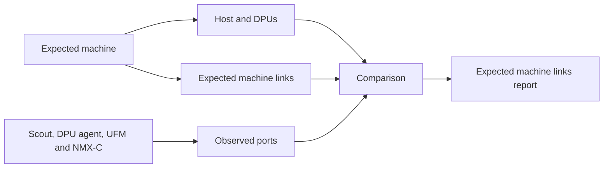

# Expected Link Validation

GitHub Issue: [#3487](https://github.com/dsx-ai-factory/infra-controller/issues/3487)

## Revision History

| Version | Date | Modified By | Description |
| :---: | :---: | --- | --- |
| 0.1 | 11/01/2026 | Felicity Xu | Initial version |
| 0.2 | 11/17/2026 | Felicity Xu | Revised version |

## Problem

NICo should support ingesting and validating the site's epected network topology. 

The site operators need a way to verify whether the machine's physical connections match their plan.
NICo currently collects some port and neighbor information but has no expected-link list to compare it with. 
This design adds that list and a report of what matches, what
differs, and what NICo cannot yet check. The operator declares every active link they expect for an expected machine. 
Each link names a host port, DPU uplink or GPU port and may name its peer
(the device and port at the other end).

NICo shows every physical port it can observe for that machine, including down ports, active ports with unknown
peers, and ports outside the plan. The comparison identifies matching links, discrepancies and links it cannot verify.
Operators can inspect the observed ports before writing a plan.

The design covers host Ethernet, DPU Ethernet uplinks, InfiniBand, and GPU-to-NVLink-switch ports. Operators can
request the reports of many expected machines in one call and find the ones whose links do not match.

Switch-to-switch links are out of scope. So are logical connections: a port here is a physical port, and logical
interfaces, representors and aggregates are not ports. 

## Design

### Workflow



An expected machine supplies the scope: its host and its DPUs. `ExpectedMachineLinks` holds the links the operator
expects for that machine. Collectors report observed ports independently of both. Core compares the two and returns
the observed ports and the comparison in an `ExpectedMachineLinksReport`. Operators can read observations before
declaring links, then edit the plan without changing what collectors report.

### RPCs

```protobuf
// Expected links of one expected machine.
rpc AddExpectedMachineLinks(AddExpectedMachineLinksRequest)
    returns (ExpectedMachineLinks);
rpc UpdateExpectedMachineLinks(UpdateExpectedMachineLinksRequest)
    returns (ExpectedMachineLinks);
rpc DeleteExpectedMachineLinks(DeleteExpectedMachineLinksRequest)
    returns (google.protobuf.Empty);
rpc GetExpectedMachineLinks(ExpectedMachineRequest)
    returns (ExpectedMachineLinks);

// Observed ports of expected machines, compared with their expected links.
rpc GetExpectedMachineLinksReport(GetExpectedMachineLinksReportRequest)
    returns (ExpectedMachineLinksReportList);
```

`AddExpectedMachineLinks` creates a list, `UpdateExpectedMachineLinks` replaces it, and `DeleteExpectedMachineLinks`
removes it. All three use the host BMC MAC as the stable key.
`GetExpectedMachineLinks` reads the expected links of one machine, with no observed status.

`GetExpectedMachineLinksReport` takes a list of host BMC MACs and returns one report per expected machine. Core
builds each report when the call is made. Nothing is computed ahead of time, so there is no stored result and no
background monitor. For a site view, a client takes the BMC MACs from `GetAllExpectedMachines`, requests the reports
in batches, and keeps the ones that are not `MATCH`.

### Expected machine links

```protobuf
// All expected links of one expected machine.
message ExpectedMachineLinks {
  // The host BMC MAC.
  string bmc_mac_address = 1;
  // Assigned by Core.
  string version = 2;
  repeated ExpectedLink links = 3;
}

message ExpectedLink {
  // The machine that owns the port. Absent means the host. Present means the DPU with that BMC MAC,
  // which must be a DPU_BMC entry of the expected machine. Ethernet only.
  optional string dpu_bmc_mac_address = 1;
  // A new interconnect adds one variant here and one in ObservedLinkPort.
  oneof interconnect {
    ExpectedLinkEthernet ethernet = 2;
    ExpectedLinkInfiniBand infiniband = 3;
    ExpectedLinkNvLink nvlink = 4;
  }
}

message AddExpectedMachineLinksRequest {
  string bmc_mac_address = 1;
  // An empty list expects zero active links.
  repeated ExpectedLink links = 2;
}

message UpdateExpectedMachineLinksRequest {
  string bmc_mac_address = 1;
  // Required.
  optional string if_version_match = 2;
  // An empty list expects zero active links.
  repeated ExpectedLink links = 3;
}

message DeleteExpectedMachineLinksRequest {
  string bmc_mac_address = 1;
  // Required.
  optional string if_version_match = 2;
}
```

Expected links are stored by host BMC MAC and belong to their expected machine. They cannot exist without it, and
deleting the expected machine deletes them.

At creation time, the handler should:
- reject an expected link with no interconnect,
- reject a `dpu_bmc_mac_address` that is not a `DPU_BMC` entry of the expected machine,
- reject any expected link with a `physical_ifname` that is not in the machine's `host_nics`
- reject a list with duplicate links

Update replaces the whole list. There are no per-link operations, so `ExpectedLink` does not need an ID. The plain repeated
`links` field makes an empty list mean "expect zero active links"; deleting the list removes that expectation.
Update and delete require `if_version_match` to protect against edits based on an old version.

**Database Table:** The proposed `expected_machine_links` table has one row per host BMC MAC:

```sql
CREATE TABLE expected_machine_links (
    bmc_mac_address macaddr PRIMARY KEY
        REFERENCES expected_machines (bmc_mac_address) ON DELETE CASCADE,
    version varchar(64) NOT NULL,
    links jsonb NOT NULL
);
```

- `bmc_mac_address` is the host BMC MAC. The foreign key ties the row to its expected machine, so deleting the
  expected machine deletes its links. However, [replace-all][expected-machine] deletes every expected-machine 
  row and recreates it, so the cascade would also delete every link list. The replace-all handler therefore should
  reads the link rows before the delete and writes them back, with their versions unchanged, for the machines that
  are still present. Links of a machine that replace-all removes are deleted with it.
- `version` follows the [existing version column convention][version-storage].
- `links` is the list of `ExpectedLink` for that machine, stored as JSONB. One column fits a list that is always
  replaced as a whole, like [expected_machines.host_nics][host-nics-storage].


#### Ethernet links

```protobuf
message ExpectedLinkEthernet {
  // Three forms, because cable plans know different things.
  oneof port {
    // The operator's port label, the same value as ExpectedHostNic.physical_ifname. Resolved through
    // that host_nics entry's MAC or the Astra mapping.
    string physical_ifname = 1;
    // Compared with LLDP local_mac_address and the MAC of the reported interface.
    string mac_address = 2;
    // The name on the owner, such as p0. Mainly for DPU uplinks, whose names are fixed and which
    // host_nics does not list. Compared with LLDP local_port and FabricInterfaceData.interface_name.
    string interface_name = 3;
  }
  // Peer fields are in LLDP terms, because LLDP is the only way NICo sees an Ethernet neighbor.
  // Each set peer field must match.
  //
  // LLDP system_name, exact match.
  optional string peer_system_name = 4;
  // LLDP chassis_id_type and chassis_id_value.
  ExpectedLinkLldpId peer_chassis_id = 5;
  // LLDP remote_port_type and remote_port_value.
  ExpectedLinkLldpId peer_port_id = 6;
  // Negotiated speed.
  optional uint32 speed_mbps = 7;
}

message ExpectedLinkLldpId {
  // ifname, mac, ... Compared too: swp8 as an interface name and as a local string are different
  // identifiers.
  string subtype = 1;
  string value = 2;
}
```

**Already collected.** Scout and the DPU agent run `lldpcli` every 60 s and Core stores the neighbors in
`machine_lldp_neighbors` ([handler][lldp]). Hosts report LLDP only while Scout is running. The DPU agent also reports
`DpuNetworkStatus.fabric_interfaces` on every loop. For hosts, Scout reports a NIC list at discovery only and no link
state. Neither reports speed. A `physical_ifname` resolves only through a `host_nics` MAC or the
[Astra mapping][astra].

**To add.**

- Scout and the DPU agent report every port, including ports without an LLDP neighbor, with its MAC, carrier and
  speed. `LinkData` gains `mac_address` and `speed_mbps`. Link-up uses the port's carrier.
- An LLDP collection time (`machines.lldp_collected_at`). Core stores none, and Scout sends nothing when the neighbors
  are unchanged, so Scout also sends an "unchanged" report at a fixed interval.
- The DPU agent [turns a failed interface read into an empty list][agent]. Surface the failure, so that a failed read
  is not taken for an empty port list.

#### InfiniBand links

An InfiniBand link names an HCA and one port on it. The operator can use its node GUID,
a device identifier, or its PCI address before the GUID is known.

```protobuf
// An InfiniBand port is a device plus a port number.
message ExpectedLinkInfiniBand {
  oneof device {
    // The HCA. Compared with Scout's InfinibandInterface.guid, the sysfs node GUID.
    string node_guid = 1;
    // The HCA before discovery, when the GUID is unknown. Compared with Scout's
    // PciDeviceProperties.slot, which holds the PCI address.
    string pci_address = 2;
  }
  // The device alone does not name a port: a dual-port HCA has two cables.
  uint32 port_number = 3;
  // The switch and its port, compared with the peer of the UFM port record. Each set peer field
  // must match.
  optional string peer_system_name = 4;
  optional string peer_node_guid = 5;
  optional uint32 peer_port_number = 6;
  // The active speed class, such as NDR. A string and not Mbps, because InfiniBand reports a class
  // per lane and converting it would be a guess.
  optional string speed = 7;
  // The number of active lanes.
  optional uint32 width = 8;
}
```

**Already collected.** Scout reports each device's [node GUID][hardware] and PCI properties at discovery, but not its
ports. `IbFabricMonitor` polls UFM for computer ports every 60 s, [matches][ib-match] each UFM port GUID against
Scout's node GUIDs, and stores GUID, LID and partition keys on the machine. It parses the logical state but stores it
only as a special LID value, and it writes only when values change. UFM is the only source for link and peer data.

**To add.**

- Scout reports each device's ports (port number, port GUID), so a UFM port can be matched to a device and port
  number. Port presence uses this list and link-up uses the UFM port state.
- The [UFM client][ufm] parses peer, active speed and active width, and the monitor stores them with the port state.
- The time of the last successful UFM poll per fabric, because the existing timestamp changes only when values change.

#### NVLink links

An NVLink link names a GPU and one of its ports. `port_number` must be present because zero is a valid port. The peer uses the NMX-C switch UID, the
identifier available in topology data, rather than assuming a mapping to NICo's switch records.

```protobuf
// An NVLink port is a GPU plus a port number.
message ExpectedLinkNvLink {
  oneof gpu {
    // Compared with NVLinkGpu.guid in machines.nvlink_info.
    uint64 gpu_guid = 1;
    // The GPU's position in the host, for expected links written before discovery. Compared with
    // NVLinkGpu.device_id, derived from the GPU module ID.
    uint32 gpu_device_id = 2;
  }
  // Required. Optional only so that port 0 can be told apart from unset. PortTopoInfo.port_num.
  optional uint32 port_number = 3;
  // The NVLink switch by its NMX-C device UID, PortTopoInfo.peer_port_device_uid. NICo has no
  // mapping from its own switch records to NMX-C UIDs, so the UID is the only identity it can compare.
  optional uint64 peer_device_uid = 4;
  // PortTopoInfo.peer_port_num.
  optional uint32 peer_port_number = 5;
  // PortTopoInfo.link_rate_mbps.
  optional uint32 rate_mbps = 6;
}
```

**Already collected.** Scout reports each GPU's fabric GUID and module ID, stored in `machines.nvlink_info`.
`NvlPartitionMonitor` polls NMX-C every 60 s for GPUs, partitions and health. It fetches no port data.

**To add.**

- The monitor calls [`GetTopologyInfo`][nmxc], which returns every `PortTopoInfo` field above. Port presence and
  link-up use the port's entry and its physical and logical state. The client method exists but nothing calls it,
  and the NMX-C mock does not implement it.
- A join from the GPU in the topology to the machine, by GPU GUID.
- The time of the last successful poll per NVLink domain.

### Expected machine links validation report

```protobuf
message GetExpectedMachineLinksReportRequest {
  // Host BMC MACs of expected machines, limited by max_find_by_ids. A MAC with no expected machine
  // is omitted from the response.
  repeated string bmc_mac_addresses = 1;
}

message ExpectedMachineLinksReportList {
  repeated ExpectedMachineLinksReport reports = 1;
}

message ExpectedMachineLinksReport {
  string bmc_mac_address = 1;
  // The version compared. Absent when no expected links are configured.
  optional string expected_links_version = 2;
  // UNSPECIFIED when no expected links are configured.
  ExpectedLinkResult result = 3;
  // One entry per expected link, including one whose port was not observed.
  repeated LinkedExpectedLink expected_links = 4;
  // Observed ports that no expected link covers. link_up carries the finding: true is an unexpected
  // link, false is a spare port, unset is unverifiable.
  repeated ObservedLinkPort undeclared_ports = 5;
}

message LinkedExpectedLink {
  ExpectedLink expected_link = 1;
  ExpectedLinkResult result = 2;
  // Explains a MISMATCH or UNKNOWN result. Absent on MATCH.
  optional string message = 3;
  // Absent when the port was not observed.
  ObservedLinkPort observed_port = 4;
}

enum ExpectedLinkResult {
  EXPECTED_LINK_RESULT_UNSPECIFIED = 0;
  EXPECTED_LINK_RESULT_MATCH = 1;
  EXPECTED_LINK_RESULT_MISMATCH = 2;
  EXPECTED_LINK_RESULT_UNKNOWN = 3;
}

message ObservedLinkPort {
  // Always a discovered machine.
  common.MachineId owner_machine_id = 1;
  oneof port {
    ObservedEthernetPort ethernet = 2;
    ObservedInfiniBandPort infiniband = 3;
    ObservedNvLinkPort nvlink = 4;
  }
  // Unset when no usable link state is available.
  optional bool link_up = 5;
  // Dates the link-state evidence when link_up is set and the port inventory otherwise.
  google.protobuf.Timestamp observed_at = 6;
}

// The variants mirror the expected messages, with every local identifier that is known. Properties
// and peer fields are set when usable.
message ObservedEthernetPort {
  string interface_name = 1;
  optional string mac_address = 2;
  // The host_nics label that resolves to this port, if any.
  optional string physical_ifname = 3;
  optional string peer_system_name = 4;
  ExpectedLinkLldpId peer_chassis_id = 5;
  ExpectedLinkLldpId peer_port_id = 6;
  optional uint32 speed_mbps = 7;
}

message ObservedInfiniBandPort {
  string node_guid = 1;
  optional string pci_address = 2;
  uint32 port_number = 3;
  optional string peer_system_name = 4;
  optional string peer_node_guid = 5;
  optional uint32 peer_port_number = 6;
  optional string speed = 7;
  optional uint32 width = 8;
}

message ObservedNvLinkPort {
  uint64 gpu_guid = 1;
  uint32 gpu_device_id = 2;
  uint32 port_number = 3;
  optional uint64 peer_device_uid = 4;
  optional uint32 peer_port_number = 5;
  optional uint32 rate_mbps = 6;
}
```

The `GetExpectedMachineLinksReport` handler in `nico-api` builds each report when it is called. There is no
background monitor and no stored result. The handler reads what the collectors have already saved in the database,
compares it with the machine's expected links, and returns the report. It does not contact hosts, DPUs, UFM or
NMX-C.

For each BMC MAC in the request, the handler needs three things.

The first is the expected links, read from the machine's row in
[`expected_machine_links`](#expected-machine-links).

The second is the set of machines to look at. The BMC MAC leads to the discovered host. The host's DPUs are the ones
named by the expected machine's `DPU_BMC` entries and the ones NICo has attached to that host. A port belongs to the
machine that reported it.

The third is the observed ports of those machines. Each interconnect has its own sources:

| Interconnect | Ports and link state | Peer | Details |
| --- | --- | --- | --- |
| Ethernet | Reported by Scout for the host and by the DPU agent for each DPU | LLDP neighbors, collected by Scout and the DPU agent every 60 s | [Ethernet links](#ethernet-links) |
| InfiniBand | Devices and ports reported by Scout; link state and speed from UFM, polled by `IbFabricMonitor` | UFM | [InfiniBand links](#infiniband-links) |
| NVLink | GPUs reported by Scout; port state and rate from NMX-C, polled by `NvlPartitionMonitor` | NMX-C | [NVLink links](#nvlink-links) |

Each of those sections says what is collected now and what has to be added. Scout runs only while a host is booted
into it, so host data stops updating once a tenant OS is running. The handler uses the time of each source's last
successful collection to decide whether its data can still be used. The age limit is an open question.

With that data, the handler does the comparison in four steps:

1. It joins the sources into one list of ports per machine. An Ethernet port is its owner plus its MAC or interface
   name. An InfiniBand port is its port GUID. An NVLink port is its GPU GUID plus port number.
2. It finds the port that each expected link names.
3. It checks each expected link. The port must exist and its link must be up. Speed, width, rate and peer are
   checked only when the expected link sets them.
4. It puts every port that no expected link named into `undeclared_ports`. When no expected links are configured,
   every port goes there.

An expected link is `MATCH` when every check passes. It is `MISMATCH` only when fresh data proves a difference: the
port is missing, the link is down, or the speed, width, rate or peer differs. It is `UNKNOWN` when the handler cannot
tell: the host or DPU is not discovered, NICo cannot tell which host a DPU belongs to, the data is missing or too
old, the last collection failed, the port cannot be located, or two expected links name the same port. Missing or
old data never counts as a mismatch.

The machine result sums up the links. It is `MISMATCH` if any expected link is a mismatch or any undeclared port has
an active link. Otherwise it is `UNKNOWN` if any expected link is unknown or any undeclared port has no usable link
state. Otherwise it is `MATCH`. `MATCH` does not prove that NICo saw every port of the machine. A machine with no
expected links configured has no result.

Results exist only in the report. They do not go into the machine `HealthReport`, because a host with any health
alert is [not eligible for DPU updates][health], and a cable problem should not block those.

**Example:** Use `GetExpectedMachineLinksReport` to inspect an expected machine's observed ports. The following
`AddExpectedMachineLinks` request expects one active DPU uplink. The DPU BMC MAC is a `DPU_BMC` entry of the
expected machine, and the request can be submitted before discovery:

```json
{
  "bmc_mac_address": "b8:3f:d2:90:a1:10",
  "links": [{
    "dpu_bmc_mac_address": "b8:3f:d2:90:a1:20",
    "ethernet": {
      "interface_name": "p1",
      "peer_system_name": "tor-a12-2",
      "peer_port_id": { "subtype": "ifname", "value": "swp8" },
      "speed_mbps": 100000
    }
  }]
}
```

Until discovery, the report gives the expected link `UNKNOWN` with a message that the DPU is not discovered. Once
evidence arrives, the same report can show this view:

```text
machine: b8:3f:d2:90:a1:10   result: MISMATCH

expected links
owner                  port  expected  observed  result    message
DPU b8:3f:d2:90:a1:20  p1    up, swp8  up, swp9  MISMATCH  peer port is swp9, expected swp8

undeclared ports
owner  port  observed
host   eth1  down
DPU    p0    up, peer unknown
```

The expected `p1` link is a mismatch because its peer port differs. The undeclared DPU port `p0` is also a mismatch
because it is active but absent from the expected links. The down host port is a spare and does not cause a mismatch.

## Open questions

1. How should a site-wide read work? The handler builds every report when it is called, by joining the expected
   links with several observation sources. That is fine for a few machines at a time. A client that polls the whole
   site would repeat that join for every machine on every poll. Options include storing each machine's result and
   filtering on it, or caching reports.
2. Should NICo raise a metric or an alert when links do not match? Today an operator sees a mismatch only by asking
   for the report. Telling operators without being asked needs something that evaluates machines in the background.
3. What should cover a host while a tenant OS is running? Scout does not run then, so the host's Ethernet links
   become `UNKNOWN`. Another source, such as the BMC's view of link state, could fill part of that gap.
4. How old may observed data be before the handler stops using it? The limit decides how quickly a link turns
   `UNKNOWN` when a collector stops reporting.

[expected-machine]: https://github.com/dsx-ai-factory/infra-controller/blob/6bab38d80dd454b1805067b838d709ece1b6fad6/crates/api-core/src/handlers/expected_machine.rs#L906
[hardware]: https://github.com/dsx-ai-factory/infra-controller/blob/6bab38d80dd454b1805067b838d709ece1b6fad6/crates/host-support/src/hardware_enumeration.rs#L315
[lldp]: https://github.com/dsx-ai-factory/infra-controller/blob/6bab38d80dd454b1805067b838d709ece1b6fad6/crates/api-core/src/handlers/lldp.rs#L71
[agent]: https://github.com/dsx-ai-factory/infra-controller/blob/6bab38d80dd454b1805067b838d709ece1b6fad6/crates/agent/src/main_loop.rs#L1139
[astra]: https://github.com/dsx-ai-factory/infra-controller/blob/6bab38d80dd454b1805067b838d709ece1b6fad6/crates/api-model/src/machine/astra.rs
[ib-match]: https://github.com/dsx-ai-factory/infra-controller/blob/6bab38d80dd454b1805067b838d709ece1b6fad6/crates/ib-fabric/src/lib.rs#L902
[ufm]: https://github.com/dsx-ai-factory/infra-controller/blob/6bab38d80dd454b1805067b838d709ece1b6fad6/crates/ib-fabric/src/ib/ufmclient/mod.rs#L100
[nmxc]: https://github.com/dsx-ai-factory/infra-controller/blob/6bab38d80dd454b1805067b838d709ece1b6fad6/crates/rpc/proto/nmx_c.proto#L454
[health]: https://github.com/dsx-ai-factory/infra-controller/blob/6bab38d80dd454b1805067b838d709ece1b6fad6/crates/api-model/src/dpu_machine_update.rs#L224
[api-style]: https://github.com/dsx-ai-factory/infra-controller/blob/6bab38d80dd454b1805067b838d709ece1b6fad6/STYLE_GUIDE.md
[rest-replace]: https://github.com/dsx-ai-factory/infra-controller/blob/6bab38d80dd454b1805067b838d709ece1b6fad6/rest-api/api/pkg/api/handler/expectedmachine.go#L2048
[optional-version]: https://github.com/dsx-ai-factory/infra-controller/blob/6bab38d80dd454b1805067b838d709ece1b6fad6/crates/api-core/src/handlers/ib_partition.rs#L129
[host-nics-storage]: https://github.com/dsx-ai-factory/infra-controller/blob/6bab38d80dd454b1805067b838d709ece1b6fad6/crates/api-db/migrations/20260708172302_squash_snapshot.sql#L1520
[version-storage]: https://github.com/dsx-ai-factory/infra-controller/blob/6bab38d80dd454b1805067b838d709ece1b6fad6/crates/api-db/migrations/20260908143052_attestation_profiles.sql
[loopback-fk]: https://github.com/dsx-ai-factory/infra-controller/blob/6bab38d80dd454b1805067b838d709ece1b6fad6/crates/api-db/migrations/20260914183000_dpu_loopback_reservations.sql#L4
[loopback-preserve]: https://github.com/dsx-ai-factory/infra-controller/blob/6bab38d80dd454b1805067b838d709ece1b6fad6/crates/api-core/src/handlers/expected_machine.rs#L427
