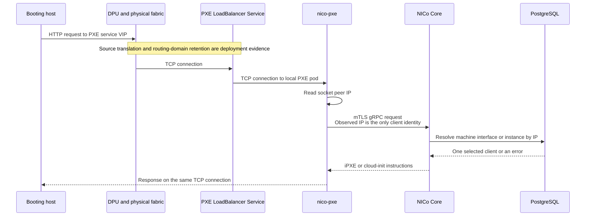

# PXE and Cloud-Init Client Identity

NICo selects machine-specific iPXE scripts and cloud-init data from the source
IP address observed by `nico-pxe`. That is a complete lookup key only while the
address is unique in the lookup domain. This page records the repository-backed
identity contract and the qualification required before separate VPCs may use
the same overlay address.

The identity investigation is tracked by
[dsx-ai-factory/infra-controller#3888](https://github.com/dsx-ai-factory/infra-controller/issues/3888),
and final qualification is tracked by
[dsx-ai-factory/infra-controller#3902](https://github.com/dsx-ai-factory/infra-controller/issues/3902).
Duplicate overlay addresses must remain disabled until the ambiguity rejection
tracked by
[dsx-ai-factory/infra-controller#3887](https://github.com/dsx-ai-factory/infra-controller/issues/3887)
is deployed, the production-equivalent evidence described below is complete,
and
[dsx-ai-factory/infra-controller#3902](https://github.com/dsx-ai-factory/infra-controller/issues/3902)
records final enablement sign-off.

## Repository-Backed Request Path

The following parts of that path are established by code and deployment
manifests:

- [`nico-pxe`](../../crates/pxe/src/main.rs) installs
  `ClientIpSource::ConnectInfo`, and Axum supplies the accepted socket's
  `SocketAddr`. The [request logger](../../crates/pxe/src/middleware/logging.rs)
  records the same peer as `remote_ip`.
- The [machine](../../crates/pxe/src/extractors/machine.rs) and
  [machine-interface](../../crates/pxe/src/extractors/machine_interface.rs)
  extractors deliberately ignore `X-Forwarded-For`. A client-provided
  forwarding header cannot select a machine.
- The [boot-instruction RPC](../../crates/pxe/src/routes/mod.rs) sends the
  observed address as `PxeInstructionRequest.client_ip`. The
  [cloud-init RPC](../../crates/pxe/src/extractors/machine.rs) sends it as
  `CloudInitInstructionsRequest.ip`. Neither request carries a VPC, VNI,
  network-segment, circuit, interface, or authenticated boot-client identity.
- The PXE workload uses its service certificate for the call to Core, and
  [Core's internal RBAC](../../crates/api-core/src/auth/internal_rbac_rules.rs)
  grants both instruction RPCs to the PXE service role. `GetPxeInstructions`
  also permits `machine-a-tron`, which supplies `client_ip` as an RPC field
  rather than deriving it from a connection. Service authentication therefore
  does not authenticate the booting host or add a routing-domain discriminator.
- The [optional Helm external Services](../../helm/charts/nico-pxe/templates/external-service.yaml)
  use `LoadBalancer` and default to `externalTrafficPolicy: Local` when
  enabled, but the chart permits that value to be cleared or changed. No PXE ingress, forwarded-header trust, or
  application-layer proxy is configured by these manifests.

The external Service setting does not prove which address reaches the socket.
An off-box DPU, gateway, or load-balancer hop may preserve or translate the
source before Kubernetes receives it.

## Inputs That Do and Do Not Identify the Client

| Input | Effect on Identity |
|---|---|
| Accepted TCP socket peer | For requests accepted by `nico-pxe`, this is the only host identity input forwarded to Core. Its trust and uniqueness depend on the deployed network path. |
| `X-Forwarded-For` and similar headers | Ignored for client identity. |
| `buildarch`, `product`, and the other iPXE query values | Caller-provided boot characteristics. They can affect rendering after address resolution but do not select the database client. |
| PXE service certificate | Authenticates the PXE service to Core, not the booting host or VPC. |
| `machine-a-tron` service certificate and `client_ip` RPC field | Authorizes another internal caller to request iPXE instructions for a supplied address. It is not evidence about the source of a PXE socket. |
| Deprecated `PxeInstructionRequest.interface_id` | Not populated by `nico-pxe` and not used by Core for client selection. |

The source address itself is therefore security-sensitive. Repository code
does not prove that the DPU prevents source spoofing on this path, that a
gateway gives each VPC a unique translated address, or that the translated
address is one Core can map back to the correct instance.

The protobuf and Core handler comments still describe reading a forwarded
header when a proxy is present. That is not the implemented `nico-pxe` request
path: both request extractors deliberately ignore forwarded headers.

## Core Lookup Behavior

An instance can use a physical interface attached to a secondary DPU. When a
tenant releases that instance, Scout can boot over its retained tenant network
before the controller switches the host to the admin network. Core preserves the
configured attachment instead of substituting the host's primary interface.
The [attachment-resolution change](https://github.com/dsx-ai-factory/infra-controller/pull/7586)
implements this behavior, tracked by
[dsx-ai-factory/infra-controller#7581](https://github.com/dsx-ai-factory/infra-controller/issues/7581).

### Address Ownership

[Core's client resolver](../../crates/api-core/src/handlers/client_resolution.rs)
checks both machine-interface addresses and all matching instance-address
allocations before selecting response material. Multiple allocation rows can
belong to one instance, including allocations on different segments. They do
not, by themselves, mean that multiple instances own the address.

Core resolves each combination of matches as follows:

| Matches for the Observed Address | Resolution |
|---|---|
| No machine interface and no instance | Return not found. |
| One machine interface and no instance | Use that interface. |
| No machine interface and one instance | Use that instance and its allocated segments. |
| One machine interface and one instance describing the same `HostInband` interface | Use the interface for PXE and the instance for cloud-init, subject to the host-state rules below. |
| Multiple instances, or unrelated machine-interface and instance owners | Reject the request with `FailedPrecondition`; do not fall back to a candidate. |

The `HostInband` exception requires a host-owned `Data` interface on the exact
`HostInband` segment in the instance's address allocations. A matching host ID
alone is insufficient. This permits the shared host and instance address used
by zero-DPU and NIC-mode hosts without admitting unrelated owners.

The ambiguity rejection tracked by
[dsx-ai-factory/infra-controller#3887](https://github.com/dsx-ai-factory/infra-controller/issues/3887)
prevents Core from selecting client-specific response material for conflicting
owners. It does not make an IP-only request distinguish two tenants with the
same observed address. The deployment qualification below remains required.

An ownership rejection must expose no candidate tenant, instance, machine,
VPC, or segment identity to the HTTP client. For these rejections, `nico-pxe`
relays Core's error text, which names the observed IP. Candidate instance and
interface IDs appear only in Core's operator logs.

### Configured Physical Attachment

For a tenant address that needs a host interface, Core matches the observed IP
and its allocated segment IDs against interface entries in
`instance.config.network`. It applies the same filter to both `old_config` and
`new_config` in a retained `update_network_config_request`. If the same IP is
allocated on several segments, all matching entries participate.

Each entry identifies a physical function (PF) or virtual function (VF), and
an optional `device_locator`. Matching entries with the same function and
locator count as one attachment. When a PF or several distinct attachments
match, Core resolves each explicit locator, including VF locators. It uses the
host's discovered DPU devices and attached DPU IDs to select exactly one host
`Data` interface attached to that DPU. An omitted locator means the primary
interface. A sole VF skips locator resolution.

Required placement and agreement checks precede compatibility selection:

| Matching Configuration | Host-Interface Selection |
|---|---|
| Conflicting functions or resolved interfaces | Reject with `FailedPrecondition`. |
| A required locator absent from the host's DPU mapping, or mapped to zero or multiple host `Data` interfaces | Reject with `FailedPrecondition`. |
| A PF whose matching attachments agree on an existing host interface | Use that interface, including a secondary DPU's interface. |
| No matching attachment, a sole VF, or multiple VF attachments that agree | Use compatibility selection. |
| Omitted placement and no primary interface | Use compatibility selection if the attachments otherwise agree. |

A missing host or missing discovered hardware information instead produces an
`Internal` error when Core needs the DPU mapping.

Compatibility selection first loads the site's Admin segments and fails if
none exist. Among the host's `Data` interfaces, it then tries the primary,
an interface on an Admin segment, and any remaining interface. Ordering among
otherwise equivalent candidates is unspecified. An empty set of host `Data`
interfaces is also an error.

The segment IDs come from stored allocations; the PXE request does not supply
a segment or prove which physical interface sent it. When Core resolves a
configured PF, its MAC and interface ID describe that attachment. Direct-address and
compatibility selections instead describe the chosen interface. Firmware boot
order and packet captures must establish which interface actually booted.

Attachment resolution reads managed state. It does not read or rewrite
operator-owned expected inventory, which supplies ingestion and linking input.
Firmware reconciliation remains owned by the machine state controller through
[`machine_boot_interfaces`](../provisioning/boot-interfaces-and-dpu-modes.md#71-desired-and-verified-machine_boot_interfaces).
Resolving a PXE request does not change the desired firmware boot device.

### Cloud-Init, Discovery, and Overrides

Cloud-init and `whoami` use the instance view when address ownership permits
it. For a known managed host state, tenant cloud-init is served in
`Assigned/Ready` and `Assigned/WaitingForRebootToReady`. Other states resolve
the address to a host interface for discovery. If the managed host state lookup
returns no state, Core retains the instance view.
In that view, `whoami` has no discovery instructions to display and renders
an error script with `exit 107` over HTTP 200.

A host-owned `Data` interface, including a predicted host's interface, can
provide discovery instructions without a DNS domain. Core returns the selected
interface and uses the host machine ID for cloud-init `metadata.instance_id`.
This covers a secondary interface that has no admin address or domain while
Scout boots during release. DPU-owned, unowned, and non-`Data` interfaces still
require a domain; a referenced domain that cannot be found is also an error. The
[`whoami` renderer](../../crates/pxe/src/routes/ipxe.rs) can display the selected
interface's hostname and MAC without a domain.

Core keys custom PXE overrides and the discovery response's `custom_cloud_init`
field to the resolved machine-interface ID. A primary-interface override does
not apply to a request resolved to the secondary interface. The tenant view
instead returns the instance's user-data. Scout's HTTP user-data route serves
[site snippets](../provisioning/discovery-os-cloud-init.md) and does not consume
Core's `custom_cloud_init` field.

The [release regression](../../crates/api-core/src/tests/machine_discovery.rs),
`test_released_instance_discovers_through_configured_secondary_dpu`, asserts
the secondary PXE MAC and interface ID, Core's secondary `custom_cloud_init`
field, and domainless host metadata. Its `DiscoverMachine` call injects a peer
address and checks that the selected interface is accepted. It does not
exercise a physical boot or a TLS connection.

Attachment conflicts also fail cloud-init's discovery instruction resolution.
The `DiscoverMachine` RPC separately validates source ownership and same-host
interface membership. After a Core error, PXE renders a non-booting script with
`exit 101` over HTTP 200. Cloud-init and `whoami` return HTTP 400 when their
request extractor receives that error. A Scout metadata fallback does not
bypass these resolver errors.

## Deployment Evidence Still Required

The repository establishes the PXE pod, Service, and Core behavior, but it does
not contain the complete [FNN](../glossary.md#fnn) gateway and physical
return-path configuration.
The launch-site SRE, DPU/HBN owner, and physical-network owner must capture both
the request and reply for the following registered endpoints:

- `/api/v0/pxe/boot` and `/api/v0/pxe/whoami`.
- `/api/v0/cloud-init/tenant/user-data`,
  `/api/v0/cloud-init/tenant/meta-data`, and
  `/api/v0/cloud-init/tenant/network-config`.
- `/api/v0/cloud-init/scout/user-data` and
  `/api/v0/cloud-init/scout/meta-data`.
- `/api/v0/cloud-init/dpu/user-data` where the deployment uses that consumer.

`/api/v0/cloud-init/tenant/vendor-data` is static and performs no client lookup.

The qualification must use two isolated FNN VPCs with the same overlay address
and correlate each request across every listed hop and endpoint. Use a unique
per-request marker where the endpoint and protocol support one. Otherwise,
synchronize clocks and record the timestamp, complete source and destination
address-and-port tuple, translation state, node or pod identity, and response
status or result at every hop. For each correlated request, also record:

1. The source address and VPC/VRF at the host-facing DPU interface.
2. The source address, VNI/VRF, and any translation at DPU egress.
3. The source address, routing table, and any translation or connection state
   at each physical gateway hop.
4. The deployed PXE Service type and `externalTrafficPolicy` value.
5. The `remote_ip` recorded by `nico-pxe` and the value sent to Core.
6. The routing context used by the reply at the site controller node, gateway,
   and DPU.
7. Which host receives the reply.

The qualification must also actively test source spoofing from both VPCs.
Record the enforcement point and a negative result showing that one host cannot
forge the other VPC's accepted source or translated peer identity. Passive
packet captures establish what happened in one request; they do not establish
that the observed identity is non-spoofable.

Use the non-tenant-specific `/api/v0/tls/root_ca` PXE endpoint for the first
network-path capture.
After the ambiguity rejection from
[dsx-ai-factory/infra-controller#3887](https://github.com/dsx-ai-factory/infra-controller/issues/3887)
is deployed, repeat the test against the instruction endpoints and verify that
neither VPC receives tenant or discovery material or candidate identities.

## Enablement Decision

[dsx-ai-factory/infra-controller#3887](https://github.com/dsx-ai-factory/infra-controller/issues/3887)
is necessary but is not, by itself, an enablement decision.

- If both VPCs reach `nico-pxe` with the same peer address, or if a shared
  translation loses routing-domain identity, a follow-up implementation is
  required before duplicate addresses can be enabled.
- If the deployed path supplies a stable, non-spoofable, globally unique value
  that Core can already map to the correct assigned instance, and the reply is
  proven to return through the same VPC, the ambiguity rejection is sufficient
  and no new protocol is needed.
- If the observed value is unique but Core cannot map it to the assigned
  instance, a follow-up implementation is still required.

Do not select a header, token, VNI field, proxy protocol, or source-NAT scheme
before the capture identifies which component can provide and authenticate the
smallest useful discriminator.
