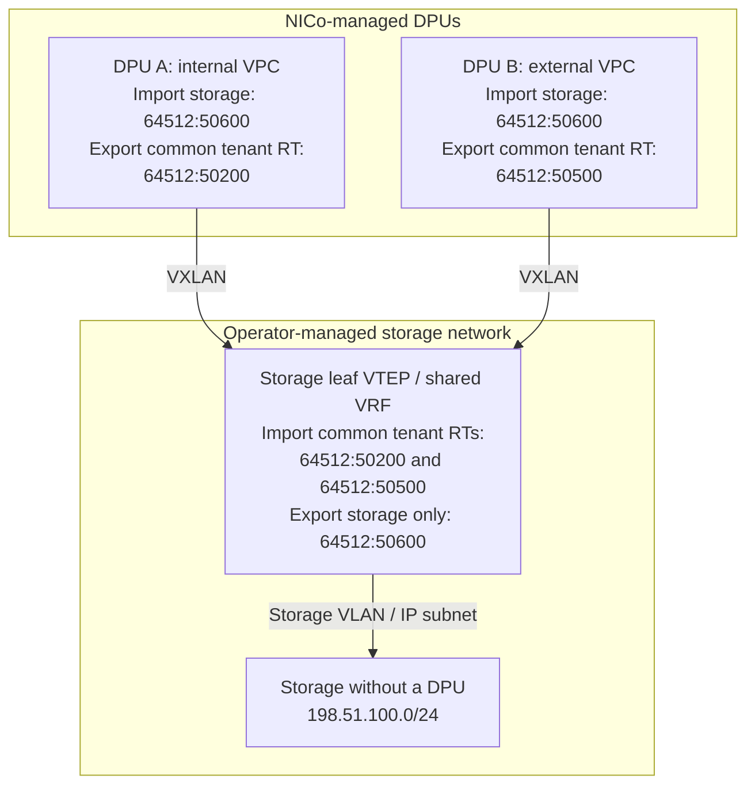

# Tenant Connectivity and Shared Services

An instance in an FNN VPC can reach storage, shared services, and external networks when both sides have the required routes and access rules. This guide explains where to configure them. It assumes the site's underlay and EVPN overlay are working. For communication within one VPC, see [Intra-VPC Connectivity](vpc_network_virtualization.md#intra-vpc-connectivity).

## Where to Configure Access

| Destination | Connection pattern | Who configures it |
|---|---|---|
| Another NICo VPC | Explicit VPC peering, subject to site policy and access controls | Tenant Admin for their own VPCs, or Provider Admin for cross-tenant peering |
| Existing datacenter network or routed storage | A route to the destination in the VPC and a return route in the external network | NICo operator selects routing policy. Network team configures the external path |
| Shared storage on an EVPN-capable leaf | Storage VRF exports service prefixes that authorized VPCs import | Network team owns the leaf/VTEP. NICo configures managed-host DPUs |
| External administrator or VPN client | Provider-routed private access or an explicitly deployed tenant edge/bastion | Provider network team and tenant/platform operator |

Creating an FNN VPC does not provision a public IP, NAT gateway, VPN endpoint, or SSH bastion. An `EXTERNAL` routing profile selects routing policy. Supply the edge and both directions of routing, then permit the required traffic with network and host firewalls.

## Reach a Tenant Through an Edge VPC

For administrative access, put a VPN endpoint or SSH bastion in a separate edge VPC for each tenant. Peer it with that tenant's workload VPCs on the same Site:

1. The provider supplies a private routed connection or a public-IP/VPN mapping to the edge instance. The external gateway, NAT if used, and return routing are provider-managed.
2. The tenant deploys and secures the edge instance, including authentication, patching, host firewall rules, and any forwarding or NAT it needs.
3. A Tenant Admin creates a peering from the edge VPC to each workload VPC using the [VPC peering REST API](vpc_peering_management.md#creating-through-rest).
4. The tenant applies NSGs that permit only the intended management flows and validates both permitted access and isolation from other tenants.

An SSH bastion starts a new connection to the workload from its own reachable address. A forwarding VPN also needs a return path to its client prefixes, or SNAT on the edge. Peering alone does not advertise VPN client networks or turn the edge instance into a router. See [BGP Peering](../networking/bgp_peering.md) for additional prefix announcements.

Peering is bidirectional, but it is not transitive: peering edge-to-A and edge-to-B does not create an A-to-B peering. A forwarding host or external router can still provide a transit path, so constrain those paths too. Use non-overlapping address space for networks that must share a routing table. Neither peering nor an NSG translates overlapping addresses.

Access to one VPC does not imply access to a second VPC, even when both belong to the same tenant. If the second VPC is unreachable, check its peering, routes, and return path before changing site-wide policy.

## Connect Storage Without a Managed DPU

For a storage server without a DPU, the leaf or border gateway can terminate VXLAN. Traffic takes this path:

1. The instance sends traffic to its DPU gateway.
2. The DPU looks up the storage prefix in the tenant VRF and encapsulates the packet toward the storage leaf's VTEP.
3. The leaf decapsulates VXLAN and routes to the storage VLAN or subnet.
4. The storage server replies through its gateway. The storage VRF uses the tenant route it imported to reach the instance's DPU.

The storage server receives ordinary IP/Ethernet traffic, possibly VLAN-tagged. It does not need a VXLAN interface. NICo configures the managed-host DPUs. The network/storage team configures the leaf VTEP, VRFs, VLANs, SVIs, EVPN policy, and storage interfaces, and must validate that they work together.

### Storage Isolation Choices

| Model | Isolation boundary | Operational consequence |
|---|---|---|
| Storage instance behind its own NICo-managed DPU | NICo VPC/VRF and NSG controls apply to that attachment | Use a storage VPC and explicit peerings where needed. Storage authorization is still required |
| Separate storage attachment per tenant, with VLAN support | Operator-managed VLAN/VRF separation on the leaf plus the storage system's tenant interfaces | The leaf performs VLAN-to-VXLAN integration. Onboarding may require per-tenant VRF, VLAN, SVI, VNI, and storage interface configuration |
| One shared storage VRF/subnet | Multiple authorized VPCs reach the same service network | Less per-tenant fabric configuration, but storage credentials, exports, namespaces, and application authorization must separate tenants |

If the storage endpoint cannot provide separate VLAN interfaces or equivalent tenant attachments, a shared subnet cannot provide per-tenant L2 isolation at that endpoint. Use storage/application isolation and appropriate network ACLs. Importing a route grants reachability. It does not authorize access to a file, object, block volume, or database.

### Example: A Shared Storage VRF

Give storage routes their own route target. This example uses ASN `64512`, storage prefix `198.51.100.0/24`, and storage RT `64512:50600`. Replace these with values from the site's address and route-target plan.

NICo tags exported VPC routes with the VPC's own native RT and the additional RTs in its effective routing profile's `route_targets_on_exports`. Those additional RTs can be common to many VPCs. In this example, internal VPCs share the tenant export RT `64512:50200`, and external VPCs share `64512:50500`. Set these values in site configuration. The profile names do not assign them automatically.

Arrows follow requests to storage. Replies use the same links in reverse. The RTs in each box control which routes that VRF imports and exports. Native VPC and infrastructure RTs are omitted from the diagram. The storage leaf imports tenant routes for the return path. Each tenant imports the storage RT, without importing the other tenants' export RTs.

| Routing table | Import | Export |
|---|---|---|
| Authorized tenant VPCs | Their own native VPC RT, required infrastructure RTs, and storage RT `64512:50600` | Their own native VPC RT and the profile's **common tenant export RT** (`64512:50200` for internal or `64512:50500` for external in this example) |
| Storage VRF on the leaf | Common tenant RTs `64512:50200` and `64512:50500` for return routes | **Only the intended storage prefixes** under `64512:50600` |

The network team configures the storage VRF once to import the agreed tenant export targets. New VPCs using those targets can then gain storage access without adding each VPC's native RT to the storage leaf. If only a subset of VPCs should participate, use a dedicated export target for that subset or import their individual native targets instead.

The optional site setting `fnn.common_internal_route_target` can add another common export tag independently of the routing profile. This example uses profile-level tags. See [Export Route-Targets](vpc_network_virtualization.md#export-route-targets-and-return-path-reachability) for the full export policy.

On the NICo side, add the storage RT to the selected routing profiles' `route_target_imports`, preserving other required imports, and ensure their `route_targets_on_exports` match what the storage VRF imports. For selected VPCs, an authorized caller can use [per-VPC routing-profile overrides](vpc_routing_profiles.md#per-vpc-routing-profile-overrides). Do not use `fnn.additional_route_target_imports` for selective access: it adds the RT to every FNN VPC VRF, including the admin VRF, regardless of profile.

For replies, the storage VRF needs routes to the instance interfaces. NICo exports their connected prefixes with the native and configured common RTs. A common RT tags multiple routes without combining their prefixes. The storage VRF must learn those routes and resolve their DPU next hops. Any aggregate advertised farther upstream must lead to a device that can forward using those more-specific routes.

<Warning>
Do not import a common tenant-export RT into every tenant VPC. That imports other tenants' routes too. Only attach the storage RT to service prefixes. Do not re-export learned tenant routes or tenant aggregates with that tag. For the same reason, give an external default route its own RT that tenants import but never attach to their own exports. Importing an RT accepts all routes tagged with it, without filtering them to the storage prefix.
</Warning>

This shared VRF example requires non-overlapping tenant return addresses in the storage routing table. If tenants reuse addresses, the storage network cannot choose the correct return tenant from the destination IP alone. Use separate routing contexts/attachments, or a provider-managed NAT or proxy design that gives each tenant an unambiguous return path. NICo route-target imports and VPC peering do not perform SNAT or DNAT.

### Default Routes and Unintended Access

Review default routes as well as explicit storage routes. Removing the storage RT import is insufficient if an instance can reach storage through a default route to an exit VRF that also knows the storage prefix. Similarly, a shared VRF that learns all tenant routes can become a transit path between tenants.

Keep unauthorized destinations out of those transit paths or filter them on the provider fabric. NICo's mutual-isolation mode also installs floating blackhole routes for the effective `site_fabric_null_routes`. An intended EVPN route must be at least as specific as a covering blackhole to take precedence. These blackholes do not protect against accidentally importing more-specific tenant routes. Follow the prefix and default-route constraints in [Network Isolation](../network_isolation.md#ethernet) and [VPC Peering](vpc_peering_management.md#virtualized-to-flat-routing-prerequisite).

## NSGs and Connectivity Checks

[Network Security Groups](../networking/network_security_groups.md) filter traffic at managed instance interfaces. They do not supply routes or protect an unmanaged storage server's other attachments.

- Attach an NSG to the VPC for rules shared by its instances. An instance NSG **replaces**, rather than merges with, that VPC NSG for the instance.
- Express rules from the instance's perspective: ingress is traffic to the instance, egress is traffic from it. Permit only the required source/destination prefixes, protocols, and ports. Rules with lower priority numbers are evaluated first.
- Account for replies. For stateless rules, permit the return flow explicitly. Stateful egress requires site support and does not grant arbitrary inbound connections. Site deny rules and operator overrides also apply.
- Wait for `networkSecurityGroupPropagationDetails` on the VPC/instance to show the intended rules have propagated. The instance's `Ready` status alone does not confirm this.

Before handing the network over, verify:

1. The tenant VRF has the intended storage or edge route and a reachable remote VTEP. The receiving VRF has routes back to the instance interfaces.
2. A real application connection succeeds in both directions, using the expected path and ports. An established BGP session alone is insufficient.
3. An unauthorized VPC cannot reach the service or another tenant, including through an exit/default route or the shared storage VRF.
4. Revoking access removes reachability through every alternate path. Exercise withdrawal and recovery in a test environment before relying on the design.

For the configuration NICo generates, see the [FNN DPU template](https://github.com/dsx-ai-factory/infra-controller/blob/main/crates/agent/templates/nvue_startup_fnn.conf). Request fields and permissions are defined in the [REST API contract](https://github.com/dsx-ai-factory/infra-controller/blob/main/rest-api/openapi/spec.yaml).
