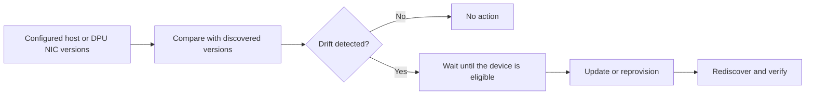

# Firmware Updates

This guide first gives a high-level view of firmware updates in NICo and helps
you choose the workflow that applies to your hardware. The linked workflow
pages then explain their configuration, prerequisites, execution, verification,
and recovery in detail.

## Overview

NICo uses a site-wide desired-state process for managed host firmware and DPU
NIC firmware. Operators configure the versions expected at the site. When
automatic updates are enabled, NICo compares those versions with the firmware
reported by managed hardware. Drift makes a device eligible for an update,
which NICo schedules automatically instead of requiring a one-off update
command.

The drift-driven workflow is:

Detecting drift does not mean the update starts immediately. NICo may wait for
the machine to enter an eligible state, an update window to open, or site-wide
concurrency limits to allow more work. The responsible controller then performs
the update or reprovisioning and verifies the result from newly discovered
hardware state.

[Pre-ingestion](firmware-updates/pre-ingestion.md) is a related but separate
path. When automatic updates are enabled, it can update new hardware whose
firmware is below a configured minimum before NICo ingests and manages it.
After ingestion, drift detection keeps the hardware aligned with the configured
baseline.

Not every firmware workflow begins with drift detection. Rack-scale compute
trays, NVSwitches, and power shelves can be updated through explicit API
requests. Some platforms require a vendor tool, a script, rack maintenance, or
a manually confirmed procedure. Refer to
[Choose the update path](#choose-the-update-path) for the path used by each
component.

## How automatic work is scheduled

Machine Update Manager schedules automatic firmware work for managed hosts and
DPUs. It does not install firmware itself; the managed-host state machine owns
the disruptive work and the return to service.

On each scheduler pass, NICo:

1. clears bookkeeping for updates that have completed;
1. counts distinct hosts reported by the update modules;
1. calculates the remaining capacity from the site-wide machine-update limit;
1. asks the host firmware module and, when enabled, the DPU module for eligible work; and
1. creates requests up to the remaining shared capacity.

Pre-ingestion firmware is not scheduled by Machine Update Manager. It has a
separate polling interval and concurrency limit because the hardware has not
yet entered the managed-host lifecycle. Refer to the
[Machine Update Manager architecture](../architecture/overview.md#machine-update-manager)
for the broader ownership model.

### Shared Host Capacity

NIC capacity accounting and the transaction protections below require a build
containing the [shared NIC accounting implementation (PR #8780)](https://github.com/dsx-ai-factory/infra-controller/pull/8780).
Earlier builds lack this NIC accounting and these transaction protections.
This implementation counts existing NIC operations; it does not enable first
production NIC admission or the full NIC rollout.
[Remaining NIC admission work](https://github.com/dsx-ai-factory/infra-controller/issues/6680)
is tracked separately.

Machine Update Manager counts distinct hosts from these sources:

- Hosts with a host reprovisioning request, including operator requests. The
  host firmware module always participates in accounting.
- Hosts with DPU reprovisioning requests from the automatic update initiator,
  while `dpu_config.dpu_nic_firmware_reprovision_update_enabled` is `true`.
  Disabling this module also stops counting its outstanding automatic requests.
- Stable or predicted hosts whose current state is `NicFirmwareUpdating`.
  NIC accounting continues when new NIC admission is disabled.

One counted host consumes one slot, even when it has several DPUs or NIC cards
or appears in several modules. A maintenance state or manual DPU request alone
does not consume a slot. This ceiling gates new automatic requests; manual
work can make occupancy exceed the ceiling. Selection follows the separate
[host scheduling gates](firmware-updates/host-firmware.md#scheduling-gates) and
[DPU eligibility checks](firmware-updates/dpu-firmware.md#eligibility-and-scheduling).

NIC accounting reads current host states, excluding state history and the
state mirrored onto DPU records. Every NIC phase occupies capacity:
`ObservingSupervisor`, `Unlocking`, `UpdatingFirmware`, `Rebooting`,
`Reobserving`, `RestoringLockdown`, and `Failed`. A host retains its slot during
recovery, lockdown restoration, and failure until it leaves `NicFirmwareUpdating`.
Missing supervisor receipts do not free capacity. A parked `Failed` operation
can require operator intervention; follow [NIC Firmware Recovery](../architecture/state_machines/managedhost.md#nic-firmware-recovery)
for diagnostics and the guarded recovery paths.

Core resolves the capacity policy after loading configuration:

- The deprecated top-level `max_concurrent_machine_updates` supplies the
  effective `machine_updater.max_concurrent_machine_updates_absolute` when the
  nested field is unset. When both are set, Core uses the smaller value.
- With `machine_updater.max_concurrent_machine_updates_percent` set, Core rounds
  that percentage of all managed hosts up, then subtracts unhealthy hosts,
  stopping at zero. A nonnegative effective absolute limit further caps this
  result. A zero or negative percentage permits no new automatic requests,
  even if the absolute limit is positive.
- Without a percentage, the effective absolute limit applies directly. If
  neither limit is set after resolving the legacy key, the ceiling is zero.
- Existing occupied slots reduce the remaining capacity. A zero ceiling stops
  new automatic requests without cancelling existing workflows or freeing slots.

For example, suppose there are 100 managed hosts, a 20% limit, 3 unhealthy
hosts, a nested absolute limit of 20, a legacy absolute limit of 10, and 2
distinct occupied hosts. These are example inputs, not defaults. The effective
absolute limit is 10, the ceiling is `min(20 - 3, 10) = 10`, and 8 slots remain
for new automatic requests.

The host total includes predicted hosts and every managed-host state. A host
is unhealthy for this calculation if it has any aggregate alert other than
`HostUpdateInProgress`. Such a host is subtracted as unhealthy even if it also
occupies an update slot. Core accepts negative absolute values: without a
percentage they prevent new requests; with a positive percentage they do not
cap the percentage calculation.

The Helm chart supplies a legacy limit of `10` by default. The setup values in
`helm-prereqs/values/nico-core.yaml`, `nico-core-10k-hosts.yaml`, and
`nico-core-simulation.yaml` override it with `20`. These are overridable chart
and setup defaults. Site TOML overrides base TOML, and `CARBIDE_API_`
environment configuration overrides both, before Core resolves the legacy key.

If an occupancy read fails, including a persisted NIC operation that cannot
be decoded, the pass fails before creating new requests. Core retries failed
passes at `machine_update_run_interval`, whose default is 300 seconds. Inspect
`carbide_managed_loop_iterations_total{manager="machine_update_manager",outcome="error"}`
and the warning "managed loop iteration failed" for the cause. A persistent
read failure blocks new automatic requests until corrected.

Cleanup and request-creation transactions verify that the scheduler still
owns its database work lock before writing. Changed ownership rejects those
writes. Each transaction applies a 5-second PostgreSQL `statement_timeout` per
statement, preserving a shorter nonzero session limit. A session limit of zero
becomes 5 seconds. The setting remains local until commit or rollback.
This cap does not bound connection acquisition, work-lock acquisition, the
total transaction duration, or the whole scheduler pass. Firmware catalog
filesystem reads and DPF compatibility checks run outside these transactions. DPF has
separate compatibility deadlines, described in [Eligibility and scheduling](firmware-updates/dpu-firmware.md#eligibility-and-scheduling).

## Set the expected versions

NICo does not discover the latest firmware version on its own. Before NICo can
detect drift, the site must define which firmware versions are expected.

For host firmware, NICo uses a catalog organized by BMC vendor, host model, and
component. A component can define both:

- `preingest_upgrade_when_below`: the threshold that triggers firmware work
  before ingestion.
- `default`: the desired version used to detect drift after ingestion.

For example, a host reporting BMC version `7.05.00.00` meets a configured
minimum of `7.00.00.00`, so ingestion can continue. If the default is
`7.10.30.00`, that host is still drifted after ingestion and becomes eligible
for the managed-host firmware workflow.

Host definitions can come from the
[Host Firmware Config API](api:PUT/v2/org/{org}/nico/firmware-config/host),
legacy `metadata.toml` files, or static `host_models` configuration. NICo merges
these sources into one effective catalog. The API is the current configuration
method; `metadata.toml` is retained for existing deployments.

DPU NIC firmware uses an accepted-version list in the site configuration
instead of the host catalog. Rack and component workflows receive their target
from an explicit request or their component backend.

Refer to [Configure Firmware Versions](firmware-updates/configuration.md) for the
configuration models, setting reference, examples, and source precedence.

## Choose the update path

Use the table below to find the path for the hardware and component you are
updating. For hosts, the path also depends on whether ingestion has completed.

| Your situation | Update path | How it begins |
|---|---|---|
| A host has not completed ingestion and a reported component version is below `preingest_upgrade_when_below`. | [Pre-ingestion](firmware-updates/pre-ingestion.md) | The pre-ingestion manager detects the condition. When global automatic updates are enabled, it selects the default or pre-ingestion-only firmware entry and starts the update. |
| Firmware on a managed host differs from the effective default in the merged firmware catalog. | [Host firmware](firmware-updates/host-firmware.md) | When host automatic updates are enabled, NICo detects the drift and schedules host reprovisioning. If `explicit_start_needed` is enabled, NICo first waits for the host's update window. |
| A managed DPU NIC reports a version outside `dpu_nic_firmware_update_versions`. | [DPU NIC firmware](firmware-updates/dpu-firmware.md#dpu-nic-firmware) | When DPU NIC updates are enabled, NICo detects the drift and schedules DPU reprovisioning. |
| A DPU component other than the NIC needs an update. | [DPU firmware components](firmware-updates/dpu-firmware.md#components-covered) | Request DPU reprovisioning explicitly. Applying the BFB updates the bundled firmware and verifies selected components; non-NIC drift is not an independent automatic trigger. |
| A rack, compute tray, NVSwitch, or power shelf needs an update. | [Rack and component firmware](firmware-updates/rack-component-firmware.md) | An operator requests the update through the appropriate API. NICo routes it to the controller or backend responsible for that component. |
