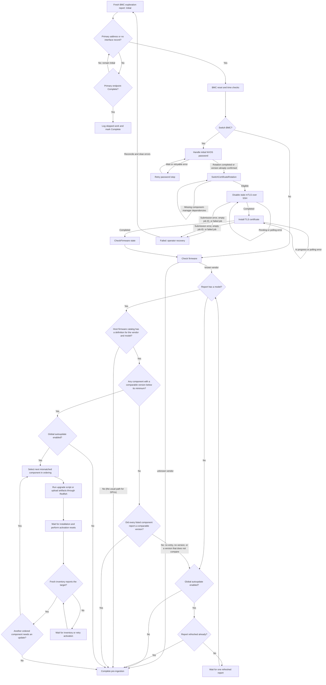

# Pre-ingestion Firmware Updates

Pre-ingestion firmware updates run against a discovered host BMC before NICo
creates the managed host. Their purpose is to update firmware that is too old
for the normal ingestion and management workflow.

This path is driven by the pre-ingestion manager. It does not use Machine
Update Manager, host update windows, `explicit_start_needed`, or per-host
automatic-update overrides. A machine ID might not exist yet, so the only
automatic-update switch used by this path is `firmware_global.autoupdate`.

This page covers host firmware selected from the
[host firmware catalog](configuration.md#host-firmware-catalog). DPU BFB
recovery also runs in the pre-ingestion state machine, but installs a DPU boot
image to recover the DPU; it is not a host firmware-catalog workflow.

At `Initial`, NICo selects one primary BMC address per machine interface: the
allocated IPv4 address when present, otherwise IPv6. Only that address begins
the full pre-ingestion workflow. While a secondary address is in `Initial`, it
waits for the primary endpoint to reach `Complete`, then becomes `Complete` and
logs that its work was skipped. A missing primary endpoint or one that has not
completed, including `Failed`, keeps the secondary waiting; NICo does not
automatically fall back to IPv6. The rack compute-tray firmware workflow can
advance aliases together after this selection, as described below.
If no machine-interface record exists, the endpoint begins the normal workflow.

Only the selected primary address can perform Site Explorer error remediation,
including after pre-ingestion completes. Pre-ingestion evaluates this selection
at `Initial`; adding an address does not cancel or reassign pre-ingestion already
in progress. Each interface permits one address per family.
Interfaces on different segments are selected independently, even
when they share a BMC MAC.

After successful BMC time synchronization, the selected switch BMC endpoint enters
[initial NVOS password rotation](../nvos-password-rotation.md#initial-rotation-during-pre-ingestion)
and then [switch certificate rotation](#switch-certificates-before-firmware)
before firmware checks and updates. Firmware work proceeds after the password
step completes or is skipped and certificate handling completes. Disabling
firmware updates or switch creation does not disable these steps.
Compute-tray and DPU BMCs do not enter `NvosPasswordRotation`,
`SwitchCertificateRotation`, or their `CheckFirmware` continuation; they proceed
through their existing firmware path.

## Switch certificates before firmware

`SwitchCertificateRotation` removes stale mTLS bindings over SSH, then installs
the switch TLS certificate through RMS using the working NVOS credentials from
the password step. Both operations use expected-switch inventory before a managed
switch exists. Firmware checks wait until certificate handling completes.
The switch controller's certificate workflow still runs after ingestion;
see [Switch Certificate Configuration](../../architecture/state_machines/switch_configure_certificate.md).

The stage uses the effective
[`[switch_state_controller].switch_mtls_services`](../../configuration/rms.md#switch_mtls_services)
list. Omission and `[]` select all four default services, then pre-ingestion
omits `scale_up_fabric_manager` and `scale_up_fabric_telemetry` because no primary
switch has been elected. The default therefore binds `nvue_api` and
`scale_up_fabric_telemetry_interface`. A non-empty configured list replaces the
defaults before this filtering. If no services remain, or the expected switch
has no rack association, either submission phase returns an error and retains
its state for retry after the configuration or expected inventory is repaired.

The two persisted states each carry an optional `job_id`. `None` submits the
operation; `Some(job_id)` polls the saved job.

| State | Behavior |
|---|---|
| `DisableMtls { job_id }` | Clear stale bindings for the selected services over SSH. Job completion advances to `ConfigureCertificate { job_id: None }`. |
| `ConfigureCertificate { job_id }` | Install certificates for the selected services using the rotated NVOS credentials. Job completion advances to `CheckFirmware`. |

Missing component-manager dependencies, expected inventory, working credentials,
or a resolvable NVOS endpoint return an error and retain the current phase for
retry when detected before the component-manager call.
Inventory, rack, service, credential, and endpoint checks apply to both
`DisableMtls { job_id: None }` and `ConfigureCertificate { job_id: None }`.
Polling a saved job does not repeat these submission checks.
Every iteration, including polling, still requires a switch endpoint, a BMC
interface, no existing managed switch, and component-manager dependencies.

A confirmed NVOS version skips password rotation and advances directly to
`SwitchCertificateRotation`; it does not skip TLS handling. Certificate
completion or failure changes only that endpoint. Secondary addresses wait in
`Initial` until the primary reaches `Complete`. Switch creation still requires
every allocated BMC address to be `Complete`.

Once a job ID is saved, restarts resume polling that job. Every polling error is
returned while retaining the phase and job ID for another poll on the next
iteration, including errors reporting a missing job, an unknown outcome, or an
unsupported operation. Successful `Pending`, `Started`, or `InProgress`
responses also continue polling. If NICo restarts after dispatch but before saving the job ID,
the state still has `job_id: None` and submits again; the backend may receive a
duplicate operation.
Submission and status reads await the backend directly, as in NVOS password
rotation, without additional pre-ingestion timeouts.
Every submission error moves the endpoint to `Failed` and returns the error,
including unsupported operations and rejection before dispatch. An empty
returned job ID also fails pre-ingestion. A successful status response reporting
a failed job moves the endpoint to `Failed`. NICo does not automatically resubmit
operations or resume polling after these terminal failures.
Reconcile the RMS operation and the switch's TLS state before clearing errors
on the failed endpoint and retrying pre-ingestion.

## Rack compute trays

An expected compute tray with a rack ID uses its rack profile instead of the
host firmware catalog. When the profile has a `firmware_object`, NICo fetches
that source-of-truth (SOT) document, reads the artifact token from the optional
named credential, and calls the RMS compute firmware API with the BMC MAC as
the node ID. The `firmware_global.autoupdate` setting does not gate this
rack-profile workflow. NICo enforces a fixed 16 MiB maximum for the fetched SOT.
Rack compute trays without a configured firmware object skip automatic firmware
updates and continue ingestion. They never use the standalone host firmware
catalog.

This path is enabled only when the Component Manager compute-tray backend is
`rms`. With another backend, compute trays keep the standard pre-ingestion
behavior. The rack state machine can still use the profile's firmware object.

NICo does not inspect or compare component versions in the SOT. RMS compares
the SOT with its firmware inventory. A successful RMS response without a job
lets NICo continue ingestion. When RMS creates a job, NICo persists the
exact job ID in pre-ingestion state and waits for completion before continuing
ingestion. This workflow updates the explored aliases together when entering
`RackFirmwareUpdateWait`, `Complete`, or `Failed`; a secondary can therefore
leave `Initial` through a shared firmware transition.
Expected switches do not use this compute-tray path. Their existing
rack state-machine firmware behavior is unchanged.

## When this path applies

A host firmware update starts during pre-ingestion when all of the following
are true:

1. Site exploration has produced a BMC vendor, host model, and firmware
   inventory for an endpoint that has not completed pre-ingestion.
1. The effective host firmware catalog contains a definition for that vendor
   and model.
1. At least one reported component has
   `preingest_upgrade_when_below` configured and its reported version is lower
   than that threshold.
1. `firmware_global.autoupdate` is enabled.

The reported version must come from an inventory entry matched by
`current_version_reported_as`. A missing catalog definition, missing inventory
match, missing version, or a version that does not compare with its minimum
cannot trigger the update. A known model with no catalog definition completes
the firmware portion of pre-ingestion at once. With `firmware_global.autoupdate`
enabled, an incomplete report is given one more chance: when the report names
a known BMC vendor but no host model, or when a definition exists but a
component's inventory entry or version is missing or its version does not
compare with its minimum, and no other component triggers the update, NICo
waits for one refreshed exploration report and decides again on that report;
if the details are still missing, it completes the firmware portion of
pre-ingestion and continues with ingestion.

When `firmware_global.autoupdate` is disabled, NICo still checks for versions
below the threshold, but it does not install firmware, does not wait for a
refreshed report, and does not block ingestion. It marks pre-ingestion
complete. The host model and machine ID allowlists used by
managed-host updates are not consulted here.

## Trigger and target

`preingest_upgrade_when_below` decides whether firmware work starts; it does not
specify the version NICo installs. NICo selects an installable entry from
`known_firmware` that is marked `preingestion_exclusive_config` or `default`.
A pre-ingestion-only entry allows the ingestion target to differ from the
steady-state default.

Once any component is below its threshold, NICo walks the model's `ordering`
and updates every ordered component whose reported version differs from its
pre-ingestion target. A component does not need to be below its own threshold
at this point. If no ordering is configured, the legacy default is BMC followed
by UEFI.

For example:

| Component | Minimum | Target | Reported on host A | Reported on host B |
|---|---|---|---|---|
| BMC | `7.00` | `7.10` | `6.50` | `7.05` |
| UEFI | `1.50` | `1.80` | `1.60` | `1.60` |

- Host A triggers pre-ingestion firmware work because its BMC is below `7.00`.
  NICo updates both BMC and UEFI because both differ from their targets.
- Host B does not trigger pre-ingestion firmware work because both components
  meet their minimums. After ingestion, both can still be treated as drifted
  from their steady-state targets.

## Update sequence



The state machine performs the following work:

1. **Select the BMC address.** The primary continues below. A secondary waits
   for the primary to complete, then skips its own pre-ingestion work.
   An endpoint without a machine-interface record continues below.
1. **Prepare the BMC.** NICo attempts an initial BMC reset, waits for a fresh
   exploration report, configures the site's NTP servers, and checks BMC time.
   Firmware comparison uses the refreshed inventory.
1. **Handle switch NVOS credentials.** The selected switch BMC endpoint enters
   `NvosPasswordRotation` before firmware work. Missing component-manager
   dependencies or an unsupported backend return an error and retain this state
   for retry. The endpoint completes or skips the password step and advances to
   `SwitchCertificateRotation`. NICo skips password rotation when the BMC's NVOS
   credential-rotation record has a confirmed `current_version`, including
   version `0`; TLS handling still runs.
   Other BMCs continue directly to firmware checks.
1. **Configure switch TLS.** NICo clears stale mTLS bindings over SSH and waits
   for certificate installation through RMS before advancing to `CheckFirmware`.
   [Service selection, prerequisites, and recovery](#switch-certificates-before-firmware)
   apply independently of firmware-update settings.
1. **Evaluate minimums.** NICo selects the effective catalog definition by BMC
   vendor and host model, then compares matched inventory versions with each
   configured pre-ingestion threshold. A component below its minimum starts
   firmware work at once. Only when no component with a comparable version
   requires an upgrade does an incomplete report matter: if it has no host
   model for a known vendor, or a listed component has no inventory entry or
   no comparable version, and `firmware_global.autoupdate` is enabled, NICo
   waits for one refreshed exploration report and decides again on that
   report. With autoupdate disabled it completes on the report it has.
1. **Select one component.** If a minimum is breached, NICo follows `ordering`
   and selects the first component whose reported version differs from its
   pre-ingestion target. Components are handled serially for each endpoint.
1. **Install the firmware.** A firmware entry with `script` runs the configured
   local upgrade script. Otherwise NICo resolves the artifact, waits for a
   shared upload slot, and uploads it through Redfish. Multi-artifact entries
   are installed in sequence.
1. **Activate and verify.** NICo waits for the Redfish task, performs the
   component-specific reset, reboot, or configured power drains, and requests
   a fresh exploration report. When the matching inventory entry is present,
   NICo waits until its reported version matches the target. A missing entry
   cannot be verified or selected for another update.
1. **Continue ingestion.** NICo repeats target selection for the remaining
   ordered components. When none need an update, it marks pre-ingestion
   complete and the normal ingestion process can continue. Switch creation
   waits until every allocated address on every interface sharing the BMC MAC
   has an explored endpoint in `Complete`. An unexplored address or an endpoint
   with unfinished or failed pre-ingestion blocks creation.

`firmware_global.max_uploads` limits concurrent uploads across firmware
workflows. `firmware_global.concurrency_limit` limits how many endpoints the
pre-ingestion manager processes concurrently; it does not allow parallel
component updates on one endpoint.

## Monitor progress

Use the BMC address to inspect the latest exploration report and pre-ingestion
state:

```bash
nico-admin-cli -a <core-api-url> site-explorer get-report endpoint <bmc-ip>
```

The states most relevant to firmware pre-ingestion are:

| State | Meaning |
|---|---|
| `Initial` | Select the interface's primary address. A secondary waits here until that primary completes, then skips to `Complete`. An endpoint without a machine-interface record begins the normal workflow. |
| `InitialBMCReset`, `SetNtpServers`, `TimeSyncReset` | NICo is preparing the BMC and obtaining reliable inventory before comparing versions. |
| `NvosPasswordRotation` | NICo is checking switch credential eligibility or waiting for the initial NVOS password operation. Completion or an already confirmed version advances to `SwitchCertificateRotation`. |
| `SwitchCertificateRotation` | NICo clears stale mTLS bindings and installs the switch TLS certificate. Missing submission prerequisites retain the current phase with an error for retry; saved-job polling does not repeat those checks. Every polling error retains the phase and job ID for retry. Firmware waits for certificate completion. |
| `CheckFirmware` | Initial NVOS password handling is finished or skipped and certificate handling is complete; NICo will check firmware minimums next. Pre-ingestion is not yet complete. |
| `FirmwareCheckRefreshWait` | The report lacked a host model, or a component's inventory entry or version, or had a version that does not compare with its minimum; NICo is waiting for one refreshed report before deciding. |
| `UpgradeFirmwareWait` | The firmware was uploaded and NICo is polling the Redfish task. |
| `ScriptRunning` | The configured firmware upgrade script is running. |
| `ResetForNewFirmware` | Installation completed and NICo is performing activation resets or power drains. |
| `NewFirmwareReportedWait` | NICo is waiting for refreshed inventory to report the target version. |
| `RecheckVersions`, `RecheckVersionsAfterFailure` | NICo is checking the current component again or selecting the next one. |
| `RackFirmwareUpdateWait` | Rack compute firmware submission or its exact RMS job is pending. |
| `Complete` | No applicable pre-ingestion update remains, firmware autoupdate was disabled, or this secondary address skipped work after its primary completed. Ingestion can continue. |
| `Failed` | Pre-ingestion stopped and requires operator action. The state includes the reason. |

`Complete` does not mean every component matches its steady-state default. It
means no pre-ingestion update remains after applying the rules above.

The following metrics provide site-wide visibility:

| Metric | What it shows |
|---|---|
| `carbide_preingestion_total` | Endpoints currently being evaluated by the full pre-ingestion state machine. |
| `carbide_preingestion_waiting_download` | Endpoints whose firmware work was deferred because no upload slot was available. |
| `carbide_preingestion_waiting_installation` | Endpoints waiting for a Redfish firmware task to complete. |
| `carbide_preingestion_firmware_upload_total` | Upload attempts by method and outcome. |
| `carbide_preingestion_firmware_upgrade_tasks_total` | Completed and failed Redfish tasks by component and final task state. |
| `carbide_preingestion_power_control_total` | Host, BMC, and chassis power operations by operation and outcome. |

## Failures and retries

NICo retries most transient conditions on later pre-ingestion passes. These
include an unavailable BMC, a busy upload limit, artifact download still in
progress, Redfish upload errors, and inventory that has not yet refreshed. A
failed Redfish task causes NICo to refresh inventory and evaluate the component
again. If an installed version is still not reported after 30 minutes, NICo can
repeat the activation reset unless `firmware_global.no_reset_retries` is set.

Rack compute pre-ingestion retries unavailable SOT downloads, BMC credentials,
artifact-token credentials, RMS status reads, and submission failures that occur
before RMS receives the request. If NICo restarts after submitting an update but
before it persists the RMS job ID, NICo marks the tray `Failed` instead of
risking a duplicate update. Reconcile the RMS job before clearing the error and
retrying pre-ingestion. NICo also marks the tray `Failed` if RMS no longer
recognizes a persisted job ID. A failed RMS submission is also terminal; when
the response includes a job ID, reconcile that job before retrying.

Switch certificate handling has a separate
[recovery boundary](#switch-certificates-before-firmware): every polling error
retries the saved job. Submission errors, empty job IDs, and successful status
responses reporting a failed job require operator recovery before clearing the
error.
A restart before saving the job ID can resubmit the operation.

The BMC time synchronization and firmware pre-update resets power off the
host, reset the BMC, power the host on, and wait 20 minutes for it to boot. A
BlueField-3 DPU that reports `Paused` after power-off is treated as off and is
force-restarted after the BMC reset. If the host does not power on within 30
minutes of the BMC reset, or does not report `On` after the boot wait, time
synchronization counts the cycle as one of its three reset attempts. The
pre-update reset moves the endpoint to `Failed` instead, but keeps waiting
while the host reports `PoweringOn` or `Reset`.

Some failures, including an unsuccessful upgrade script or exhausted BMC time
synchronization attempts, move the endpoint to `Failed`. Correct the underlying
problem, then clear the error to restart pre-ingestion from `Initial`:

```bash
nico-admin-cli -a <core-api-url> site-explorer clear-error <bmc-ip>
```

The command resets only a terminal `Failed` pre-ingestion state; it does not
interrupt an update that is still progressing or change other endpoints.

An upgrade script interrupted by a NICo restart is not resumed automatically
and can remain in `ScriptRunning`. After confirming that the script and firmware
operation are no longer running, an operator can delete the unpaired explored
endpoint as a last resort and allow it to be discovered again:

```bash
nico-admin-cli -a <core-api-url> site-explorer delete --address <bmc-ip>
```

NICo rejects explored-endpoint deletion after the endpoint belongs to a managed
host.
