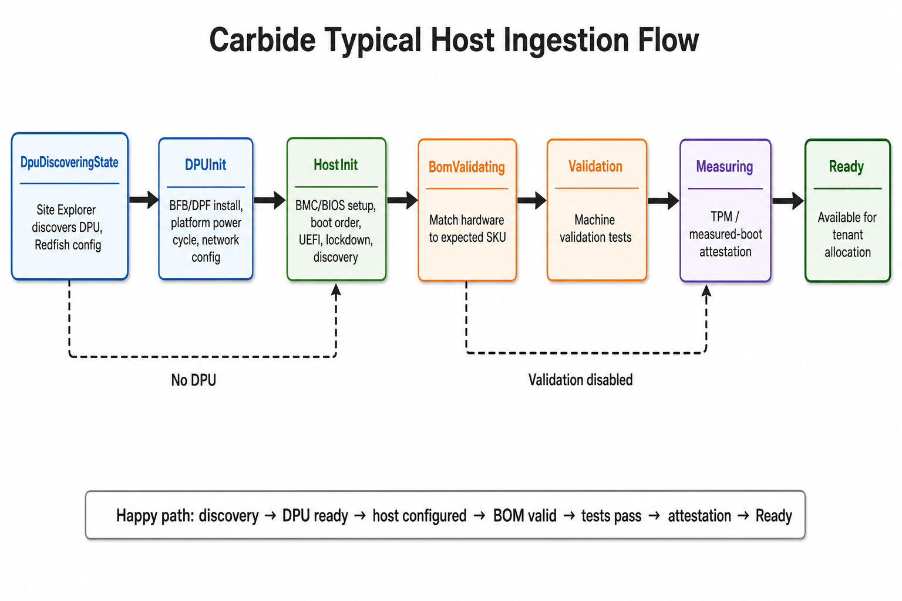

# Host Ingestion Failures

Use this playbook when a host does not enter the managed pool after being added
to a site.

## Ingestion Flow



## Quick Checks

1. Confirm the host is listed in expected machines.
1. Confirm the host BMC is reachable over the out-of-band network.
1. Confirm BMC credentials are available through the configured credential source.
1. Check Site Explorer output.
1. Check DHCP and PXE/HTTP boot logs.
1. Check `nico-scout` logs on the host.
1. Check validation and SKU validation results.

Complete the [DHCP Cutover Checklist](../../provisioning/ip-and-network-configuration.md#dhcp-cutover-checklist)
and configure the [Site-wide BMC Root](../../provisioning/ingesting-hosts.md#store-host-and-dpu-bmc-password)
and [Host and DPU UEFI Defaults](../../provisioning/ingesting-hosts.md#store-host-and-dpu-uefi-passwords)
before troubleshooting individual devices. These REST workflows read passwords
from stdin through `nicocli --data-file -`.

<Warning>
The direct Core credential commands in the
[Quick Start Guide](../../getting-started/quick-start.md#set-site-wide-credentials)
pass passwords in process arguments.
Disabling shell history does not hide those arguments. Run them only on a
trusted administrative host where process inspection and command-argument
collection are restricted to authorized credential administrators, with shell
history and tracing disabled. Prefer the stdin-based REST workflows above
when REST is available, and follow their credential-source prerequisites.
</Warning>

## Expected Machine

Confirm the host exists in NICo inventory or expected-machine state.

```bash
nico-admin-cli expected-machine show
nico-admin-cli managed-host show --all
```

If the host is missing, fix the expected-machine source before debugging host
boot or discovery.

## BMC and Redfish

NICo cannot ingest a host if it cannot reach the BMC.

Check:

- BMC IP is reachable from the site controller.
- BMC credentials are present and valid.
- Access from `nico-api` to the configured credential source is healthy.
- Site Explorer can scrape the endpoint.

```bash
nico-admin-cli site-explorer get-report all
nico-admin-cli redfish browse --address <bmc-ip> /redfish/v1
```

Look in `nico-api` logs for:

- Redfish client creation errors
- missing credentials
- HTTP 401 or 403
- TLS failures
- timeout or route failures

### BMC Refuses HTTPS but IPMI Works

A responding IPMI interface does not prove that the BMC's Redfish HTTPS
service is running. After confirming the BMC IP belongs to the intended
device, distinguish connection refusal on TCP 443 from a TLS validation
error, authentication failure, or network timeout. Check the BMC's HTTPS
and Redfish service configuration.

If the HTTPS service stopped responding after a BMC reset, use the hardware
vendor's supported BMC cold-reset procedure during a maintenance window,
then wait for Redfish to return before retrying exploration. Save the logs
and escalate persistent failures to the hardware owner. A BMC reset is
different from a factory reset; do not erase its configuration or credentials
as a connectivity diagnostic.

### Stale Exploration Record

After DHCP changes, compare the BMC IP, MAC, and chassis identity in the
Site Explorer report with the device now using that address. An exploration
report from the previous IP owner can mislead pairing and discovery.

Fix duplicate assignments and DHCP reservations first. If a stale endpoint
is not part of a managed host, remove only that exploration record with
[`site-explorer delete`](https://github.com/dsx-ai-factory/infra-controller/blob/main/docs/manuals/nico-admin-cli/commands/site-explorer/site-explorer-delete.md).
Site Explorer can rediscover a reachable endpoint on a later exploration.
The API rejects deletion when the endpoint belongs to a managed host.
Investigate its identity with the lifecycle owner rather than force-deleting
the host to clear the report.

### DPU IP Conflicts

Check host BMC, DPU BMC, and DPU OS addresses separately. Reserving the host
BMC address does not reserve either DPU address. Match each lease to its
interface MAC, remove competing DHCP offers or static assignments, and
verify that the pools have capacity for every interface. The
[DHCP Cutover Checklist](../../provisioning/ip-and-network-configuration.md#dhcp-cutover-checklist)
and [Expected Interface IP Allocation](../../provisioning/ip-and-network-configuration.md#13-expected-interface-ip-allocation)
cover those inputs. Clear a stale exploration record only after resolving
the conflict.

### Reported Chassis Serial Does Not Match Inventory

Compare the Expected Machine chassis serial with the physical chassis label
and the BMC's Redfish chassis and system inventory. A component serial,
such as a power distribution board serial, must not replace the chassis
identity. Correct an erroneous Expected Machine source entry; if Redfish
reports the wrong hardware identity, have the hardware owner correct that
record or firmware. Do not change the expected chassis serial merely to
make ingestion accept a different component's serial.

## DHCP and PXE

Host discovery depends on DHCP and PXE/HTTP boot.

Check:

```bash
kubectl -n <nico-namespace> logs deploy/nico-dhcp --tail=500 | grep <mac-or-machine-id>
kubectl -n <nico-namespace> logs deploy/nico-pxe --tail=500 | grep <mac-or-machine-id>
```

Common signs:

| Symptom | Likely issue |
|---|---|
| No DHCP request | relay, cabling, VLAN, or host not booting from the expected NIC. |
| DHCP request but no lease | IP pool exhausted or MAC not in expected state. |
| Lease assigned but no PXE request | boot order or next-server path. |
| PXE request succeeds but host never reports | discovery image boot or `nico-scout` failure. |

## Scout Logs

When the discovery image boots, `nico-scout` reports host details back to NICo.

On the host:

```bash
cat /var/log/nico/nico-scout.log
```

Look for:

- API reachability failures
- TLS or root CA problems
- hardware enumeration failures
- NIC or DPU pairing problems
- SKU or validation input mismatch

### Check the Scout version

NICo records the build version of Scout most recently observed during machine
discovery. Use this value to determine whether ingestion or validation failures
may correlate with a specific Scout release:

```bash
nico-admin-cli -a <api-url> -f json machine show <host-machine-id> \
  | jq -r '.status.last_scout_observed_version // "unknown"'
```

The `last_scout_observed_version` value is updated whenever Scout registers the
host during discovery and remains associated with the machine after assignment.
It identifies the last discovery image, not necessarily a currently running agent.
The value is `null` for machines that have not completed discovery with a Scout
version that reports it, and a later Scout discovery replaces the stored value.

## Validation and SKU

After discovery, ingestion may block on validation.

```bash
nico-admin-cli machine-validation results show --machine <host-machine-id>
nico-admin-cli machine-validation runs show --machine <host-machine-id>
nico-admin-cli sku verify <host-machine-id>
nico-admin-cli machine health-report show <host-machine-id>
```

If validation failed, avoid force deleting the host until the failed test and
hardware expectation are understood.

## Recovery

| Root cause | Recovery |
|---|---|
| Incorrect expected-machine entry | Correct source data and restart discovery. |
| BMC unreachable | Fix OOB network, BMC power, credentials, or Vault. |
| DHCP/PXE broken | Fix relay, IP pool, boot order, or PXE service. |
| Scout cannot reach API | Fix routing, TLS, proxy, or API availability. |
| Validation failed | Fix hardware or SKU expectation, then rerun validation. |

Avoid deleting and retrying unless the object has not been created on the site
or the lifecycle owner confirms it is safe.
