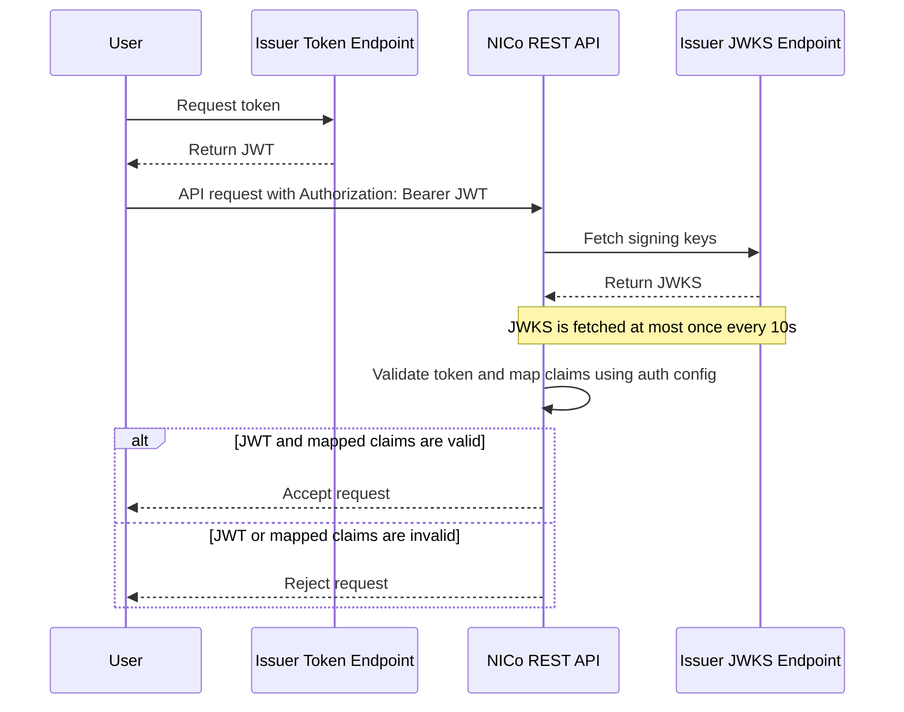

{/* <!-- rumdl-disable MD041 --> */}

This guide explains how to configure authentication and authorization for the NICo REST API.

### Overview

NICo REST API uses JWT bearer tokens for authentication. For every API request, the service validates the token signature and issuer, then uses configured claim mappings to determine the caller's organization and roles.

Authorization is role based. NICo supports two roles:

- `PROVIDER_ADMIN` can manage provider-owned resources and allocate capacity to tenants.
- `TENANT_ADMIN` can manage tenant-owned resources after the tenant is initialized or receives allocations.

The organization and role that NICo derives from the token determine which API flows are available to the caller. After authentication is configured, API users normally start by retrieving their current Service Account, Infrastructure Provider, or Tenant as described in the [Getting Started](/infra-controller/rest-api-reference/getting-started) section.

Configuring authentication is a Day 0 task. Once it is in place, the Day 1 operator workflow for creating tenants, linking them to an infrastructure provider, and allocating capacity is [Tenant Management](https://docs.nvidia.com/infra-controller/documentation/configuration-day-1/tenant-management).

The sequence diagram below illustrates the typical authentication and authorization flow when using issuer config.



Additional auth configuration details are documented in [`rest-api/auth/README.md`](https://github.com/dsx-ai-factory/infra-controller/blob/main/rest-api/auth/README.md).

### Choose an Authentication Mode

NICo REST API supports two authentication configuration modes:

- Configure one or more external JWT issuers under `issuers`.
- Configure the built-in Keycloak integration under `keycloak`.

Use only one mode for a deployment. Helm values document `issuers` and `keycloak` as mutually exclusive. When Keycloak is disabled, at least one issuer should be configured.

### Where to Configure Authentication

Authentication is part of the REST API configuration.

For local or direct REST API configuration, update `issuers` or `keycloak` in [`rest-api/api/config.yaml`](https://github.com/dsx-ai-factory/infra-controller/blob/main/rest-api/api/config.yaml):

```yaml
issuers:
  - issuer: "https://auth.example.com"
    jwks: "https://auth.example.com/.well-known/jwks.json"
    audiences: ["nico-api"]
    claimMappings:
      - orgName: "acme-corp-provider"
        orgDisplayName: "ACME Corp Provider"
        roles: ["PROVIDER_ADMIN"]
      - orgName: "acme-corp-tenant"
        orgDisplayName: "ACME Corp Tenant"
        roles: ["TENANT_ADMIN"]
```

For Helm deployments, set the same values under `config` in [`helm/rest/nico-rest/charts/nico-rest-api/values.yaml`](https://github.com/dsx-ai-factory/infra-controller/blob/main/helm/rest/nico-rest/charts/nico-rest-api/values.yaml):

```yaml
config:
  issuers:
    - issuer: "https://auth.example.com"
      jwks: "https://auth.example.com/.well-known/jwks.json"
      audiences: ["nico-api"]
      claimMappings:
        - orgName: "acme-corp-provider"
          orgDisplayName: "ACME Corp Provider"
          roles: ["PROVIDER_ADMIN"]
        - orgName: "acme-corp-tenant"
          orgDisplayName: "ACME Corp Tenant"
          roles: ["TENANT_ADMIN"]
```

For Kustomize deployments, set the same values in the REST API ConfigMap at [`rest-api/deploy/kustomize/base/api/configmap.yaml`](https://github.com/dsx-ai-factory/infra-controller/blob/main/rest-api/deploy/kustomize/base/api/configmap.yaml) under `data.config.yaml`:

```yaml
apiVersion: v1
kind: ConfigMap
metadata:
  name: nico-rest-api-config
data:
  config.yaml: |
    issuers:
      - issuer: "https://auth.example.com"
        jwks: "https://auth.example.com/.well-known/jwks.json"
        audiences: ["nico-api"]
        claimMappings:
          - orgName: "acme-corp-provider"
            orgDisplayName: "ACME Corp Provider"
            roles: ["PROVIDER_ADMIN"]
          - orgName: "acme-corp-tenant"
            orgDisplayName: "ACME Corp Tenant"
            roles: ["TENANT_ADMIN"]
```

After changing a Kubernetes ConfigMap or Helm value, restart or roll out the REST API pods so the service loads the updated configuration.

### Configure an External JWT Issuer

Use `issuers` when tokens are issued by an external identity provider. Each issuer entry tells NICo where to get signing keys, which issuer claim to trust, and how to map token claims to NICo organizations and roles.

```yaml
issuers:
  - issuer: "https://auth.example.com"
    jwks: "https://auth.example.com/.well-known/jwks.json"
    jwksTimeout: "5s"
    audiences: ["nico-api"]
    scopes: ["openid", "nico"]
    claimMappings:
      - orgName: "acme-corp-provider"
        orgDisplayName: "ACME Corp Provider"
        roles: ["PROVIDER_ADMIN"]
      - orgName: "acme-corp-tenant"
        orgDisplayName: "ACME Corp Tenant"
        roles: ["TENANT_ADMIN"]
```

Key fields:

- `issuer` must exactly match the token `iss` claim and identifies the entry; it must be unique across all issuers.
- `jwks` is the identity provider's JWKS endpoint.
- `jwksTimeout` controls how long NICo waits when fetching signing keys. If omitted, the default is `5s`.
- `audiences` is optional. If set, the token `aud` claim must contain at least one configured audience.
- `scopes` is optional. If set, the token must contain all configured scopes. NICo checks the `scope`, `scopes`, and `scp` claims.
- `claimMappings` is required and controls the organization and roles assigned to authenticated users.
- A claim mapping may also set `audiences`. The token `aud` claim must contain at least one exact, case-sensitive match for the requested organization's mapping. If issuer and mapping audiences are both configured, both gates must pass.
- A claim mapping may also set `scopes`, which the token must satisfy in full, exactly like the issuer-level list. Mapping scopes are an additional gate rather than a replacement: a token that satisfies the issuer-level scopes but not the requested organization's mapping is rejected for that organization with `403`, while other organizations on the same issuer are unaffected. The audience gate is evaluated first, so a token failing both reports the audience error.

### Audience Matching Examples

Audience matching is an exact, case-sensitive overlap check. A configured list uses ANY-match semantics: the token needs at least one value from that list.

With one issuer-level audience:

```yaml
issuers:
  - issuer: "https://idp.example.com"
    jwks: "https://idp.example.com/.well-known/jwks.json"
    origin: "custom"
    audiences: ["api-audience"]
    claimMappings:
      - orgName: "tenant-org"
        orgDisplayName: "Tenant Organization"
        roles: ["TENANT_ADMIN"]
```

A token with `aud: ["api-audience", "tenant-client-a"]` passes because `api-audience` overlaps the configured issuer list.

With multiple issuer-level audiences:

```yaml
issuers:
  - issuer: "https://idp.example.com"
    jwks: "https://idp.example.com/.well-known/jwks.json"
    origin: "custom"
    audiences: ["api-audience", "admin-api-audience"]
    claimMappings:
      - orgName: "tenant-org"
        orgDisplayName: "Tenant Organization"
        roles: ["TENANT_ADMIN"]
```

The token needs either `api-audience` or `admin-api-audience`; it does not need both.

Mapping audiences can be used without issuer-level audiences:

```yaml
issuers:
  - issuer: "https://idp.example.com"
    jwks: "https://idp.example.com/.well-known/jwks.json"
    origin: "custom"
    claimMappings:
      - orgName: "automation-org"
        orgDisplayName: "Automation Organization"
        isServiceAccount: true
        audiences: ["automation-client-a"]
      - orgName: "tenant-org"
        orgDisplayName: "Tenant Organization"
        roles: ["TENANT_ADMIN"]
        audiences: ["tenant-client-a", "tenant-client-b"]
```

For `automation-org`, the token must contain `automation-client-a`. For `tenant-org`, either `tenant-client-a` or `tenant-client-b` is sufficient. The service-account mapping requires disconnected mode.

When issuer-level and mapping audiences are both configured, they are independent gates:

```yaml
issuers:
  - issuer: "https://idp.example.com"
    jwks: "https://idp.example.com/.well-known/jwks.json"
    origin: "custom"
    audiences: ["api-audience", "admin-api-audience"]
    claimMappings:
      - orgName: "automation-org"
        orgDisplayName: "Automation Organization"
        isServiceAccount: true
        audiences: ["automation-client-a", "automation-client-b"]
      - orgName: "tenant-org"
        orgDisplayName: "Tenant Organization"
        roles: ["TENANT_ADMIN"]
        audiences: ["tenant-client-a", "tenant-client-b"]
```

A token requesting `automation-org` needs:

- at least one of `api-audience` or `admin-api-audience`; and
- at least one of `automation-client-a` or `automation-client-b`.

A token requesting `tenant-org` needs:

- at least one of `api-audience` or `admin-api-audience`; and
- at least one of `tenant-client-a` or `tenant-client-b`.

For example, `aud: ["api-audience", "tenant-client-a"]` authorizes `tenant-org` but not `automation-org`.

### Per-Organization Scopes

Scopes work the same way across the two levels, except that a configured list uses ALL-match semantics at both: the token must carry every value.

```yaml
issuers:
  - issuer: "https://idp.example.com"
    jwks: "https://idp.example.com/.well-known/jwks.json"
    origin: "custom"
    scopes: ["openid"]
    claimMappings:
      - orgName: "automation-org"
        orgDisplayName: "Automation Organization"
        roles: ["PROVIDER_ADMIN"]
        scopes: ["nico:admin"]
      - orgName: "tenant-org"
        orgDisplayName: "Tenant Organization"
        roles: ["TENANT_ADMIN"]
```

A token with `scope: "openid"` authorizes `tenant-org`, which adds no scope requirement, and is rejected for `automation-org` with `403`. `scope: "openid nico:admin"` authorizes both. A token without `openid` is rejected before any organization is resolved, because the issuer-level list applies to the whole issuer.

Use this to require a stronger token for the organizations that grant provider-level access, without splitting them onto a separate issuer.

NICo supports `RS256`, `RS384`, `RS512`, `PS256`, `PS384`, `PS512`, `ES256`, `ES384`, `ES512`, and `EdDSA` signed tokens.

### Claim Mapping Recipes

Claim mappings are the bridge between identity-provider claims and NICo authorization. Choose the mapping style that matches how your IdP represents users, organizations, and roles.

#### Service Account

Use this for machine-to-machine automation. A service account gets both provider and tenant admin roles for the configured organization, which is useful when building a SaaS on top of NICo with its own tenancy layer.

```yaml
claimMappings:
  - orgName: "automation"
    orgDisplayName: "Automation"
    isServiceAccount: true
```

When the REST API is configured in service account mode, API users should first call the [Retrieve Service Account endpoint](/infra-controller/rest-api-reference/api-reference/service-account/get-current-service-account). The service account organization can act as both provider and tenant for common bootstrap and automation workflows.

#### Static Organization and Static Roles

Use this for the simplest onboarding path: every token from the issuer maps to the same NICo organization and fixed roles.

```yaml
claimMappings:
  - orgName: "acme-corp"
    orgDisplayName: "ACME Corp"
    roles: ["TENANT_ADMIN"]
```

#### Static Organization and Dynamic Roles

Use this when every token belongs to the same organization, but the IdP controls each user's roles.

```yaml
claimMappings:
  - orgName: "acme-corp"
    orgDisplayName: "ACME Corp"
    rolesAttribute: "realm_access.roles"
```

The `rolesAttribute` value can use dot notation for nested claims. Roles may be provided as an array, such as `["TENANT_ADMIN"]`, or as a space-separated string, such as `"TENANT_ADMIN PROVIDER_ADMIN"`.

#### Dynamic Organization and Dynamic Roles

Use this for multi-tenant identity providers where organization and role information comes from token claims.

```yaml
claimMappings:
  - orgAttribute: "tenant_id"
    orgDisplayAttribute: "tenant_name"
    rolesAttribute: "nico_roles"
```

With this mapping, the decoded JWT payload should include matching claims:

```json
{
  "iss": "https://auth.example.com",
  "aud": "nico-api",
  "sub": "user-123",
  "tenant_id": "tenant-a",
  "tenant_name": "Tenant A",
  "nico_roles": ["TENANT_ADMIN"]
}
```

All three attributes support dot notation for nested claims. For example, if `orgAttribute` is `tenant.id`, `orgDisplayAttribute` is `tenant.displayName`, and `rolesAttribute` is `nico.roles`, the decoded JWT payload should look like this:

```json
{
  "iss": "https://auth.example.com",
  "aud": "nico-api",
  "sub": "user-123",
  "tenant": {
    "id": "tenant-a",
    "displayName": "Tenant A"
  },
  "nico": {
    "roles": ["TENANT_ADMIN"]
  }
}
```

Dynamic organizations cannot use an organization name already reserved by a static `orgName` mapping. A dynamic mapping may set `audiences`, but the same flat audience set gates every organization it resolves; audience values are not bound to resolved organization names.

### Common Configuration Examples

#### SaaS Service Account

Use this when building a SaaS on top of NICo with its own tenancy layer. NICo sees the SaaS backend as one automation identity with both provider and tenant privileges, while the SaaS application manages end-user tenants separately.

```yaml
issuers:
  - issuer: "https://auth.acme-corp.example.com"
    jwks: "https://auth.acme-corp.example.com/.well-known/jwks.json"
    audiences: ["nico-api"]
    claimMappings:
      - orgName: "acme-corp-saas"
        orgDisplayName: "ACME Corp SaaS"
        isServiceAccount: true
```

#### One Business with Provider and Tenant Teams

Use this when one team or group manages infrastructure and another team or group consumes it within the same business. Both teams authenticate through the same issuer, but NICo maps them to separate organizations and roles.

```yaml
issuers:
  - issuer: "https://login.acme-corp.example.com"
    jwks: "https://login.acme-corp.example.com/.well-known/jwks.json"
    audiences: ["nico-api"]
    claimMappings:
      - orgName: "acme-corp-infra"
        orgDisplayName: "ACME Corp Infrastructure Team"
        roles: ["PROVIDER_ADMIN"]
      - orgName: "acme-corp-platform"
        orgDisplayName: "ACME Corp Platform Team"
        roles: ["TENANT_ADMIN"]
```

#### Provider with Multiple Tenant IdPs

Use this when NICo has one provider organization and multiple tenant organizations that authenticate through different identity providers. The provider issuer maps only to `PROVIDER_ADMIN`; each tenant issuer maps only to its own `TENANT_ADMIN` organization.

```yaml
issuers:
  - issuer: "https://login.acme-corp.example.com"
    jwks: "https://login.acme-corp.example.com/.well-known/jwks.json"
    audiences: ["nico-api"]
    claimMappings:
      - orgName: "acme-corp-provider"
        orgDisplayName: "ACME Corp Provider"
        roles: ["PROVIDER_ADMIN"]
  - issuer: "https://login.tenant-a.example.com"
    jwks: "https://login.tenant-a.example.com/.well-known/jwks.json"
    audiences: ["nico-api"]
    claimMappings:
      - orgName: "tenant-a"
        orgDisplayName: "Tenant A"
        roles: ["TENANT_ADMIN"]
  - issuer: "https://login.tenant-b.example.com"
    jwks: "https://login.tenant-b.example.com/.well-known/jwks.json"
    audiences: ["nico-api"]
    claimMappings:
      - orgName: "tenant-b"
        orgDisplayName: "Tenant B"
        roles: ["TENANT_ADMIN"]
```

### One Organization Behind Two Identity Providers

Use this when the same organization admits users from more than one identity provider, or grants different roles depending on which provider authenticated the user. Sharing an organization name is off by default; set `auth.sharedStaticOrgs: true` to allow it deployment-wide. The name remains reserved, so a dynamic (`orgAttribute`) mapping still cannot claim it, and only one issuer may hold the organization's service account mapping.

```yaml
auth:
  sharedStaticOrgs: true

issuers:
  - issuer: "https://login.acme-corp.example.com"
    jwks: "https://login.acme-corp.example.com/.well-known/jwks.json"
    audiences: ["nico-api"]
    claimMappings:
      - orgName: "acme-corp"
        orgDisplayName: "ACME Corp"
        roles: ["PROVIDER_ADMIN"]
  - issuer: "https://login.contractors.example.com"
    jwks: "https://login.contractors.example.com/.well-known/jwks.json"
    audiences: ["nico-api"]
    claimMappings:
      - orgName: "acme-corp"
        orgDisplayName: "ACME Corp"
        roles: ["TENANT_ADMIN"]
```

Each token receives the roles its own issuer declares for the organization, so a contractor token is a `TENANT_ADMIN` in `acme-corp` and an employee token is a `PROVIDER_ADMIN`. The setting applies to issuers created through the issuer API as well as those defined here.

### Replica convergence and key refresh

These are Go duration strings. Omit them to keep the defaults.

```yaml
auth:
  sharedStaticOrgs: false
  issuerReloadInterval: 30s   # how often each replica rebuilds DB issuers
  jwksRefreshInterval: 15m    # how often each replica re-fetches signing keys
  resolveFlightTimeout: 30s   # ceiling for one on-demand issuer lookup
  allowInternalIssuerHosts: false
```

`allowInternalIssuerHosts` is not a duration. By default the API rejects an `issuerUrl` or `jwksUrl` on a loopback, private, link-local, `localhost`, `*.svc`, `*.cluster.local`, or `*.internal` host with `400`, because every replica fetches `jwksUrl` from inside the cluster network. Set it to `true` only for local development against an in-cluster identity provider.

`jwksRefreshInterval` may be raised (for example `30m`) when identity-provider key rotation is slow. `issuerReloadInterval` is the idle convergence floor across replicas; a token naming a new issuer still resolves on demand without waiting for that tick.

NICo will not use a cached signing-key set more than 24 hours after its last
successful fetch. A request that encounters an older set first attempts to
refresh it. If the issuer remains unreachable, token validation fails closed
until a refresh succeeds; the expired set stays cached so a later request or
background pass can retry without losing diagnostic state.

### Configure Keycloak

Use the `keycloak` section when deploying NICo with the built-in Keycloak integration.

```yaml
keycloak:
  enabled: true
  baseURL: http://keycloak.keycloak.svc.cluster.local:8082
  externalBaseURL: https://auth.nico.example.com
  realm: nico
  clientID: nico-cloud
  clientSecretPath: /var/secrets/keycloak/client-secret
  serviceAccount: true
```

Key fields:

- `enabled` turns on Keycloak integration.
- `baseURL` is the internal URL the REST API uses to reach Keycloak from inside the cluster.
- `externalBaseURL` must match the issuer URL in tokens issued to users.
- `realm` is the Keycloak realm.
- `clientID` is the OAuth client ID.
- `clientSecretPath` is the file path where the client secret is mounted.
- `serviceAccount` enables service account features.

Create the client secret in Kubernetes before enabling Keycloak:

```bash
kubectl create secret generic keycloak-client-secret \
  --namespace nico-rest \
  --from-literal=client-secret="${OAUTH_CLIENT_SECRET}" \
  --dry-run=client -o yaml | kubectl apply -f -
```

For Helm deployments, set `secrets.keycloakClientSecret` if the secret name differs from `keycloak-client-secret`. For Kustomize deployments, ensure the REST API Deployment mounts the secret at the path configured by `keycloak.clientSecretPath`.

If Keycloak is exposed through an ingress, only expose the public endpoints required for authentication and key discovery:

- `/realms/{realm}/protocol/openid-connect/certs`
- `/realms/{realm}/protocol/openid-connect/auth`
- `/realms/{realm}/broker/*/endpoint`

Block administrative and token-exchange paths, including `/admin/*` and `/realms/{realm}/protocol/openid-connect/token`, from external access unless your deployment explicitly requires them.

### Validation Rules

Use these rules when reviewing a configuration before rollout:

- The same issuer URL can only appear once, and the same JWKS URL can only appear once.
- A static `orgName` appears at most once within an issuer, and at most once across all issuers unless the deployment sets `auth.sharedStaticOrgs: true`. A shared name stays reserved, so dynamic organization mappings still cannot claim it.
- Static mappings require `orgDisplayName`.
- Service account mappings are limited to one total in disconnected mode, or one per issuer URL in connected mode.
- Dynamic organization mappings are limited to one across all issuers.
- Dynamic organizations cannot claim statically configured organization names.
- Roles must be `TENANT_ADMIN`, `PROVIDER_ADMIN`, or both.

Configuration is validated at startup, and a violation is fatal: the API logs
`Invalid issuers configuration` with the offending issuer and exits rather than
serving requests under an ambiguous mapping.

#### Upgrade check

Cross-issuer `orgName` uniqueness is enforced from this release. Before
upgrading, check whether any two issuers in the deployed configuration map the
same `orgName`. If they do, either remove the duplicate mappings or set
`auth.sharedStaticOrgs: true` for a deployment that intends several issuers to
serve one organization. A shared name stays reserved against dynamic
organization mappings, and only one issuer may hold the organization's service
account mapping.

### Troubleshooting

If requests fail after authentication is enabled, check the token and REST API configuration together.

- `401 Unauthorized` with an audience error usually means the token `aud` claim does not match any configured `audiences`. Update the IdP client audience, update NICo `audiences`, or omit `audiences` if audience enforcement is not needed.
- `403 Forbidden` with an organization audience error means issuer validation passed, but token `aud` did not match the requested claim mapping's `audiences`.
- `403 Forbidden` with a scope error usually means the token is missing one or more configured `scopes`. NICo checks `scope`, `scopes`, and `scp`. An organization scope error means the issuer-level list passed but the requested claim mapping's `scopes` did not.
- Invalid token errors often come from an unreachable `jwks` URL, an unsupported signing key, or an `issuer` value that does not exactly match the token `iss` claim.
- Missing authorization usually means the selected `claimMappings` entry did not produce a valid organization and role set. Check `orgName`, `orgAttribute`, `roles`, and `rolesAttribute`.
- For Keycloak, confirm that `externalBaseURL` matches the token issuer and that the client secret is mounted at `clientSecretPath`.

After updating configuration, restart the REST API and inspect pod logs for configuration or token validation errors.
